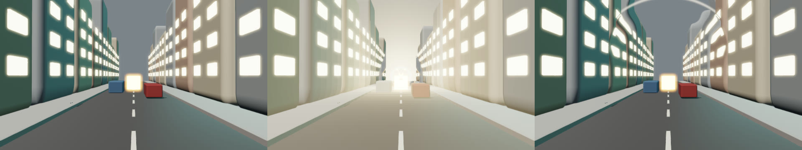

# Agent lighting and look

This feature is included in npm release `0.5.0` and later.

Agent scene recipes can contain `environment`, `effects`, and `shadow` objects.
These fields belong to canonical recipes and checkpoint snapshots.
Look commands use the same atomic revision checks as node and material commands.
Failed look validation preserves the previous recipe and revision.

The optional helper `normalizeAgentLook({ environment, effects, shadow })` returns detached, fully normalized JSON.
It fills omitted fields without mutating the input.
`resolveAgentShadow(shadow, lightDirection)` returns detached renderer bounds with `eye`, `target`, `up`, `extent`, `near`, and `far`.
The helpers do not create geometry, render targets, or GPU resources.

```js
import { normalizeAgentLook, resolveAgentShadow } from '67js/addons/agent-scene';

const look = normalizeAgentLook({
  environment: {
    world: true,
    lightDirection: [-0.6, 1, 0.2],
    keyIntensity: 0.8,
    pointLights: [{ position: [0, 2, 1], color: [1, 0.6, 0.3], intensity: 12 }],
    volumeFog: { density: 0.02, minimum: [-4, 0, -4], maximum: [4, 4, 4] },
  },
  effects: { exposure: 1.2, bloom: { strength: 0.25 } },
  shadow: { target: [0, 1, 0], extent: 5, distance: 10, far: 24 },
});

const shadowBounds = resolveAgentShadow(look.shadow, look.environment.lightDirection);
```

The renderer uses `effects.exposure` as `frame.exposure`.
The remaining effect controls belong to `frame.effects`.
The environment's `world` flag selects the renderer's world presentation.
Look normalization always supplies the authored key color, including in world mode.

The MCP adapter applies the canonical look on every draw. A custom browser adapter must pass it explicitly:

```js
const renderer = new Renderer67(canvas, scene.parts, {
  ground: false, hdr: true, depth: true,
  world: scene.environment.world,
  environment: scene.environment,
  shadowBounds: resolveAgentShadow(scene.shadow, scene.environment.lightDirection),
});

function draw() {
  renderer.world = scene.environment.world;
  renderer.shadowBounds = resolveAgentShadow(scene.shadow, scene.environment.lightDirection);
  renderer.shadowsDirty = true;
  renderer.resize();
  renderer.updateParts(scene.parts);
  renderer.render({
    ...scene.camera, environment: scene.environment, effects: scene.effects,
    exposure: scene.effects.exposure, time: 0,
  });
}
```

For a frame loop, update shadow bounds and mark shadows dirty only when projector controls or geometry change.
Use `replaceParts` when `topologyRevision` changes, as described in the scene guide.

## Catalog HDRIs and looks

A recipe names a file; it never carries a path or a URL, and nothing is downloaded. Two kinds of entries exist:

| Entry | Field | Source |
| --- | --- | --- |
| `sky-clouds` | `environment.hdri` | Poly Haven `kloofendal_48d_partly_cloudy_puresky`, CC0, shrunk to 128 x 64 |
| `studio-softbox` | `environment.hdri` | Poly Haven `studio_small_03`, CC0, shrunk to 128 x 64 |
| `teal-orange`, `noir` | `environment.look` | made for 67js, CC0, 9 points per side |
| 64-character ID | either | a `.hdr` or `.cube` file (4 MiB at most) in the MCP `--assets` directory, listed by `scene_asset_catalog` as kind `environment` or `look` |

The four shipped files total about 100 KB. For a bigger HDRI, put a 1k or 2k `.hdr` (for example from Poly Haven) in the assets directory and use its ID. Outside MCP, decode with `parseRadianceHdr` or `parseCube` and register with `registerCatalogEnvironment(name, data)` or `registerCatalogLook(name, look)` from `src/look-catalog.js` before building the scene. The look needs the `view-transform-shader` module (`loadAgentSceneModules` loads it). Render jobs light the scene with the same entries.

## Atomic look commands

| Operation | Payload |
| --- | --- |
| `set-environment` | `{ environment: partialEnvironment }` |
| `set-effects` | `{ effects: partialEffects }` |
| `set-shadow` | `{ shadow: partialShadow }` |

Each operation also contains its `type` discriminator.
Omitted fields retain their current canonical values.
Nested `volumeFog` and `bloom` objects merge their supplied fields.
Vector arrays replace their previous vector.
The complete `pointLights` list replaces the previous list, including `[]` to remove all point lights.
Final merged look fields pass normalization before any command publishes.

```js
const checkpoint = scene.checkpoint();
scene.apply([
  { type: 'set-environment', environment: { keyIntensity: 0.4, volumeFog: { density: 0.03 } } },
  { type: 'set-effects', effects: { exposure: 1.4, bloom: { threshold: 1.5 } } },
  { type: 'set-shadow', shadow: { extent: 7 } },
], { expectedRevision: scene.revision });

scene.apply([
  { type: 'set-environment', environment: { pointLights: [] } },
], { expectedRevision: scene.revision });

scene.restore(checkpoint, { expectedRevision: scene.revision });
scene.releaseCheckpoint(checkpoint);
```

The helper normalizes a complete candidate rather than merging patches itself.
Session and transport adapters own patch merging and renderer updates.
Checkpoint restore recovers canonical lighting, effects, and shadow controls with the rest of the scene.

## Environment

All numeric values must be finite and representable as Float32.
RGB arrays contain exactly three numbers.
Key light, point light, and fog colors use linear RGB.
Sky colors use display RGB, matching the renderer's existing environment contract.

| Field | Default | Range or meaning |
| --- | --- | --- |
| `world` | `false` | Boolean world presentation flag. With `true` the setup environment is also the background |
| `hdri` | absent | A shipped HDRI (`sky-clouds`, `studio-softbox`) or the 64-character ID of a `.hdr` file in `scene_asset_catalog`. It lights, reflects and (with `world: true`) forms the background instead of the setup sky; `environmentIntensity` is its strength and `environmentRotation` turns it about the vertical axis. The setup still gives the key light, so set `keyIntensity: 0` when the HDRI has its own sun. `null` clears. See [Catalog HDRIs and looks](#catalog-hdris-and-looks) |
| `ground` | on | Absent unless set. `false` removes the preview's automatic floor and contact shadow |
| `resolveCoplanar` | `'offset'` | Flush and near-flush faces, inside one mesh or across parts, are ranked per triangle and drawn with a small depth-only bias, so the face in front wins at every distance and nothing flickers. Geometry never moves. `false` opts out, and `scene_inspect` then lists each pair as a `coplanar-overlap` warning. Parts that set `decal` or `depthLayer` keep their own layer. Where an opaque face covers another on the same plane, or in front of it by at most a thousandth of the shared face (between a millimetre and a centimetre), the covered part is cut out of the drawn copy of the hidden face (the part and its geometry stay as you made them), so a stack of any depth is settled and the path tracer sees one face. What cannot be settled comes back as a `coplanar-overlap` warning with a `reason`: `rank-overflow` (more than 16 faces a wider gap apart), `double-sided-gap`, `unchecked` or `collapsed-node` |
| `objectReflections` | on | Absent unless set. Each smooth metal part (`metallic` 0.5 or more, `roughness` 0.6 or less; at most 8 such parts, in a scene with at most 256 other parts) gets a reflection probe of the scene around it, so a chrome sphere shows the floor and its neighbours. `false` turns it off. Probes are traced at rest, so a part that moves reflects the scene as it started. `scene_inspect` names them in `reflections` |
| `sky` | absent | Absent unless set. `{ type: 'physical', preset, sunElevation, sunRotation, turbidity, groundAlbedo, aerialPerspective, ozone, sunDisc }`: one time-of-day control. `sunElevation` -90 to 90 degrees (default 45), `sunRotation` degrees clockwise from -Z seen from above (0), `turbidity` 1 to 10 haze (3), `groundAlbedo` 0 to 1 (0.3), `aerialPerspective` 0 to 4 scales the distance haze (1; 0 for none), `ozone` 0 to 10 Chappuis-band absorption (1), `sunDisc` boolean (true). `preset` is `golden-hour` (sun 4 degrees up), `sunset` (1 degree) or `blue-hour` (4 degrees below the horizon), each with the sun turned to rotation 250: it supplies the sun only, fields beside it win, and a preset in a `set-environment` patch starts the sky again from its own sun with the other fields at their defaults. A sun below 14 degrees is fitted to Blender's sky (checked at 2, 6 and 15 degrees, comparison in `docs/golden-hour-comparison.jpg`): a narrow saturated orange band forms along the horizon, the zenith dims and the key warms and strengthens; at 14 degrees and above the sky is unchanged. The sky sets `lightDirection`, `keyColor` (the sun reddens and dims with air mass and sets below the horizon), `skyTop`, `skyBottom`, `fogColor` and `fogDensity`, and replaces the setup's environment map with the sky, so those fields no longer take your values while a sky is set. `environment` motion tracks can animate `sunElevation`, `sunRotation`, `turbidity`, `groundAlbedo`, `aerialPerspective` and `ozone` for time-of-day arcs. A `set-environment` patch changes the fields it names and keeps the rest; `sky: null` in a patch keeps the last derived values as plain fields. It is an analytic single-scattering approximation (Rayleigh, aerosol and ozone, Kasten-Young air mass), not Blender's Nishita integration: no clouds. Raster first: the path tracer backends read the same environment map and key light, but are not yet checked against it. |
| `floorSkyTrace` | on | Absent unless set. A closed room a sun lights gets the sky each floor texel sees traced into its floor (`applyFloorSkyVisibility`, strength 0.2), so shadowed floors under a roof or between walls get less world and sky light; it makes the dark end of halls closer to Cycles. Open scenes and rooms lit by lamps alone are left as they are. `false` turns it off; a value that is not a boolean is refused. It loads lazily with a recipe that names its sun (`keyColor` or `keyIntensity`), costs about 1 s of trace when the scene is built and adds triangles to the floor (0.1 to 0.4 ms per frame in the reference halls). |
| `specularAntiAliasing` | `1` | Absent unless set. `0` to `4`. Widens highlights where the shading normal or normal map detail changes within a pixel (geometric specular anti-aliasing plus a Toksvig term read from the filtered normal map length), so grainy or scanned metal stops sparkling from frame to frame at grazing angles. `0` gives a highlight that follows every texel; above `1` is softer. |
| `sunBounce` | `1` | Absent unless set. A number of 0 or more. A closed room a sun lights gets a few point lights at its sunlit patches (`withSunBounce`, found when the scene is prepared), so the floor, walls and pillars around a patch are lit by the light it bounces and the far end of the room less. `0` turns it off and gives the look without it; `1` is fitted to Cycles; above `1` is stronger. A value that is not a number of 0 or more is refused. Open scenes and rooms with no sun are left as they are. It loads lazily with the sun, and the lights take up to 6 of the 16 point light slots. |
| `setup` | `daylight` | `daylight`, `overcast`, `sunset` or `studio`. See Lighting setups |
| `environmentIntensity` | `1` | `0` to `100`. Scales the setup's environment light and reflections |
| `environmentRotation` | `0` | `-100` to `100` radians around the vertical axis |
| `lightDirection` | the setup's | Components within ±1000000, length at least `0.000001` |
| `keyColor` | the setup's | Components from `0` to `1000` |
| `keyIntensity` | `1` | `0` to `100` |
| `fillIntensity` | `0` | `0` to `100` |
| `ambientIntensity` | `1` | `0` to `100`. Scales the environment light |
| `daylight` | `1` | `0` to `100` |
| `pointLights` | `[]` | At most 16 point light records |
| `skyTop` | `[0.2, 0.38, 0.52]` | Components from `0` to `1` |
| `skyBottom` | `[0.62, 0.7, 0.67]` | Components from `0` to `1` |
| `fogColor` | `[0.35, 0.43, 0.43]` | Components from `0` to `1` |
| `fogDensity` | `null` | `0` to `10`. `null` fits the density to the scene: `0.006`, or `1.2` divided by the scene diagonal in metres when that is smaller, so a 900 m scene keeps 30 percent of its contrast at the far side. Set `0` for no fog |
| `volumeFog` | Complete defaults below | One bounded world volume |
| `localVolumes` | Absent | Up to 8 box, sphere or mesh (a part) volumes that absorb and emit light; see [volume fog](https://67js.codepawl.com/volumetric.md#local-volumes) |

Directional key radiance equals `keyColor * keyIntensity`.
Zero intensity disables that lighting contribution.
Direction magnitude remains in the canonical recipe.
The shadow projector uses its normalized direction, so changing only magnitude does not change shadow placement.
High radiance can clip at the renderer's half-float HDR target limit of `65504` before bloom and tone mapping.

## Light units and three.js conversion

Every intensity is a linear scene value, not a photometric unit with its own scale.
For a white diffuse surface facing a light, the outgoing radiance is `intensity * color / PI`, the same as three.js r155 and later (`useLegacyLights` removed, physical units).
So a three.js light copies over with the factor below, and a scene lit by one light matches without tuning.
Compare at the same `exposure` (three.js `toneMappingExposure`), and note that 67js tone maps with an ACES-style curve only when `hdr` is off.

| 67js field | Unit | three.js light | Value to use |
| --- | --- | --- | --- |
| `keyColor * keyIntensity` | Irradiance on a surface facing the light, lux-like | `DirectionalLight.color * intensity` | Same value. Put the intensity in `keyIntensity` and keep `keyColor` in `0` to `1` |
| `pointLights[].intensity` | Candela-like: irradiance at distance `d` is `intensity / d^2` | `PointLight.intensity` | Same value. `range` is `distance` (the same smooth cutoff). Set `radius: 0.1` to match three.js's clamp of `d^2` at `0.01` |
| `spotLights[].intensity` | Candela-like, as a point light, scaled by the cone | `SpotLight.intensity` | Same value. `angle` is the same half angle in radians. `penumbra` fades in cosine here and in angle in three.js; both agree at `0` and `1` |
| `areaLights[].intensity` | Candela-like: on axis, far from the light, irradiance is `intensity / d^2`, and `intensity / (d^2 + width * height / PI)` in general | `RectAreaLight.intensity` (nits) | `nits * width * height` |
| `fillIntensity`, `ambientIntensity`, `environmentIntensity` | Unitless multipliers on the fill rig, the sky ambient and the setup's environment map | `AmbientLight`, `HemisphereLight`, `scene.environmentIntensity` | No exact equivalent. |

A three.js scene built before r155 with the legacy light model multiplies each of those intensities by `PI` to get the 67js value.
`tests/light-units.test.js` ports a directional, point, spot and area light this way and checks the irradiance each produces against the three.js formula within 2 percent.

## Lighting setups

A recipe with no lighting settings uses `daylight` (and no occlusion): a small procedural sky map (128 by 64, generated in code, no files or URLs) lights every surface and shows in metal and glossy reflections, with a warm key light for shadows.
The four setups are `daylight`, `overcast` (even grey light, weak key), `sunset` (low warm sun, dark blue zenith) and `studio` (neutral room with three soft boxes).
Setting `setup` through `set-environment` resets `lightDirection`, `keyColor`, `keyIntensity`, `fillIntensity`, `ambientIntensity`, `skyTop` and `skyBottom` to that setup; fields in the same call still win, and fields set earlier are replaced.
Remote URLs and HDRI files are not accepted from tool input.
This changes the look of every recipe that sets no lighting: before, the default had no environment map, a key color of `[5.2, 4.7, 4.1]` and a fill intensity of `1`.
To get the earlier flat look, set `keyColor`, `fillIntensity` and `environmentIntensity: 0` yourself.
The MCP preview adds an automatic floor: a light grey disc under the scene's lowest geometry, at that height, which catches the key light's shadow. It is not a recipe node and is not exported. A part that already forms a floor (spans at least 90 percent of the scene's width and depth, is thinner than a quarter of its width and is the lowest geometry) switches it off, and `environment.ground: false` removes it. While a motion time is sampled (a render job, or `scene_look` at a time) the floor is decided and sized once from the pose at time 0, so flying or falling parts never resize it or move the horizon. Code that builds its own `Renderer67` gets it by passing `createAgentGround(agentGroundPlacement(parts, environment))` as the `ground` option (`src/agent-ground.js`).

## Point lights

Each point light requires a world-space `position`.
The renderer uses inverse-square attenuation outside its radius.
Radius limits attenuation rather than creating an area emitter or softening shadows.
Point lights currently cast no local shadows and do not scatter through volume fog.

| Field | Default | Range |
| --- | --- | --- |
| `position` | Required | Three components within ±1000000 |
| `color` | `[1, 1, 1]` | Linear RGB components from `0` to `1` |
| `intensity` | `1` | `0` to `100000` |
| `radius` | `0.05` | `0.001` to `1000000` |
| `range` | `0` | `0` for unlimited falloff, otherwise `0.001` to `1000000` |

Range values between zero and `0.001` reject.
The existing directional shadow map remains the source of shadows.
Point lights can illuminate through opaque walls.

## Outlines and toon light

`environment.lines` draws outlines, an optional banded light and screen-width polylines. One edit turns it on:

```json
{ "type": "set-environment", "environment": { "lines": { "width": 2, "toon": 3 } } }
```

`"lines": null` turns it off. A material can also set `toon` (0 to 8) for its own bands. The fields, limits and costs are in [line art](line-art.md). `scene_capabilities` reports `lineArt` and the `toon` layer field.

## Volume fog

Active volume fog requires an opaque renderer with `{ hdr: true, depth: true }` and negotiated HDR support.
The volume uses resolved opaque depth and directional scattering with the directional shadow map.
Density zero disables the volume.
These controls reuse `resolveVolumeFog` and its existing domain rules.

| Field | Default | Range |
| --- | --- | --- |
| `density` | `0` | `0` to `10` |
| `minimum` | `[-100, 0, -100]` | Three components within ±100000 |
| `maximum` | `[100, 20, 100]` | Three components within ±100000, strictly above minimum after Float32 rounding |
| `color` | `[0.8, 0.85, 0.9]` | Linear RGB components from `0` to `1` |
| `ambient` | `[0.03, 0.035, 0.04]` | Linear RGB components from `0` to `10` |
| `drift` | `[0.03, 0, 0]` | Three components within ±100 |
| `steps` | `16` | Integer from `8` to `48` |
| `anisotropy` | `0.3` | `-0.9` to `0.9` |
| `noiseAmount` | `0.5` | `0` to `1` |
| `noiseScale` | `0.3` | `0.001` to `100` |
| `maxDistance` | `100` | `0.01` to `10000` |
| `shadowAmbient` | derived from the scene: 0.15 in a closed room, 1 under open sky | `0` to `1` |
| `scatterOctaves`, `multiScatter`, `multiExtinction`, `multiAnisotropy`, `keyTransmittance`, `surfaceTransmittance` | `1`, `0.5`, `0.5`, `0.5`, `0`, `0` | Integer `1` to `4`, then `0` to `1` each; off by default, see [volume fog](https://67js.codepawl.com/volumetric.md) |
| `detailOctaves`, `detailAmount`, `warp`, `contrast`, `profileSoftness`, `keyScattering` | `1`, `0.5`, `0`, `1`, `0.5`, `1` | Integer `1` to `3`, `0` to `1`, `0` to `4`, `0` to `4`, `0` to `0.95`, `0` to `10`; see [volume fog](https://67js.codepawl.com/volumetric.md) |

Fog bounds reject dimensions that collapse after Float32 rounding.
The current volume supports one directional scattering source.
Local point scattering, transparent depth, multiple scattering, and multiple volumes remain outside this contract.
See [volume fog](https://67js.codepawl.com/volumetric.md) for renderer requirements and frame-time limits.

## Effects

The controls reuse `resolveEffects` with a preview bloom strength of `0.12`.
Exposure remains independent and maps to `frame.exposure`.
Bloom strength zero disables bloom.
Ambient occlusion reads the depth texture, so it needs the HDR depth target that previews use. A renderer built without `depth: true` skips the pass and lists an `ambient-occlusion-without-depth` warning in `renderer.diagnostics` (the preview's render info carries it too). The program compiles and its half-resolution target allocates on first use. On SwiftShader at 960 by 540 it adds about 16 ms to a 190 ms frame (measured, 8 percent). It is off by default: against Cycles on 10 reference scenes it improved no score by more than 0.002 and made most slightly worse, because the largest gaps are cast shadow shape and reflections, not contact darkening. Pixels that direct light already brightens keep less of it, because occlusion belongs to indirect light.

| Field | Default | Range |
| --- | --- | --- |
| `exposure` | `1` | `0.01` to `16` |
| `saturation` | `1` | `0` to `2` |
| `contrast` | `1` | `0.1` to `2` |
| `temperature` | `0` | `-1` to `1` |
| `vignette` | `0` | `0` to `1` |
| `grain` | `0` | `0` to `0.1` |
| `ambientOcclusion` | `0` | `0` to `1`. Screen-space contact darkening, off by default; any value above `0` runs the pass |
| `ambientOcclusionRadius` | `0.5` | `0.01` to `100` world units |
| `bloom.strength` | `0.12` | `0` to `2` |
| `bloom.threshold` | `1` | `0` to `10` |
| `bloom.radius` | `1` | `0.1` to `4` |
| `depthOfField.blur` | `0` | `0` to `1`. Lens blur from depth, off by default; the widest circle is 5 percent of the image height |
| `depthOfField.focusDistance` | `5` | `0.01` to `100000` metres from the camera that stay sharp |
| `motionBlur.shutter` | `0` | `0` to `0.5` seconds of camera motion to smear |
| `motionBlur.objects` | `0` | `0` to `1`. How much of each moving part's own motion to smear over the same shutter; `0` leaves it off |
| `colorBalance.lift` | `[0, 0, 0]` | Three numbers, `-1` to `1`. Raises the shadows per channel and fades out toward white |
| `colorBalance.gamma` | `[1, 1, 1]` | Three numbers, `0.1` to `4`. Bends the midtones; above `1` is brighter |
| `colorBalance.gain` | `[1, 1, 1]` | Three numbers, `0` to `4`. Scales the highlights |
| `glare.streaks` | `0` | `0` to `1`. Thin star streaks from every pixel above the threshold, bright at the core and fading to the tip |
| `glare.count` | `4` | Whole number, `1` to `8`. Arms spaced evenly around the circle: `2` is one straight line (a horizontal anamorphic streak at angle `0`), `4` a plus, `6` a six-point star |
| `glare.angle` | `0` | `-360` to `360` degrees. Turns the first arm from the horizontal; `45` turns a plus into an X |
| `glare.fogGlow` | `0` | `0` to `1`. A soft halo around the same bright pixels |
| `glare.threshold` | `1` | `0` to `10`. Peak scene brightness (linear, before tone mapping) from which a pixel glares |
| `glare.size` | `0.15` | `0.01` to `1`. Streak length and halo radius as a fraction of the image height |
| `stylize.sharpen` | off | `0` to `2`. Adds the difference between a pixel and its four neighbours back to it |
| `stylize.kuwahara` | off | Whole number, `0` to `8`. Painterly smoothing: each pixel takes the mean of the least varying quadrant within this many pixels |
| `stylize.posterize` | off | Whole number, `0` to `256`. Rounds each channel to this many steps |
| `stylize.pixelate` | off | Whole number, `0` to `64`. Block size in pixels |
| `colorBalance.mask`, `stylize.mask` | none | Limits the step to part of the frame, see below |
| `composite.background` | none | `{ color: [r, g, b] }` or `{ top, bottom }` (a vertical gradient), each channel `0` to `64`. Shows through keyed pixels and through any alpha the frame has |
| `composite.key.chroma` | none | `{ color, tolerance, softness }`: pixels whose chroma (hue and saturation, not brightness) is within `tolerance` (`0` to `1`, default `0.3`) of `color` turn transparent, fading over `softness` (`0` to `1`, default `0.1`) |
| `composite.key.luma` | none | `{ low, high, invert }`: pixels darker than `low` turn transparent and those brighter than `high` stay, `0` to `10` in linear light (`0.18` is middle grey), smooth between. `invert: true` keeps the dark ones instead |
| `composite.mask` | none | Limits the key to part of the frame, same fields as the other masks |
| `lensDistortion.distortion` | `0` | `-1` to `1`. Above `0` is barrel, below is pincushion |
| `lensDistortion.dispersion` | `0` | `0` to `1`. Red and blue split apart toward the edges, up to 3 percent of the distance from the center |

A step with a `mask` applies only where the mask is on; with no `mask` it applies to the whole frame, as before. `mask` takes `objects` (one to 16 part names, the node ids of the parts in the scene; `scene_look` takes no `pass` argument), `depth` (`near`, `far` metres along the view direction, and `feather`, the metres over which each end fades; defaults `0`, `100000`, `0`), or both, which multiply, and `invert: true` to flip the result. A grade for the hero part only: `{ "colorBalance": { "gain": [1.3, 1, 0.8], "mask": { "objects": ["hero"] } } }`. A mask by parts reads the object ID pass, so the frame is drawn twice, and its edges are hard because an object ID cannot be antialiased; a mask by depth costs nothing extra. A name that is not a part of the frame fails with the names it knows. A mask cannot be combined with an active `lensDistortion` (distortion other than 0, or dispersion above 0): the mask is built in undistorted screen space, so it would not line up with the warped image, and the recipe fails with an error that says so. `composite` runs last, after `stylize`: it keys the finished frame, grade and filters included, and draws it over the background, so key a green screen with the colour it has after those steps. A key needs a background, and a mask needs a key. Only keys are in so far: alpha over an image, Z combine and cryptomatte are not. A mask on `composite` limits where the key applies, so pixels outside it stay as drawn. `stylize` runs after color balance: pixelate first (the other filters read the blocks), then kuwahara, sharpen, posterize. Every filter is off until named, and a filter set to `0` is off.

Depth of field and motion blur are deterministic: they read the frame, its depth and the camera, with fixed sample patterns, so a seek to a time gives the same pixels as playing to it.
Depth of field applies to every render, including `scene_look`.
Motion blur needs camera `motion` tracks and a render job with `settings.motion`: the job samples the camera at `motion.start + elapsed - shutter` as well, and smears each pixel along the screen movement between the two.
With `motionBlur.objects` above zero, a part that moves between `motion.start + elapsed - shutter` and `motion.start + elapsed` also smears along its own screen path while the still background stays sharp (`1` is the full shutter). It reads each pixel's part from an object ID pass, so it costs a second draw of the frame, and it replaces the camera smear on that frame, since it covers the camera's motion too. A part is moved as one rigid body by its node transform: a skinned or morphed part, an imported asset and a translucent part are not smeared per object.
Both effects compile their shader and allocate their targets the first time a frame uses them, and a scene that leaves them at zero pays nothing.

The named post steps are `depthOfField` (defocus from depth), `colorBalance`, `distortion`, `flash`, `glare`, `lensDistortion`, `stylize` and `composite`. Each is its own group, off until a recipe names it, and a group at its neutral values draws nothing. They run on the resolved HDR frame, before bloom and tone mapping, in this order: depth of field, motion blur, distortion, flash, glare, lens distortion, color balance, stylize, composite. Like the two above they are deterministic, and `colorBalance`, `glare`, `lensDistortion`, `stylize` and `composite` load their code and shaders only for a recipe that names one.

### Air distortion and flash



A blast sells itself in its first frames: a flash, a ring that bends the air, and shimmer above the fire. `effects.distortion` bends the picture behind it, and `effects.flash` lifts the light around a point for a moment. Both are steps you place in the scene, like a light, and both follow the scene clock, so any frame renders the same.

```json
{ "effects": {
  "flash": { "node": "bomb", "startTime": 0, "attack": 0, "decay": 0.15, "intensity": 3.5, "radius": 6, "ambient": 0.15 },
  "distortion": [
    { "shape": "ring", "node": "bomb", "startTime": 0, "speed": 45, "thickness": 2.2, "strength": 1, "falloff": 0.6, "edge": 0.5 },
    { "shape": "haze", "centre": [0, 3, -16], "region": "sphere", "size": [5, 4, 5], "noiseScale": 1.1, "scroll": 3, "strength": 0.9 }
  ]
} }
```

Each step takes one source or a list of up to four. Every source places itself with `centre` (`[x, y, z]` metres) or with `node`, the ID of a node it follows; the recipe fails with the node IDs it has when one is unknown.

| Field | Default | Meaning |
| --- | --- | --- |
| `distortion.shape` | required | `ring` or `haze` |
| `distortion.startTime` | `0` | Ring only. Seconds on the scene clock, `0` to `3600` |
| `distortion.speed` | `40` | Ring only. Metres per second, `0` to `10000`; the radius at time `t` is `speed * (t - startTime)` |
| `distortion.thickness` | `1.5` | Ring only. Metres, `0.01` to `1000` |
| `distortion.strength` | `0.5` ring, `0.3` haze | `0` to `1`. At `1` the picture shifts by up to 15 percent of the image height for a ring and 4 percent for haze |
| `distortion.falloff` | `0.4` | Ring only. `0` to `20`; the strength decays as `exp(-falloff * seconds)` while the ring grows |
| `distortion.edge` | `0` | Ring only. `0` to `2`. A warm light lift on the thin band at the ring radius, scaled by the ring's strength, so the front reads as a visible edge on flat walls. Off by default |
| `distortion.maxRadius` | `200` | Ring only. Metres, `0.01` to `100000`; the ring vanishes past it |
| `distortion.region` | `box` | Haze only. `box` or `sphere` |
| `distortion.size` | `[2, 2, 2]` | Haze only. Half-extents in metres, each `0.01` to `1000` |
| `distortion.noiseScale` | `1.5` | Haze only. Noise cells per metre, `0.01` to `100` |
| `distortion.scroll` | `1` | Haze only. Metres per second the shimmer rises, `0` to `100` |
| `flash.startTime` | `0` | Seconds on the scene clock |
| `flash.attack` | `0.05` | Seconds to rise to full brightness, `0` to `60`; `0` is instant |
| `flash.decay` | `0.4` | Seconds to fall from full brightness to zero, `0.01` to `60` |
| `flash.intensity` | `4` | `0` to `1000`, linear scene light added at the point |
| `flash.color` | `[1, 0.85, 0.6]` | Three numbers, `0` to `1` |
| `flash.radius` | `50` | Metres, `0.01` to `100000`. The light is `intensity / (1 + (distance / radius)^2)`, so it halves at this distance from the point |
| `flash.ambient` | `0` | `0` to `0.5`. A screen-wide gain at the flash's peak (`0.15` is 15 percent), so the frame far from the point does not read dark beside it |
| `*.time` | `0` | Seconds. The scene sets it from the playhead; set it yourself to hold a still of a scene with no motion |

The ring bends the picture where the line of sight passes the centre at the ring radius, and the haze shifts it by noise taken inside its box or sphere. Both read the depth buffer: a surface in front of the bending air is not dragged along, and air behind a wall does nothing. The flash adds light before bloom and tone mapping, so a bright flash feeds bloom where bloom is on. Surfaces are lit by their distance from the point; sky is lit by the distance of its line of sight.

Animate them with the clock and with motion tracks. `sampleMotion` and a timeline set the time of every source, and a followed node carries its source along. A track `{ "kind": "effects", "property": "distortionStrength" }` or `"flashIntensity"` multiplies every source of that step by a gain from `0` to `1`, to fade or to key them by hand; it needs the step in the recipe. A mask on `colorBalance`, `stylize` or `composite` cannot be combined with an active distortion, because the mask is built in the undistorted frame. The steps draw nothing, and load no code, in a recipe that does not name them.

To reproduce the picture and the clip: `node bench/post/air-distortion.mjs --out=artifacts/air-distortion`.

## Directional shadows

Shadow controls define an orthographic projector aligned with the current light direction.
The derived eye equals `target + normalize(lightDirection) * distance`.
The projector uses up vector `[0, 0, 1]` when the absolute normalized Y component exceeds `0.99`.
Other directions use `[0, 1, 0]`.
This avoids a collinear camera up vector for vertical lights.

| Field | Default | Range |
| --- | --- | --- |
| `target` | `[0, 1, 0]` | Three components within ±1000000 |
| `extent` | `3.5` | `0.01` to `100000`, half-width and half-height |
| `distance` | `8` | `0.01` to `1000000` |
| `near` | `0.1` | `0.001` to `1000000` |
| `far` | `15` | `0.001` to `1000000`, above near after Float32 rounding |

The derived eye and target must remain distinguishable at Float32 precision.
View, projection, and combined matrices must remain finite and nonsingular at Float32 precision.
Large targets and short distances can fail these combined checks even when each field fits its individual range.
Derived projectors do not automatically fit scene or fog bounds.

Recipes always derive the eye from `lightDirection`, so shadows follow the light. A custom adapter that passes its own `shadowBounds.eye` to the renderer overrides that: the eye decides where shadows fall, and `lightDirection` only moves the shading. When the two differ by 10 degrees or more, the renderer lists a `shadow-light-direction-mismatch` warning in `renderer.diagnostics`. Leave `eye` out of `shadowBounds` to make the shadow follow the light.

## Validation boundary

Every object rejects unknown keys.
Inputs must contain ordinary plain JSON objects and dense arrays without extra fields or hidden properties.
Accessors, executable values, cyclic references, typed arrays, and nonfinite numbers reject.
The helpers return independent arrays, including volume defaults.
JSON nesting has a maximum depth of 32, and look arrays have at most 16 entries.

| Design | Benefit | Cost |
| --- | --- | --- |
| Forward raw renderer environment and postprocess options | Direct access to every renderer field | Defaults and validation vary across adapters |
| Normalize a bounded JSON look before publication | Canonical defaults, replay, atomic validation, and one derived shadow direction | Explicit field vocabulary |

The helper normalizes bounded JSON while reusing the engine's lighting, effects, and volume validators.
Session and transport code remain responsible for revisions, patches, checkpoint ownership, and rendering.
