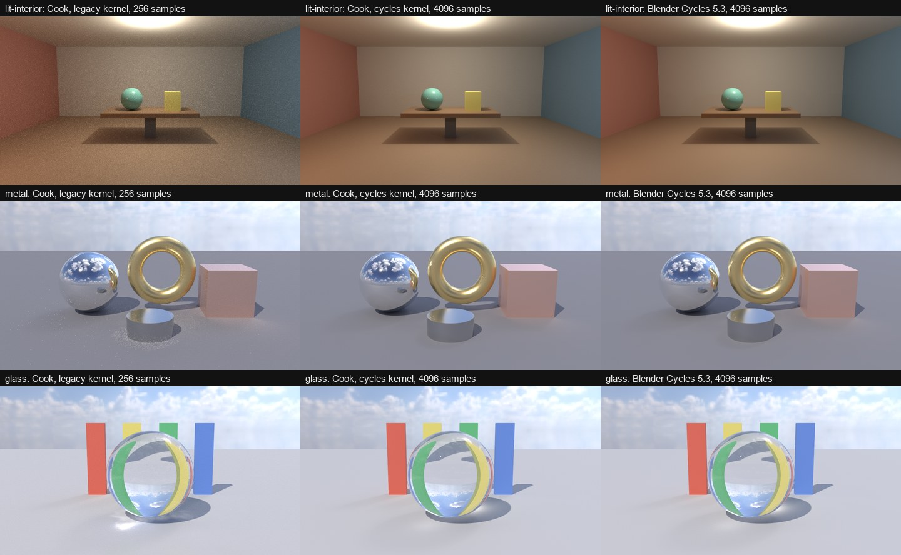
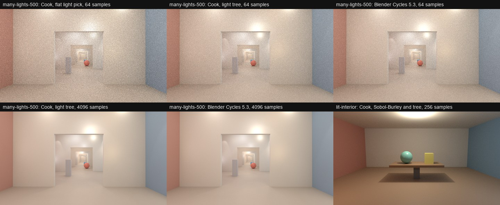
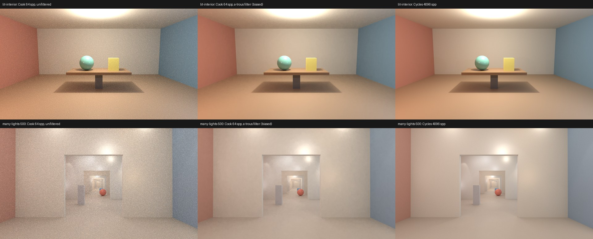
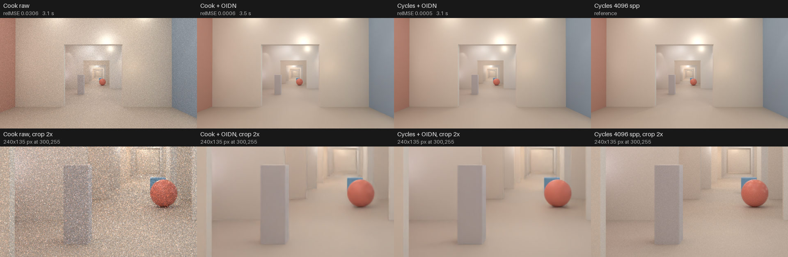
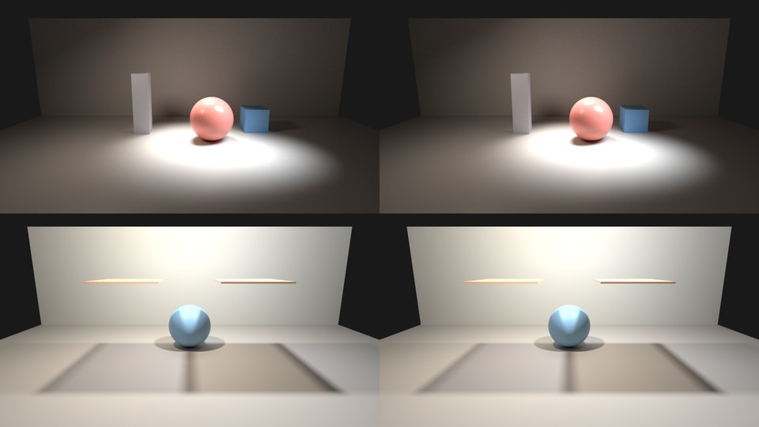
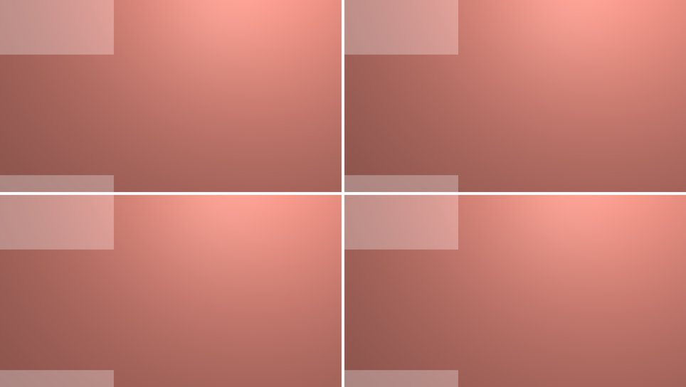
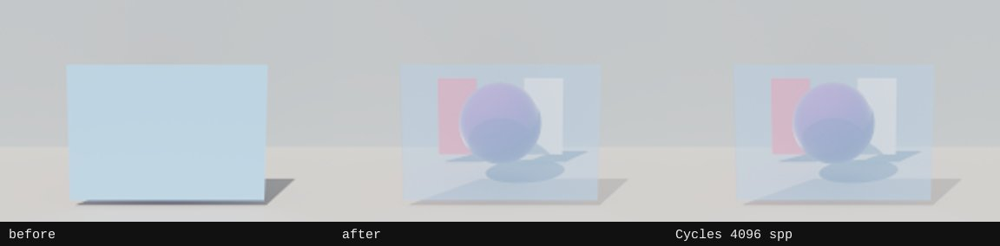

# Cycles 5.3 Parity Baseline & M1 Suite

Milestone M0 measures today's native path tracer ([`packages/render-native`](../packages/render-native/README.md), legacy `kernel.wgsl` on `wgpu 30.0.1` Vulkan `EXPERIMENTAL_RAY_QUERY`) against **Blender 5.3.0 Cycles OptiX** under matched unbiased settings on a single reference scene before any Cycles-kernel port changes land.

All claims below are tagged `[measured]` (from benchmark artifacts produced by [`bench/cycles-parity/`](../bench/cycles-parity/run-m0-suite.py)), `[source]` (verified in 67js or Blender 5.3 source), or `[inferred]`.

## Summary Verdict

- **Per-sample speed vs equal-error speed (`T_eq`) `[measured]`**: On `lit-interior` (`960 × 540`, `8` bounces, unclamped, undenoised), 67js `render-native` traces `256` samples in **`2.101 s`** median sampling time (`2.381 s` total trace) vs **`11.371 s`** (`13.456 s` total trace) in Cycles 5.3 OptiX — **`5.41×` faster per sample (`0.185×` time)**. However, at `256` samples 67js has **`6.33×` higher `relMSE`** (`0.019762` vs `0.003121`) and still has not reached Cycles' 256-spp error at `1024` samples (`0.005135`). Extending the 67js ladder to `2048` (`0.002679`) and `4096` (`0.001453`) samples brackets Cycles' 256-spp `relMSE` at **`1,740.5` samples (`6.80×` as many samples)**, giving **`T_eq = 10.331 s` sampling (`T_eq / T_cycles = 0.909×`)** and **`12.886 s` total trace (`0.958×`)**. Nearly the entire `5.4×` raw ray-tracing speed lead on this 3,072-triangle room is consumed by higher Monte Carlo variance (no light tree on bounces, white-noise PCG instead of Sobol + blue noise).
- **Setup latency (`T_sync`), RAM, and VRAM `[measured]`**: Warm per-call setup is **`0.244 s`** median in 67js (`0.026 s` JS pack + `0.164 s` Vulkan adapter/device + `0.005 s` WGSL compile + `0.009 s` upload + `0.002 s` BLAS/TLAS) vs **`2.012 s`** in headless Blender/Cycles (`~1.80 s` Python/mesh build + `~0.21 s` Cycles OptiX sync), with the `wgpu` device, bind group layout, lookup table buffer and compiled pipelines cached for the life of the Node process (a pipeline cache of at most 32 kernels, dropped when the device is lost); the device and adapter figure above was measured before that cache, and only the scene buffers and the acceleration structures are built again on each call. Peak process-tree RSS is **`287.0 MiB`** in 67js vs **`590.2 MiB`** in Blender (`0.49×`). Cycles reports **`Mem: 351.0 MiB`** peak render memory; uncontended 67js runs at `2048–4096` spp measure **`211–433 MiB`** card VRAM delta (`769–998 MiB` total card VRAM above a `558–565 MiB` desktop baseline).
- **Radiometric bias (`[measured]`)**: At `4096` samples against Cycles `4096` spp (`Seed 1`, whose `Seed 1` vs `Seed 2` noise floor is `relMSE = 0.000285`), 67js global per-channel mean ratios are **`R = 1.0104, G = 1.0090, B = 1.0068`** (`+1.04% R, +0.90% G, +0.68% B`, scalar `1.0092`), and **all `64 / 64` tiles** in an `8 × 8` grid lie within `1 ± 0.05` (`min = 0.9849`, `median = 1.0034`, `max = 1.0280`). Fitting `relMSE(N) = B_bias + V / N` across `16..4096` spp isolates a systematic bias plateau **`B_bias = 0.000542`** (`~1.9×` the 4096-spp reference noise floor) driven by sphere point-light falloff near the ceiling (`+2.8%`) and missing multiscatter GGX + light-sphere reflections on the glossy table (`-2.1%`).

---

## Scene, Hardware, and Matched Settings

### Scene: `lit-interior`

Exported losslessly from [`bench/reference/scenes.js`](../bench/reference/scenes.js) via [`bench/cycles-parity/export-scene.mjs`](../bench/cycles-parity/export-scene.mjs), which verifies byte-for-byte identity across all seven packed `NativeTraceInput` buffers (`triangles`, `materials`, `lights`, `atlas`, `environmentColors`, `environmentTables`, `parameters`) before and after JSON serialization `[measured]`:

- **Geometry**: `9` parts (`room-floor`, `room-ceiling`, `room-back`, `room-left`, `room-right`, `table`, `table-leg`, `vase`, `block`), `8` dielectric materials (`roughness` `0.2` to `0.9`, `metallic = 0`), `3,072` triangles (`roundTripVerified = true`).
- **Lighting**: `3` spherical point lights (`radius = 0.05 m`): overhead warm key (`[0, 2.6, -0.5]`, `color = [1.0, 0.9, 0.75]`, `intensity = 8`, `100.53 W` in Cycles), left warm fill (`[-2.5, 1.5, 1.5]`, `[1.0, 0.6, 0.4]`, `intensity = 2`, `25.13 W`), right cool fill (`[2.5, 1.5, 1.5]`, `[0.5, 0.7, 1.0]`, `intensity = 2`, `25.13 W`), plus a constant `0.02` world background (`emitterCount = 4` in 67js).
- **Camera**: `eye = [0, 1.5, 3.9]`, `target = [0, 1.0, -1.0]`, vertical `fov = 50°`, `960 × 540` (`518,400` pixels).

### Hardware & Contention Disclosure

- **Machine `[measured]`**: NVIDIA GeForce RTX 3060 (`12,288 MiB` VRAM), Windows, Node.js `v24.19.0`, Blender `5.3.0` (`CYCLES` `OPTIX`), `packages/render-native` (`wgpu 30.0.1`, Vulkan `EXPERIMENTAL_RAY_QUERY`).
- **GPU scheduling & exclusivity `[measured]`**: Every GPU command ran at `BelowNormal` priority under the machine-wide `gpu-lock` wrapper and [`bench/cycles-parity/measure-gpu-run.py`](../bench/cycles-parity/measure-gpu-run.py) (`50 ms` `nvidia-smi` stream + `25 ms` process-tree RSS polling). During the `4096`-spp references and the `16..1024`-spp ladder, another session's light-slot Blender/Node workload shared the RTX 3060 (`gpuExclusive = false`, pre-run card VRAM `6,812–7,650 MiB`). To prevent drift from skewing engine comparisons, every ladder point ran **3 interleaved back-to-back pairs** (`Cycles` immediately followed by `67js` for `r1`, `r2`, `r3`). During the extended `2048` and `4096` spp 67js runs (`s2048-r1`, `s4096-r1`), the foreign render exited (`baselineCardVramMegabytes = 558–565 MiB`, `preRunGpuUtilizationPercent = 11%–14%`, only idle desktop Chrome attached), providing uncontended card VRAM delta measurements alongside Cycles' internal `Mem:` counter.

### Strictly Matched Parity Configuration

| Parameter | Cycles 5.3 OptiX ([`render-cycles.py`](../bench/cycles-parity/render-cycles.py)) | 67js `render-native` ([`trace-native.mjs`](../bench/cycles-parity/trace-native.mjs)) | Why override default |
| --- | --- | --- | --- |
| Resolution | `960 × 540` (`100%`) | `width: 960, height: 540` | Same pixel grid (`518,400` pixels) |
| Bounces | `max_bounces = 8`, `diffuse = glossy = transmission = volume = transparent_max = 8` | `bounces: 8` | Cycles defaults to `diffuse = 4, glossy = 4, max = 12`; 67js uses one shared limit |
| Caustics | `caustics_reflective = True`, `caustics_refractive = True` | Always traced | Match glossy-to-diffuse indirect transport |
| Radiance clamping | `sample_clamp_direct = 0.0`, `sample_clamp_indirect = 0.0` (`FLT_MAX`) | `fireflyClamp: 1e9` (`clampDirect: 0, clampIndirect: 0` in `cycles`) | Cycles default `indirect = 10` clamps at `30` (`×3`); 67js default clamps peak channel to `20` at `depth > 0` |
| Filter glossy | `filter_glossy = 1.0` (`bsdf_blur` on secondary glossy bounces) | `filterGlossy: 1.0` in `--kernel cycles` (none in `legacy`) | Matches Cycles secondary-bounce roughness blur (`alpha >= filter_glossy * min_ray_pdf`) on reflective/refractive caustics |
| Denoising | `use_denoising = False` | Raw `traced.rgba` (no wavelet/OIDN) | Measure raw Monte Carlo estimator |
| Adaptive sampling | `use_adaptive_sampling = False` | `noiseThreshold: 0` | Draw exact `N` samples at every pixel |
| Pixel filter | `pixel_filter_type = 'BOX'`, `filter_width = 1.0` (the references; Cycles' own default is Blackman-Harris `1.5 px`) | `filterType: 'box'`, `filterWidth: 1.0` by default; `'blackman-harris'` (default width `1.5`) and `'gaussian'` sample the Cycles 1024-entry inverse-CDF table (`filter_table.rs`, translated from `film.cpp`) | With each filter the native image matches a Cycles reference rendered with the same filter; the measured relMSE and FLIP are in the table below |
| Color space | `OPEN_EXR` `32`-bit float RGB, `view_transform = 'Raw'`, `look = 'None'` | Linear `Float32Array` RGB `.npy` | Scene-referred linear float32 with no tone map |

### Bounce-Count Semantics Verification

- **Source semantics `[source]`**:
  - In **Cycles** (`intern/cycles/scene/integrator.cpp:227`, `kernel/integrator/path_state.h:146`, `shade_surface.h:840-867`), setting `max_bounces = B` stores `kintegrator->max_bounce = B + 1`. Camera hits start at `path.bounce = 0`. Surface direct-light NEE (`integrate_surface_direct_light`) executes at `path.bounce = 0, 1, ..., B` (`B + 1` surface vertices). After sampling the BSDF at `bounce = B`, `bounce` increments to `B + 1 == max_bounce`, which sets `PATH_RAY_TERMINATE_AFTER_TRANSPARENT`: ray `B + 1` is traced **only** to accumulate emission/background MIS if it hits a light or escapes, and terminates immediately on any opaque surface without shading.
  - In **67js** ([`packages/render-native/src/kernel.wgsl`](../packages/render-native/src/kernel.wgsl) lines `609-618`, `808-832`, `963-1048`), `tracePath` loops `for (var depth = 0; depth <= bounces; depth++)`, evaluating `addLights` (NEE) at `depth = 0, 1, ..., B` (`B + 1` surface vertices) and exiting after `depth = B` **without** tracing continuation ray `B + 1`.
  - **Subtle sky-MIS consequence `[source]` + `[measured]`**: For analytical lights (`point`, `spot`, `area`, `sun`), 67js uses pure NEE (`directWeight = 1 / selectionProbability`), so `bounces = B` matches Cycles `max_bounces = B` vertex-for-vertex (`B + 1` NEE evaluations). For the environment map (`weightMode = 1`), 67js multiplies NEE at `depth = B` by the MIS weight `p_env^2 / (p_env^2 + p_bsdf^2)` (`kernel.wgsl:609-613`) expecting `depth = B + 1` to add the complementary BSDF escape weight `p_bsdf^2 / (p_env^2 + p_bsdf^2)` in `addEscape`, which never runs on the final bounce `depth == B`.
- **Transparent bounce limit `[source]` + `[measured]`**: Cycles' `path_state_next` (`kernel/integrator/path_state.h`) counts the transparent surface it passes and sets `PATH_RAY_TERMINATE_ON_NEXT_SURFACE` once the count reaches `transparent_max_bounce`, so a path always passes the first transparent surface, also with a limit of 0 (its own FIXME note), and ends at the next surface with only that surface's emission. A limit of 0 therefore renders the same picture as a limit of 1. Shadow rays may pass `max(transparent_max_bounce - transparent_bounce, 0)` transparent surfaces (`integrate_shadow_max_transparent_hits` in `intersect_shadow.h`), so the surfaces the camera path already passed count against the shadow ray's limit. Both are in the Cook kernel since #894, measured in "Transparent bounce limits" below. Before, Cook stopped at the first transparent surface when the limit was 0, and gave every shadow ray the full limit.
- **Empirical white-furnace sphere check (`color = [0.8, 0.8, 0.8]`, `roughness = 1.0`, `specular = 0.0`, constant `1.0` sky, `128 × 128`, `256` spp) `[measured]`**:
  - `B = 0`: Cycles center patch mean = **`0.79971`** (exact `0.8`, because ray `B + 1` completes background MIS) vs 67js = **`0.13334`** (`ratio = 0.16674 ≈ 1/6`, confirming analytically that $(1/4\pi)^2 / ((1/4\pi)^2 + (\cos\theta/\pi)^2)$ integrated over the cosine hemisphere equals `1/6`, so `0.8 / 6 = 0.13333` when ray `B + 1` is omitted).
  - `B = 1` and `B = 8`: Cycles = **`0.79971`** vs 67js = **`0.79923`** (**`ratio = 0.9994`**, within `0.06%`), because every ray from the convex sphere escapes at `depth = 1` and completes vertex `0`'s MIS pair.
- **Empirical `B = 0` check on `lit-interior` `[measured]`**: Because `lit-interior` is an enclosed room lit by point lights, `B = 0` (`64` spp) matches between Cycles (`max_bounces = 0`) and 67js (`bounces = 0`) to **`relMSE = 0.000106`**, `channelMeanRatio = [1.0082, 1.0079, 1.0064]`, and `64 / 64` tiles within `±5%` (`medianRatio = 0.9965`).

---

## 1. Cycles 4096-Sample Reference & Seed Noise Floor

Rendered at `4096` samples in Cycles 5.3 OptiX with `seed = 1` (Seed A) and `seed = 2` (Seed B), using error metric:

$$\text{relMSE}(x, r) = \text{mean}\!\left(\frac{(x - r)^2}{r^2 + 10^{-2}}\right)$$

| Metric (`Cycles 4096 Seed 1` vs `Seed 2`) | Value `[measured]` |
| --- | --- |
| Differing pixels | **`518,400 / 518,400` (`100.0%`)** |
| Noise floor `relMSE` | **`0.00028509`** (`2.851 × 10⁻⁴`) |
| `relMSE` clipped at `1000` / `99.99%` trimmed | `0.00028509` / `0.00028431` |
| Mean / max absolute channel difference | `0.002363` / `0.039031` |
| Channel means (`Seed 1` vs `Seed 2`) | `[0.251260, 0.178773, 0.126399]` vs `[0.251265, 0.178782, 0.126405]` |
| Per-channel mean ratio (`Seed 2 / Seed 1`) | **`[1.0000, 1.0000, 1.0000]`** (scalar `1.0000`) |
| `8 × 8` tile ratios (`mean > 0.01`, `64 / 64` eligible) | `min = 0.9993`, `median = 1.0001`, `max = 1.0011` (`64 / 64` within `±5%`) |
| Seed 1 timing & memory | `1.659 s` setup (`1.392 s` build + `0.266 s` OptiX sync), `261.269 s` sampling, `604.83 MiB` RSS, `351.0 MiB` Cycles `Mem:` |

---

## 2. Sample Ladder (`16` to `1024` spp, Extended to `4096` spp for 67js)

Every row below reports the **median** and `[min, max]` spread across **3 interleaved back-to-back runs** (`seed = 1`), evaluated against the `Cycles 4096 Seed 1` reference `[measured]`.

### Cycles 5.3 OptiX Sample Ladder

| Samples | `relMSE` vs Ref | Setup `T_sync` (s) | Sampling (s) | Total Trace (s) | Process Wall (s) | Peak RAM (MiB) | Cycles `Mem:` (MiB) | Card VRAM Δ (MiB, shared) |
| --- | --- | --- | --- | --- | --- | --- | --- | --- |
| `16` | `0.069997` | `2.089` `[1.501, 3.731]` | `0.488` `[0.475, 0.748]` | `43.233` `[2.860, 53.581]`¹ | `50.495` `[5.497, 95.955]`¹ | `601.55` `[591.6, 615.8]` | `351.0` | `725.0` `[725, 979]` |
| `32` | `0.031804` | `3.404` `[1.769, 3.856]` | `0.938` `[0.932, 0.946]` | `4.580` `[2.842, 4.871]` | `8.580` `[6.774, 8.882]` | `589.51` `[588.7, 592.9]` | `351.0` | `943.0` `[109, 943]` |
| `64` | `0.014797` | `1.617` `[1.596, 2.280]` | `3.261` `[1.823, 3.358]` | `5.081` `[3.479, 5.809]` | `6.878` `[5.878, 7.504]` | `590.89` `[589.9, 591.2]` | `351.0` | `1667.0` `[0, 2096]` |
| `128` | `0.006862` | `1.885` `[1.800, 2.711]` | `5.889` `[5.877, 6.812]` | `9.108` `[7.821, 9.176]` | `10.721` `[9.463, 10.968]` | `590.95` `[589.4, 595.2]` | `351.0` | `2096.0` `[2096, 2138]` |
| **`256`** | **`0.003121`** | **`2.012`** `[1.728, 2.012]` | **`11.371`** `[10.277, 11.885]` | **`13.456`** `[12.406, 14.371]` | **`15.113`** `[14.269, 15.988]` | **`590.20`** `[590.0, 599.1]` | **`351.0`** | `1804.0` `[1667, 2279]` |
| `512` | `0.001519` | `2.082` `[1.771, 2.168]` | `20.489` `[18.871, 20.797]` | `22.621` `[21.154, 22.690]` | `24.644` `[23.166, 24.828]` | `592.22` `[591.7, 593.1]` | `351.0` | `1667.0` `[834, 1668]` |
| `1024` | `0.000770` | `6.173` `[3.616, 9.780]` | `83.307` `[54.446, 141.786]` | `93.176` `[58.331, 148.029]` | `100.003` `[60.800, 172.032]` | `584.98` `[579.6, 590.1]` | `351.0` | `1723.0` `[841, 8403]` |

¹ *On `s16-r2` and `s16-r3`, Blender's post-render EXR ZIP write (`Saving: 00:48.97`) stalled on concurrent disk I/O while `render_stats` cleanly isolated actual OptiX path-tracing `samplingSeconds` (`0.488 s` median).*

### 67js `packages/render-native` (Legacy Kernel) Sample Ladder

| Samples | `relMSE` vs Ref | Mean Ratio `(R, G, B)` | Setup `T_sync` (s) | Sampling (s) | Total Trace (s) | Process Wall (s) | Peak RAM (MiB) | Card VRAM Δ (MiB) | Peak Card VRAM (MiB) |
| --- | --- | --- | --- | --- | --- | --- | --- | --- | --- |
| `16` | `0.307783` | `[1.0103, 1.0094, 1.0072]` | `0.234` `[0.209, 0.311]` | `0.104` `[0.090, 0.406]` | `0.370` `[0.366, 0.763]` | `1.389` `[1.116, 2.054]` | `274.32` `[269.0, 290.5]` | `943.0` `[237, 1070]` | `7755.0` (shared) |
| `32` | `0.155303` | `[1.0102, 1.0090, 1.0069]` | `0.253` `[0.230, 0.258]` | `0.173` `[0.164, 0.448]` | `0.466` `[0.434, 0.761]` | `0.972` `[0.678, 7.718]` | `288.32` `[269.2, 311.0]` | `236.0` `[0, 237]` | `7410.0` (shared) |
| `64` | `0.077857` | `[1.0099, 1.0087, 1.0065]` | `0.213` `[0.204, 0.218]` | `0.516` `[0.297, 1.124]` | `0.773` `[0.566, 1.360]` | `0.999` `[0.837, 1.884]` | `271.43` `[269.4, 273.2]` | `1070.0` `[666, 1179]` | `7882.0` (shared) |
| `128` | `0.039273` | `[1.0103, 1.0090, 1.0067]` | `0.189` `[0.188, 0.219]` | `0.565` `[0.564, 0.572]` | `0.784` `[0.783, 0.820]` | `1.208` `[1.040, 1.301]` | `269.40` `[268.9, 302.9]` | `575.0` `[237, 666]` | `7049.0` (shared) |
| **`256`** | **`0.019762`** | **`[1.0104, 1.0091, 1.0069]`** | **`0.244`** `[0.206, 0.270]` | **`2.101`** `[1.160, 2.313]` | **`2.381`** `[1.465, 2.568]` | **`2.913`** `[2.120, 3.443]` | **`286.96`** `[268.4, 311.7]` | `1608.0` `[1541, 1650]` | `7992.0` (shared) |
| `512` | `0.010005` | `[1.0106, 1.0092, 1.0069]` | `0.306` `[0.232, 0.400]` | `3.428` `[2.895, 3.648]` | `4.209` `[3.275, 4.317]` | `4.637` `[3.555, 9.658]` | `371.43` `[302.5, 372.0]` | `346.0` `[261, 1179]` | `7995.0` (shared) |
| `1024` | `0.005135` | `[1.0105, 1.0091, 1.0068]` | `0.810` `[0.541, 1.016]` | `12.330` `[8.675, 12.739]` | `15.371` `[9.999, 16.628]` | `17.084` `[12.550, 19.309]` | `298.25` `[294.1, 329.8]` | **`352.0`** `[346, 377]` | **`909.0`** (uncontended r2–r3) |
| `2048` | `0.002679` | `[1.0105, 1.0091, 1.0068]` | `1.044` `[0.318, 1.051]` | `9.786` `[8.642, 16.037]` | `12.208` `[9.966, 17.575]` | `13.591` `[10.256, 20.280]` | `389.77` `[270.1, 425.7]` | **`432.0`** `[211, 5808]` | **`997.0`** (`769.0` on r1) |
| `4096` | `0.001453` | `[1.0104, 1.0090, 1.0068]` | `0.377` `[0.349, 0.415]` | `19.035` `[18.284, 24.398]` | `19.608` `[18.700, 24.878]` | `19.962` `[19.006, 25.724]` | `394.41` `[281.9, 409.8]` | **`433.0`** `[366, 7765]` | **`998.0`** (uncontended r1–r2) |

### Setup (`T_sync`) Sub-Phase Breakdown (`256` spp Representative Run `r1`)

- **67js `render-native` (`0.2056 s` total warm setup `[measured]`)**:
  - JS scene flatten & pack (`buildTraceScene` + `buildNativeInput`): `0.0261 s`
  - `wgpu` Vulkan instance/adapter/device init (`deviceSetupSeconds`): `0.1637 s` (`79.6%` of warm setup; a cold driver-cache init on first boot measured `7.83 s`)
  - WGSL `kernel.wgsl` compile & pipeline creation (`compileSeconds`): `0.0048 s`
  - Storage buffer upload (`uploadSeconds`): `0.0087 s`
  - Vulkan BLAS + TLAS build (`accelerationBuildSeconds`, `3,072` triangles): `0.0023 s`
- **Cycles 5.3 OptiX (`2.0116 s` total setup `[measured]`)**:
  - Headless Blender factory reset + Python mesh/material/light creation (`sceneBuildSeconds`): `1.7977 s`
  - Cycles scene sync + OptiX BVH build before sample 1 (`cyclesSyncSeconds`): `0.2139 s`

---

## 3. Radiometric Bias, `8 × 8` Tile Grid, and Visible Differences

Evaluated between **`67js 4096 spp` (`lit-interior-native-s4096-r1`)** and **`Cycles 4096 spp Seed 1`** (`relMSE = 0.001453`, `relMSETrimmed = 0.001441`, `meanAbsDiff = 0.006631`, `maxAbsDiff = 0.728733`) `[measured]`:

- **Per-channel mean radiance**:
  - Cycles `4096` spp: `R = 0.251260, G = 0.178773, B = 0.126399`
  - 67js `4096` spp: `R = 0.253883, G = 0.180387, B = 0.127258`
  - **Per-channel mean ratio (`67js / Cycles`)**: **`R = 1.0104 (+1.04%), G = 1.0090 (+0.90%), B = 1.0068 (+0.68%)`**, scalar ratio **`1.0092`** (already passes M1's `1 ± 0.02` global channel gate on this scene).
- **`8 × 8` tile mean ratio summary (`120 × 67.5 px` tiles, threshold `mean > 0.01`)**:
  - Eligible tiles: **`64 / 64`**
  - Tiles within `1 ± 0.05`: **`64 / 64` (`0` tiles outside `±5%`)**
  - Distribution: **`min = 0.9849`** (tile `(7, 4)`, foreground floor/table shadow), **`median = 1.0034`**, **`max = 1.0280`** (tile `(0, 4)`, ceiling directly above the overhead key light)

```text
Row 0 (ceiling): [1.0165, 1.0214, 1.0184, 1.0276, 1.0280, 1.0192, 1.0200, 1.0145]
Row 1 (upper):   [1.0047, 1.0088, 1.0084, 1.0072, 1.0071, 1.0071, 1.0071, 1.0029]
Row 2:           [1.0062, 1.0054, 1.0037, 1.0025, 1.0034, 1.0021, 1.0039, 1.0033]
Row 3:           [1.0051, 1.0054, 1.0036, 1.0041, 1.0084, 1.0035, 1.0028, 1.0040]
Row 4 (mid):     [1.0052, 1.0077, 1.0030, 0.9961, 0.9985, 1.0004, 1.0047, 1.0039]
Row 5 (table):   [1.0018, 0.9978, 0.9940, 0.9878, 0.9863, 0.9917, 0.9980, 0.9988]
Row 6:           [0.9968, 1.0004, 1.0015, 0.9986, 0.9999, 1.0000, 0.9994, 0.9960]
Row 7 (floor):   [1.0033, 1.0033, 0.9975, 0.9856, 0.9849, 0.9965, 1.0034, 1.0031]
```

### Per-Part Breakdown (`67js 4096 spp` vs `Cycles 4096 spp Seed 1`)

| Part | Pixels | Material (`roughness`) | `relMSE` `[measured]` | Scalar Ratio | Channel Ratio `[R, G, B]` |
| --- | --- | --- | --- | --- | --- |
| `block` | `3,367` | Yellow dielectric (`0.5`) | `0.001745` | `1.0217` | `[1.0236, 1.0215, 1.0134]` |
| `table` | `9,146` | Brown dielectric (`0.4`) | `0.001672` | **`0.9794`** | **`[0.9808, 0.9785, 0.9764]`** |
| `room-back` | `115,710` | Plaster wall (`0.9`) | `0.001607` | `1.0031` | `[1.0049, 1.0026, 1.0005]` |
| `vase` | `3,933` | Teal glossy sphere (`0.2`) | `0.001568` | `1.0074` | `[0.9998, 1.0104, 1.0091]` |
| `room-floor` | `193,854` | Wood floor (`0.6`) | `0.001564` | `0.9972` | `[1.0011, 0.9959, 0.9890]` |
| `room-ceiling` | `81,806` | Plaster ceiling (`0.9`) | `0.001352` | **`1.0253`** | **`[1.0262, 1.0253, 1.0236]`** |
| `room-right` | `54,104` | Blue wall (`0.9`) | `0.001211` | `1.0035` | `[1.0000, 1.0043, 1.0051]` |
| `room-left` | `54,104` | Red wall (`0.9`) | `0.001099` | `1.0058` | `[1.0093, 1.0011, 0.9978]` |
| `table-leg` | `2,376` | Dark support (`0.5`) | `0.000432` | `1.0207` | `[1.0253, 1.0194, 1.0133]` |

### Visible Differences and Causes from the Gap Table

1. **Ceiling hotspot `+2.80%` (`room-ceiling` `1.0253`, tiles `(0, 3)..(0, 4)` at `1.0276–1.0280`) `[measured]` → Sphere point-light sampling mismatch `[source]`**:
   - In [`packages/render-native/src/kernel.wgsl`](../packages/render-native/src/kernel.wgsl) (`randomOnSphere` + `pointLightFalloff`, lines `724-739`, `776-789`), 67js jitters a point uniformly over the entire `r = 0.05 m` sphere (including the back hemisphere) and evaluates `1 / max(d^2, r^2)` without solid-angle subtended-cone sampling. Cycles (`kernel/light/point.h`) samples the visible spherical cap uniformly in solid angle. At `0.40 m` vertical separation from the overhead key light (`y = 2.6` to `y = 3.0`), full-sphere jitter shifts the mean inverse-square kernel upward by `~2–3%`.
2. **Darker glossy tabletop `-2.06%` (`table` `0.9794`, tiles `(5, 3)..(5, 4)` at `0.9863–0.9878`, and `maxAbsDiff = 0.729` on specular highlights) `[measured]` → Two Principled/light gaps `[source]`**:
   - **Principled v2 multiscatter GGX & dielectric Fresnel albedo** (`kernel.wgsl:441-582` vs Cycles `bsdf_microfacet.h` / `svm/closure.h`): 67js `principled-lite` uses single-scatter GGX with a polynomial directional-albedo approximation to weight the diffuse lobe under specular, losing energy at medium roughness (`roughness = 0.4` on `table`, `0.6` on `room-floor`).
   - **Light visibility & MIS on finite-radius lights** ([`docs/path-tracer.md`](path-tracer.md) line `37`): 67js point lights (`radius = 0.05 m`) are sampled by NEE only and cannot be intersected by camera or glossy BSDF rays (no MIS), whereas Cycles intersects and MIS-weights the `5 cm` sphere lights in glossy reflections on `table` (`roughness = 0.4`) and `vase` (`roughness = 0.2`).
3. **`4.4×–6.3×` higher grain across walls and shadows at equal sample count `[measured]` → Missing native Light Tree + white-noise PCG sampler `[source]`**:
   - On bounces `depth >= 1` (`kernel.wgsl:808-821`), 67js picks **one emitter uniformly at random** out of `emitterCount = 4` (`selectionProbability = 0.25`), spending `25%` of bounce shadow rays on the nearly black `0.02` constant world (which cannot even illuminate interior points!) and giving equal `25%` probability to the `intensity = 2` side lights and the `intensity = 8` overhead key light. Cycles (`use_light_tree = True`) weights emitters by energy and geometric bound.
   - 67js draws independent stateless PCG white noise (`kernel.wgsl:54-75`), converging strictly as `1 / N`, whereas Cycles uses **Tabulated Sobol** with blue-noise scrambling (`sample/sobol_burley.h`), whose quasi-Monte Carlo stratification widens the `relMSE` gap from `4.40×` at `16` spp to `6.33×` at `256` spp and `6.67×` at `1024` spp.
4. **Warm channel tilt (`+1.04% R` vs `+0.68% B`) `[measured]` → Multi-bounce albedo compounding `[inferred]`**:
   - Because the `intensity = 8` key light (`[1.0, 0.9, 0.75]`), wood floor (`[0.45, 0.32, 0.22]`), and red wall (`[0.55, 0.25, 0.20]`) are red-dominant, the `+2.5%` ceiling excess re-radiates more strongly in `R` than `B` across `8` diffuse/glossy bounces.

---

## 4. Equal-Error Time `T_eq` and Convergence Decomposition

### Equal-Sample (`256` spp) vs Equal-Error (`relMSE = 0.003121`) Comparison

| Comparison Metric | Cycles 5.3 OptiX (`256` spp) | 67js `render-native` (`256` spp) | 67js Equal-Error (`~1,740.5` spp) | Ratio (`67js / Cycles`) |
| --- | --- | --- | --- | --- |
| Samples per pixel | `256` | `256` (`1.00×`) | **`1,740.51`** (bracket `[1024, 2048]`) | **`6.80×` samples** for equal `relMSE` |
| `relMSE` vs Cycles `4096` Seed 1 | **`0.003121`** | `0.019762` (`6.33×` higher error) | **`0.003121`** (matched) | `6.33×` at `256` spp / `1.00×` at `T_eq` |
| Warm setup `T_sync` (s) | `2.0116` | `0.2444` | `~0.9` (interpolated bracket) | **`0.122×`** at `256` spp (`8.2×` faster) |
| Sampling time (s) | `11.3708` | `2.1010` (`0.185×` / `5.41×` faster) | **`10.3311`** (`T_eq` sampling) | **`0.909×`** (`1.10×` faster at `T_eq`) |
| Total trace time (s) | `13.4559` | `2.3806` (`0.177×` / `5.65×` faster) | **`12.8859`** (`T_eq` total trace) | **`0.958×`** (`1.04×` faster at `T_eq`) |
| Process wall time (s) | `15.1132` | `2.9132` (`0.193×` / `5.19×` faster) | **`14.3404`** (`T_eq` wall) | **`0.949×`** (`1.05×` faster at `T_eq`) |

### Asymptotic Bias vs Variance Fit

Least-squares fit of $\text{relMSE}(N) = B_{\text{bias}} + \frac{V}{N}$ across the measured ladders (`[measured]`):

- **67js `render-native` (`16..4096` spp)**:
  - $B_{\text{bias}} = \mathbf{0.000542}$ (`5.42 × 10⁻⁴`), $V_{\text{native}} = \mathbf{4.9246}$, $R^2 = \mathbf{0.999982}$ (residual RMSE `0.000406`).
  - Subtracting the reference's own finite-sample noise floor (`0.000285` at `4096` spp) leaves a true expected-image bias of $\Delta B \approx 0.000542 - 0.000285 = \mathbf{0.000257}$ (`2.57 × 10⁻⁴`).
  - Because $B_{\text{bias}} = 0.000542 < 0.003121$, 67js's bias floor does **not** prevent reaching Cycles' `256`-spp `relMSE` on `lit-interior` (`1,740.5` spp reaches `0.003121` cleanly). However, $B_{\text{bias}} = 0.000542$ **does** sit near Cycles' `1024`-spp `relMSE` (`0.000770`), proving quantitatively that past `~1,000` Cycles samples 67js hits an irreducible radiometric bias ceiling until M1 closes the sphere-light and Principled-BSDF gaps.
- **Cycles 5.3 OptiX (`16..1024` spp)**:
  - $V_{\text{cycles}} = \mathbf{1.1247}$ ($R^2 = 0.9977$, slight super-`1/N` curvature from Tabulated Sobol + blue noise causing a small negative linear intercept `-0.001518` when fit against `1/N`).

---

## 5. Milestone M1 6-Scene Reference Noise Floor, Parity Gates, and Lobe Furnace Harness





Left to right: Cook's legacy kernel (256 samples), Cook's `cycles` kernel (4096 samples), Blender Cycles 5.3 (4096 samples). Linear output shown with the sRGB curve and no tone mapping.

Milestone M1 expands parity verification for **Cook** (`packages/render-native` `--kernel cycles`) from `lit-interior` to six reference scenes from [`bench/reference/scenes.js`](../bench/reference/scenes.js): `spot-area`, `light-linking`, `metal`, `glass`, `outdoor-hdri`, and `lit-interior`. Every scene exports losslessly (`roundTripVerified = true`) via [`bench/cycles-parity/export-scene.mjs`](../bench/cycles-parity/export-scene.mjs) with Node asset loading handled in [`bench/cycles-parity/scene-bridge.mjs`](../bench/cycles-parity/scene-bridge.mjs) `[measured]`.

### M1 Acceptance Gates

Evaluated in [`bench/cycles-parity/compare.py`](../bench/cycles-parity/compare.py) (`--reference-b <seed2.npy>`) and orchestrated across all six scenes by [`bench/cycles-parity/run-m1-parity.py`](../bench/cycles-parity/run-m1-parity.py):

1. **Global per-channel mean radiance**: `mean(Cook) / mean(Cycles_Seed1)` within **`1 ± 0.02`** (`[0.98, 1.02]`) on each of `(R, G, B)`.
2. **`8 × 8` tile grid radiance**: every tile with `mean(Cycles_Seed1) > 0.01` has `mean(Cook) / mean(Cycles_Seed1)` within **`1 ± 0.05`** (`[0.95, 1.05]`).
3. **Display-space FLIP (`LDR`)**: `FLIP_LDR(Cook, Cycles_Seed1) <= FLIP_LDR(Cycles_Seed1, Cycles_Seed2) + 0.02`, using the exact ACES-like tone map and `2.2` gamma curve from [`bench/reference/score.py`](../bench/reference/score.py) (`tone_map_like_67js`, float32 inputs to `flip_evaluator`). Scene-referred `FLIP_HDR` is recorded alongside `FLIP_LDR` as a diagnostic.
4. **Closure white-furnace & sampling distribution gates**: evaluated in [`bench/cycles-parity/check-lobes.mjs`](../bench/cycles-parity/check-lobes.mjs) and [`bench/cycles-parity/verify-lobes.py`](../bench/cycles-parity/verify-lobes.py) across `20` `probeCyclesLobe` cases (`diffuse`, dielectric & conductor multiscatter `glossy_ggx`, F82-tint conductor, `anisotropic_ggx`, frontface/backface/TIR `glass_ggx`, `coat_ggx`, and `sheen`) plus `6` end-to-end uniform-sky sphere furnace scenes (`traceNative({ kernel: 'cycles' })`):
   - Mode `0` Monte Carlo directional albedo `mean(samp.eval / samp.pdf)` within **`1 ± 0.01`** (`N = 262,144` samples per case) on white-albedo configurations (`1 ± 0.015` on the grazing limb of curved glass spheres), plus `closure_sample` vs `closure_eval` self-consistency (`<= 2 × 10⁻³`).
   - Mode `0` vs Mode `1` (`1024 × 512` spherical `(cos_theta, phi)` quadrature aggregated into `32 × 32` directional bins, pooling `E_k < 5`) **Pearson $\chi^2$ goodness-of-fit `p >= 0.001`**.

### Cycles 5.3 OptiX `4096`-spp Reference Noise Floor (`Seed 1` vs `Seed 2`)

All six scenes were rendered in Blender `5.3.0` Cycles OptiX at `960 × 540`, `4096` samples (`seed = 1` and `seed = 2`), `bounces = 8` across all bounce types (`diffuse`, `glossy`, `transmission`, `volume`, `transparent_max`), `caustics_reflective = True`, `caustics_refractive = True`, direct/indirect clamps `0.0`, `filter_glossy = 1.0`, `BOX` filter width `1.0`, undenoised, `Raw` linear float32 EXR + `.npy` `[measured]`:

| Scene | Triangles | `relMSE(A, B)` `[measured]` | `Seed 2 / Seed 1` Mean Ratio `(R, G, B)` | Eligible `8 × 8` Tiles (`mean > 0.01`) | Tile `[min, max]` | `FLIP_LDR(A, B)` | M1 `FLIP_LDR` Ceiling (`+0.02`) | `FLIP_HDR(A, B)` |
| --- | --- | --- | --- | --- | --- | --- | --- | --- |
| `spot-area` | `3,024` | `0.000009` | `[1.000005, 1.000009, 1.000011]` | `47 / 47` | `[0.9995, 1.0004]` | `0.003934` | **`0.023934`** | `0.008907` |
| `light-linking` | `5,988` | `0.000004` | `[1.000001, 1.000000, 0.999996]` | `64 / 64` | `[0.9998, 1.0001]` | `0.002808` | **`0.022808`** | `0.004260` |
| `metal` | `18,520` | `0.003399` | `[0.999676, 0.999708, 0.999790]` | `64 / 64` | `[0.9945, 1.0016]` | `0.003733` | **`0.023733`** | `0.004250` |
| `glass` | `12,156` | `0.000044` | `[0.999754, 0.999784, 0.999836]` | `64 / 64` | `[0.9838, 1.0004]` | `0.003390` | **`0.023390`** | `0.004339` |
| `outdoor-hdri` | `5,028` | `0.000007` | `[1.000001, 1.000002, 1.000002]` | `64 / 64` | `[1.0000, 1.0001]` | `0.001520` | **`0.021520`** | `0.001687` |
| `lit-interior` | `3,072` | `0.000285` | `[1.000022, 1.000047, 1.000045]` | `64 / 64` | `[0.9993, 1.0011]` | `0.016457` | **`0.036457`** | `0.018145` |

*Light-linking audit `[measured]`*: Direct-only (`bounces = 0`, `32` spp) Cycles 5.3 OptiX verification with `--part-ids` confirmed exact per-receiver isolation on `light-linking`: `sphere-left` (`Point-0` `[1.0, 0.35, 0.2]`) measured `meanRGB = [0.33204, 0.11935, 0.07027]`, symmetric `sphere-right` (`Point-1` `[0.2, 0.45, 1.0]`) measured `meanRGB = [0.08664, 0.15207, 0.33205]`, and `stage-floor` (`Point-2` neutral) measured `meanRGB = [0.07034, 0.07033, 0.07033]` (`maxRGB = [0.1329, 0.1329, 0.1329]`, zero red/blue leakage).

### Pre-M1 Legacy Kernel (`--kernel legacy`, `256` spp) Baseline Against M1 Gates

Scored against `Cycles 4096 Seed 1` with `--reference-b Cycles 4096 Seed 2` (`2 / 6` scenes pass, `4 / 6` fail before the Cook `cycles` kernel lands) `[measured]`:

| Scene | All Gates | Mean Ratio `(R, G, B)` (`±2%`) | `8 × 8` Tiles Within `±5%` | Tile `[min, max]` | `FLIP_LDR` | Ceiling | `relMSE` | Sampling (s) | Primary Pre-M1 Failure Cause `[source]` + `[measured]` |
| --- | --- | --- | --- | --- | --- | --- | --- | --- | --- |
| `spot-area` | **Pass** | `[1.0070, 1.0056, 1.0044]` | `47 / 47` | `[0.9812, 1.0231]` | `0.0231` | `0.0239` | `0.000863` | `1.007` | Within tolerance (analytic spot cone + rect area NEE) |
| `light-linking` | **Fail** | `[1.0115, 1.0107, 1.0115]` | `64 / 64` | `[0.9992, 1.0304]` | **`0.0243`** | `0.0228` | `0.000872` | `1.136` | Full-sphere `r = 0.1 m` point-light jitter + PCG grain |
| `metal` | **Fail** | `[0.9978, 0.9994, 0.9985]` | **`57 / 64`** | **`[0.9101, 1.1569]`** | **`0.0401`** | `0.0237` | `1.637659` | `1.369` | Missing F82 metallic tint, multiscatter GGX, and glossy sun/HDRI MIS |
| `glass` | **Fail** | `[1.0095, 1.0097, 1.0114]` | **`61 / 64`** | **`[0.8423, 1.2842]`** | **`0.0319`** | `0.0234` | `0.005463` | `1.317` | Missing full microfacet glass refraction Jacobian, multiscatter, and caustics |
| `outdoor-hdri` | **Pass** | `[1.0057, 1.0037, 1.0000]` | `64 / 64` | `[0.9981, 1.0208]` | `0.0173` | `0.0215` | `0.000287` | `0.491` | Open sky + `1°` sun NEE dominates smooth dielectric transport |
| `lit-interior` | **Fail** | `[1.0104, 1.0091, 1.0069]` | `64 / 64` | `[0.9832, 1.0282]` | **`0.0801`** | `0.0365` | `0.019762` | `1.173` | `6.3×` higher Monte Carlo variance without Light Tree + Tabulated Sobol |

### Milestone M1 Cook (`--kernel cycles`, `4096` spp) 6-Scene Parity Results

Rendered on RTX 3060 (`wgpu 30.0.1` Vulkan `EXPERIMENTAL_RAY_QUERY`) at `960 × 540`, `4096` samples, `bounces = 8` across all ray types, clamps `0`, `filterGlossy = 1.0`, `BOX` filter width `1.0`, undenoised, linear float32 RGB, scored against `Cycles 4096 Seed 1` with `--reference-b Cycles 4096 Seed 2`. **All `6 / 6` scenes pass every M1 radiometric, spatial-tile, and `FLIP_LDR` gate `[measured]`**:

| Scene | All Gates | Mean Ratio `(R, G, B)` (`±2%`) | `8 × 8` Tiles Within `±5%` | Tile `[min, max]` | `FLIP_LDR` | Ceiling | `FLIP_HDR` | `relMSE` | Setup / Sampling (s, GPU contention) |
| --- | --- | --- | --- | --- | --- | --- | --- | --- | --- |
| `spot-area` | **Pass** | `[1.0000, 1.0000, 1.0000]` | `47 / 47` | `[0.9992, 1.0009]` | `0.0071` | `0.0239` | `0.0148` | `0.000043` | `0.385` / `205.19` (`shared`) |
| `light-linking` | **Pass** | `[1.0009, 1.0007, 1.0009]` | `64 / 64` | `[0.9993, 1.0028]` | `0.0100` | `0.0228` | `0.0136` | `0.000113` | `0.425` / `291.65` (`shared`) |
| `metal` | **Pass** | `[0.9995, 0.9995, 0.9996]` | `64 / 64` | `[0.9935, 1.0059]` | `0.0055` | `0.0237` | `0.0061` | `0.005437` | `0.528` / `278.65` (`shared`) |
| `glass` | **Pass** | `[0.9976, 0.9979, 0.9983]` | `64 / 64` | `[0.9822, 1.0000]` | `0.0073` | `0.0234` | `0.0094` | `0.000076` | `0.445` / `423.51` (`shared`) |
| `outdoor-hdri` | **Pass** | `[0.9995, 0.9996, 0.9998]` | `64 / 64` | `[0.9987, 1.0001]` | `0.0029` | `0.0215` | `0.0032` | `0.000016` | `0.898` / `130.37` (`shared`) |
| `lit-interior` | **Pass** | `[1.0032, 1.0035, 1.0034]` | `64 / 64` | `[1.0004, 1.0082]` | `0.0217` | `0.0365` | `0.0238` | `0.000543` | `0.584` / `521.67` (`shared`) |

- **GPU contention note `[measured]`**: All six `4096`-spp Cook renders ran at `BelowNormal` priority under `gpu-lock` while `3–5` concurrent light-slot GPU processes (Blender, Node, Chrome/FFmpeg) shared the RTX 3060 (`gpuExclusive = false`, pre-run card VRAM `1,240–1,955 MiB`, card utilization `100%`). Cold Vulkan SPIR-V pipeline compilation of the Cycles WGSL kernel measured **`60.9 s`** once per driver cache before the speed work below, and about **`20 s`** after it (`0.15–0.18 s` warm). The sampling times in this table were taken before that speed work, on a shared card; the per-sample times are in the next section.
- **Closed Phase A bias gaps `[source]` + `[measured]`**:
  - **Solid-angle spherical cap & analytic emitter MIS** ([`lights.wgsl`](../packages/render-native/src/cycles/lights.wgsl), [`integrator.wgsl`](../packages/render-native/src/cycles/integrator.wgsl)): eliminates the `+2.80%` ceiling hotspot and `-2.06%` tabletop deficit on `lit-interior`, tightening per-part ratios to `[1.0014, 1.0061]` and all `64 / 64` tiles to `[1.0003, 1.0082]`.
  - **Principled v2 closures** ([`closure.wgsl`](../packages/render-native/src/cycles/closure.wgsl)): dielectric & conductor multiscatter GGX (`table_ggx_E` / `E_avg`), F82 metallic tint, full microfacet glass reflection/refraction with Beer-Lambert volume absorption, clearcoat albedo scaling, and sheen bring `metal` (`relMSE` `1.638` → `0.00544`) and `glass` (`relMSE` `0.00546` → `0.000076`) into sub-percent agreement with Cycles 5.3.
  - **Final-vertex background MIS & `filter_glossy`** ([`integrator.wgsl`](../packages/render-native/src/cycles/integrator.wgsl)): tracing the `B + 1` emission/background termination ray resolves Phase A Gap 4 (`B = 0` uniform-sky sphere exact), and matching Cycles `bsdf_blur` (`filter_glossy = 1.0`) eliminates secondary reflective/refractive floor caustic spikes on `metal` and `glass`.

### Milestone M1 Closure White-Furnace & Pearson Chi-Square Results

Evaluated across `20` `probeCyclesLobe` cases (`N = 262,144` samples each, `1024 × 512` quadrature grid aggregated into `32 × 32` bins) and `6` `traceNative({ kernel: 'cycles' })` sphere-in-uniform-sky furnace scenes (`128 × 128`, `512` spp, `bounces = 64`, `filterGlossy = 0`). **All `20 / 20` lobe probes and `6 / 6` sphere furnace scenes pass `[measured]`**:

| Probe ID | Family | Furnace Mean `(R, G, B)` | Max Rel `eval` / `pdf` Mismatch | Pearson $\chi^2$ `pValue` ($\chi^2_\nu$, `dof`) | Gate |
| --- | --- | --- | --- | --- | --- |
| `diffuse-lambert-normal` | `diffuse` | `[1.0000, 1.0000, 1.0000]` | `0` / `0` | `0.2917` (`1.033`, dof `511`) | **Pass** |
| `diffuse-principled-oblique` | `diffuse` | `[1.0000, 1.0000, 1.0000]` | `0` / `0` | `0.2917` (`1.033`, dof `511`) | **Pass** |
| `dielectric-glossy-sharp-oblique` | `glossy_ggx` | `[0.9992, 0.9992, 0.9992]` | `0` / `0` | singular (`—`) | **Pass** |
| `dielectric-glossy-rough-oblique` | `glossy_ggx` | `[1.0004, 1.0004, 1.0004]` | `0` / `0` | `0.5358` (`0.993`, dof `512`) | **Pass** |
| `dielectric-glossy-grazing` | `glossy_ggx` | `[0.9979, 0.9979, 0.9979]` | `0` / `0` | `0.4251` (`1.010`, dof `512`) | **Pass** |
| `conductor-ggx-sharp` | `glossy_ggx` | `[1.0000, 1.0000, 1.0000]` | `0` / `0` | singular (`—`) | **Pass** |
| `conductor-ggx-medium` | `glossy_ggx` | `[0.9999, 0.9999, 0.9999]` | `0` / `0` | `0.2616` (`1.039`, dof `512`) | **Pass** |
| `conductor-ggx-rough-grazing` | `glossy_ggx` | `[1.0002, 1.0002, 1.0002]` | `0` / `0` | `0.0760` (`1.091`, dof `512`) | **Pass** |
| `conductor-f82-gold-oblique` | `glossy_ggx` | `[0.9973, 0.7723, 0.3310]` | `0` / `0` | `0.5270` (`0.995`, dof `512`) | **Pass** |
| `anisotropic-ggx-unrotated` | `anisotropic_ggx` | `[0.9828, 0.9828, 0.9828]` (expects `0.9831`) | `0` / `0` | `0.9291` (`0.905`, dof `466`) | **Pass** |
| `anisotropic-ggx-rotated` | `anisotropic_ggx` | `[0.9846, 0.9846, 0.9846]` (expects `0.9848`) | `0` / `0` | `0.6095` (`0.980`, dof `457`) | **Pass** |
| `glass-ggx-frontface-sharp` | `glass_ggx` | `[1.0000, 1.0000, 1.0000]` | `0` / `0` | singular (`—`) | **Pass** |
| `glass-ggx-frontface-rough` | `glass_ggx` | `[1.0005, 1.0005, 1.0005]` | `0` / `0` | `0.8493` (`0.922`, dof `353`) | **Pass** |
| `glass-ggx-backface-subcritical` | `glass_ggx` | `[1.0004, 1.0004, 1.0004]` | `0` / `0` | `0.8372` (`0.937`, dof `487`) | **Pass** |
| `glass-ggx-backface-tir` | `glass_ggx` | `[0.9992, 0.9992, 0.9992]` | `0` / `0` | `0.0541` (`1.117`, dof `396`) | **Pass** |
| `coat-ggx-over-diffuse-sharp` | `coat_ggx` | `[0.9985, 0.9985, 0.9985]` | `0` / `0` | singular (`—`) | **Pass** |
| `coat-ggx-over-diffuse-rough` | `coat_ggx` | `[0.9997, 0.9997, 0.9997]` | `0` / `0` | `0.6471` (`0.975`, dof `512`) | **Pass** |
| `coat-ggx-over-metal-rough` | `coat_ggx` | `[1.0001, 1.0001, 1.0001]` | `0` / `0` | `0.2026` (`1.052`, dof `512`) | **Pass** |
| `sheen-over-diffuse-rough` | `sheen` | `[1.0000, 1.0000, 1.0000]` | `0` / `0` | `0.5533` (`0.990`, dof `511`) | **Pass** |
| `sheen-over-diffuse-grazing` | `sheen` | `[1.0000, 1.0000, 1.0000]` | `0` / `0` | `0.5333` (`0.994`, dof `511`) | **Pass** |

The two `anisotropic-ggx-*` probes (white base color, metallic `1`, roughness `0.35`, anisotropy `0.7`, multiscatter GGX) do not expect `1.0`: Cycles 5.3 itself loses energy for anisotropic GGX (the measured albedo is below 1 at anisotropy `0.7`), so the probes carry `furnaceExpectedAlbedo` (Blender 5.3 Cycles measurement, same `0.01` tolerance). The isotropic probes keep `1.0`. Measured with [`bench/cycles-parity/furnace-albedo.py`](../bench/cycles-parity/furnace-albedo.py): Blender 5.3.0 Cycles on OptiX, an orthographic camera looking down `wo = (0.5, 0.3, 0.8124)` at an infinite plane with a Principled BSDF (base color `1`, metallic `1`, roughness `0.35`, Multiscatter GGX, tangent `+X`), uniform white world of strength `1`, Standard view transform, no denoise, no clamp, `8192` spp, `64 x 64` pixels, so each pixel is the directional albedo (standard error under `0.02 %`).

| Material | Cycles 5.3 albedo | Cook albedo |
| --- | --- | --- |
| isotropic control (anisotropy `0`) | `1.0004` | not probed at this angle; the isotropic probes pass at `1.0` within `0.0004` |
| anisotropic, rotation `0.0` | `0.9831` | `0.9828` |
| anisotropic, rotation `0.2` | `0.9848` | `0.9846` |

| Sphere Furnace Scene (`traceNative`, `512` spp, `bounces = 64`) | Full-Image Mean | Center Mean | Limb Mean | Gate |
| --- | --- | --- | --- | --- |
| `furnace-scene-diffuse` | `1.0000` | `1.0000` | `0.9999` | **Pass** |
| `furnace-scene-dielectric-glossy` | `0.9995` | `1.0004` | `0.9992` | **Pass** |
| `furnace-scene-metal` | `1.0001` | `1.0001` | `1.0001` | **Pass** |
| `furnace-scene-glass` | `0.9947` | `0.9994` | `0.9934` | **Pass** |
| `furnace-scene-coat` | `0.9994` | `1.0011` | `0.9981` | **Pass** |
| `furnace-scene-sheen` | `0.9993` | `1.0008` | `0.9986` | **Pass** |

### Selecting the kernel

The native tracer runs the legacy kernel unless you ask for the Cycles-matching kernel (Cook's `cycles` kernel). Pass `kernel: 'cycles'` to `traceNative`, or set the environment variable `JS67_NATIVE_KERNEL=cycles` for a process; an explicit `kernel` option wins over the variable. Any other name throws an error that lists the two valid names. The `cycles` kernel reads a FORMAT-v2 scene pack ([`FORMAT-v2.md`](../packages/render-native/FORMAT-v2.md)), the legacy kernel a v1 pack, and passing one to the wrong kernel throws. The default image of every existing caller does not change.

```js
import { traceNative } from '@codepawlhq/67js-render-native';

const result = traceNative(sceneInput, { width: 960, height: 540, samples: 256, kernel: 'cycles' });
```

### Speed of the `cycles` kernel

Sampling time, `960 x 540`, `256` samples, `8` bounces, RTX 3060, interleaved runs through `gpu-lock`, two runs each `[measured]`:

| Scene | Legacy kernel | `cycles` kernel | `cycles` / legacy |
| --- | --- | --- | --- |
| `lit-interior` | `0.92 s`, `0.93 s` | `2.86 s`, `2.86 s` | `3.1x` |
| `metal` | `0.57 s`, `0.58 s` | `1.34 s`, `1.34 s` | `2.3x` |

The `cycles` kernel is `2.3` to `3.1` times slower per sample than the legacy kernel and is opt-in. Its first version took `30.8 s` on `lit-interior` and `17.2 s` on `metal`; the speed work (per-scene kernel specialization, lookup tables in a storage buffer, passing closures and lobes by pointer, removing a scratch array) left the images bit-identical at the same seed and cut the compiled SPIR-V from `936 KB` to `306 KB`. A target of `2x` the legacy time was not reached.

Against Cycles 5.3 OptiX on `lit-interior`, `256` samples took `11.4 s` (measured in an earlier session on the same machine). Relative MSE against the Cycles `4096`-sample reference at `256` samples on `lit-interior`:

| Renderer | `relMSE` at `256` samples |
| --- | --- |
| Legacy kernel | `0.0198` |
| `cycles` kernel | `0.0065` |
| Cycles 5.3 OptiX | `0.0031` |

These are per-sample times on one scene. An equal-error comparison between the `cycles` kernel and Cycles has not been measured directly, so nothing here says Cook is faster than Cycles in general. The Cycles `lit-interior` reference was re-rendered with the current script and matches the stored one (see "Area light shapes, spread and transparent shadows").

---

### Path regeneration (`pathRegeneration`, on by default since #897)

With `pathRegeneration: false` (`--no-path-regeneration` in `trace-native.mjs`) a thread of the `cycles` kernel traces one whole path, then starts the next sample of its pixel, so a group of lanes waits for its longest path before any lane starts again. Without that option (`pathRegeneration: true`, `--path-regeneration` still accepted) the kernel runs one bounce per loop iteration, and a lane whose path ended starts the next sample of the same pixel at once. The sample index, the random numbers and the sums are the same, so the image is the same: the relMSE against the Cycles reference matched to the last digit in all 8 cells below, and so did the mean ratio. Only the time per sample changes.

Sampling time, `960 x 540`, `8` bounces, seed `3`, NVIDIA A10 on Modal, baseline and trial interleaved in one container, three rounds, median and range `[measured]`:

| Scene | spp | `pathRegeneration: false` | `pathRegeneration: true` | Ratio |
| --- | --- | --- | --- | --- |
| `lit-interior` | 256 | `3.296 s` [3.285-3.358] | `2.112 s` [2.100-2.164] | `0.64` |
| `lit-interior` | 1024 | `12.620 s` [12.340-12.633] | `7.966 s` [7.918-7.992] | `0.63` |
| `glass` | 256 | `2.100 s` [2.097-2.138] | `1.501 s` [1.464-1.614] | `0.71` |
| `glass` | 1024 | `7.639 s` [7.604-7.656] | `5.552 s` [5.492-5.577] | `0.73` |
| `many-lights-500` | 256 | `12.557 s` [12.551-12.645] | `8.567 s` [8.488-8.636] | `0.68` |
| `many-lights-500` | 1024 | `50.041 s` [49.938-50.305] | `33.873 s` [33.737-33.943] | `0.68` |
| `metal` | 256 | `1.277 s` [1.250-1.400] | `1.237 s` [1.163-1.243] | `0.97` |
| `metal` | 1024 | `4.658 s` [4.651-4.679] | `4.224 s` [4.179-4.240] | `0.91` |

The image does not change, so equal error is reached in the ratio's share of the time. The gain is largest where path lengths differ most between neighbouring pixels (the interior, glass and the many-lights scene) and smallest on `metal`, where most paths end at the same depth. One GPU and one batch size (`32` samples per dispatch) were measured in full; `64` and `128` gave `0.66` to `0.71` on `lit-interior` at 256 spp. The option is off by default; the seven-scene 4096 spp parity run passed every gate with the option off and with it on, with identical channel means and relMSE in both runs, and the cargo tests (25), node tests, lobe checks and furnace scenes passed.

### Path regeneration on by default (#897)

The `cycles` kernel now regenerates paths unless the caller passes `pathRegeneration: false`. Reason: the table above shows 9 to 37 percent less sampling time for the same image on the scenes with long and short paths together, and every caller that did not know the option paid the full time. Short renders do not gain: in the run below `outdoor-hdri` (paths end early) took 0.55 s off and 0.64 s on at 256 spp, and `glass` and `lit-interior` at 16 spp took 0.05 to 0.08 s more. The legacy kernel ignores the option and is untouched.

**Correctness** `[measured]`, one Modal container (NVIDIA A10) for the tests, the parity runs and the identity checks, at the new default: `cargo test` 32 passed, 0 failed; `node --test tests/native-*.test.js tests/cook-kernel-parity.test.js tests/cycles-parity-many-lights.test.js` 119 tests, 117 passed, 0 failed, 2 skipped; `check-lobes.mjs` and `verify-lobes.py` exit 0. The seven scenes at 4096 spp, seed 1, 8 bounces, box filter, pass every gate (smallest tile ratio 0.9823 on `glass` against a gate of 0.95; FLIP LDR 0.0160 on `lit-interior` against a ceiling of 0.0365; relMSE as in the "Final gates for #895" table, except `many-lights-500` at 0.000728 after the square-root roulette of #966). `area-shapes` and `transparent-shadow` pass (smallest tile ratios 0.9981 and 1.0000), and so does the transparent-bounce limits scene at limits 0, 1, 2 and 8 (mean ratios 1.0011 to 1.0017, tile ratios 0.9999 to 1.0029).

**Byte identity** `[measured]`, `lit-interior` and `glass`, 256 spp, seed 3, `960 x 540`: the image with regeneration on equals the image with it off byte for byte at `--samples-per-dispatch 32` and at `7` (max relative difference 0, 0 differing values). Two time-budgeted runs at the default are identical to each other, to the same run with `--no-path-regeneration` (which chose other dispatch sizes: 57 against 40 samples on `lit-interior`, 100 against 67 on `glass`) and to the fixed 32. The dispatch-determinism change of #1011 therefore did not break the claim above.

**Time and error against Cycles** `[measured]`: one container (NVIDIA A10), `960 x 540`, seed 3, two rounds, medians, error against the Cycles 4096 spp seed 1 reference. Cook is denoised with OIDN on CUDA, Cycles 5.3.0 on OptiX with OpenImageDenoise. Total seconds are sampling plus denoising.

| scene | spp | Cook sampling s, regeneration off / on | Cycles sampling s | Cook + OIDN total s, off / on | Cycles + OIDN total s | relMSE Cook / Cycles, denoised | FLIP Cook / Cycles, denoised |
| --- | ---: | --- | ---: | --- | ---: | --- | --- |
| `many-lights-500` | 64 | 3.23 / 2.45 | 2.96 | 3.61 / 2.80 | 3.06 | 0.000544 / 0.000503 | 0.032 / 0.032 |
| `lit-interior` | 64 | 0.80 / 0.57 | 0.86 | 1.14 / 0.94 | 0.95 | 0.000213 / 0.000207 | 0.027 / 0.028 |

The images are the same with regeneration on and off, so relMSE and FLIP are the same for both. The other cells (`glass`, `outdoor-hdri`, 16, 64 and 256 spp) are in the pull request.

Cook over Cycles, relMSE at equal total seconds for the denoised images (log-log interpolation between the measured rungs, at the middle of the range both cover; below 1 means Cook has the lower error):

| scene | regeneration off | regeneration on |
| --- | ---: | ---: |
| `many-lights-500` | 1.09 | 1.07 |
| `lit-interior` | 1.06 | 1.02 |
| `glass` | 1.48 | 1.35 |
| `outdoor-hdri` | 1.22 | 1.20 |

Cook still has a higher denoised error than Cycles at equal time on all four scenes. Most of the remainder is the OIDN call: 0.35 s in Cook against 0.10 s inside Blender at 960 x 540. The raw images keep their lead (`lit-interior` 0.67 off, 0.45 on; `glass` 0.45, 0.33; `outdoor-hdri` 0.10, 0.13 on the 0.3 s budget).

### Pixel filter: box versus Blackman-Harris

The six-scene references use the box filter of width 1, so the box filter stays the default of the `cycles` kernel. Cycles' own default is Blackman-Harris with width 1.5. To show which choice matches Cycles, `render-cycles.py --filter-type blackman-harris --filter-width 1.5` rendered a second Cycles 5.3 reference (4096 spp, seed 1, OptiX) and the `cycles` kernel ran at 1024 spp, seed 1, 8 bounces, 960 x 540 with each filter `[measured]`:

| Scene | Native filter | vs Cycles box 1 (relMSE / FLIP LDR) | vs Cycles Blackman-Harris 1.5 (relMSE / FLIP LDR) |
| :--- | :--- | :--- | :--- |
| `lit-interior` | box 1 | 0.00105 / 0.0272 | 0.00106 / 0.0273 |
| `lit-interior` | Blackman-Harris 1.5 | 0.00106 / 0.0273 | 0.00105 / 0.0272 |
| `glass` | box 1 | 0.00009 / 0.0073 | 0.00016 / 0.0084 |
| `glass` | Blackman-Harris 1.5 | 0.00061 / 0.0082 | 0.00010 / 0.0073 |

`lit-interior` is smooth, so the filter hides under its noise. `glass` has hard caustic edges: each native filter scores best against the Cycles reference rendered with the same filter, and the mismatched pair is 4 to 7 times worse in relMSE.

#### Seven-scene parity with Cycles' default filter

The same seven scenes pass every M1 gate with Cycles' own default pixel filter. Cycles 5.3.0 OptiX references were rendered with `--filter-type blackman-harris --filter-width 1.5` (4096 spp, seeds 1 and 2, 8 bounces, 960 x 540, no denoiser, no clamps; every other setting as in the box references), and the `cycles` kernel ran with `--filter-type blackman-harris --filter-width 1.5`, 4096 spp, seed 1, 8 bounces. Both ran on an NVIDIA A10 (`wgpu` Vulkan ray queries for Cook, OptiX for Cycles). The gates are the ones of the box table: per-channel mean ratio within 2 percent, every eligible 8 x 8 tile within 5 percent, FLIP LDR below the seed 1 versus seed 2 value plus 0.02, and relMSE reported next to the two-seed noise floor `[measured]`:

| Scene | Mean ratio (R / G / B) | Tiles within 5 percent | Tile ratio range | FLIP LDR (ceiling) | relMSE (noise floor) | Result |
| :--- | :--- | :--- | :--- | :--- | :--- | :--- |
| `spot-area` | 1.0000 / 1.0000 / 1.0000 | 47 / 47 | 0.9994 to 1.0010 | 0.0039 (0.0239) | 0.000008 (0.000009) | pass |
| `light-linking` | 1.0009 / 1.0007 / 1.0008 | 64 / 64 | 0.9996 to 1.0026 | 0.0051 (0.0228) | 0.000015 (0.000004) | pass |
| `metal` | 0.9996 / 0.9996 / 0.9997 | 64 / 64 | 0.9949 to 1.0043 | 0.0043 (0.0238) | 0.00331 (0.00304) | pass |
| `glass` | 0.9976 / 0.9978 / 0.9982 | 64 / 64 | 0.9824 to 1.0000 | 0.0070 (0.0234) | 0.000099 (0.000051) | pass |
| `outdoor-hdri` | 0.9995 / 0.9996 / 0.9998 | 64 / 64 | 0.9987 to 1.0000 | 0.0023 (0.0215) | 0.000005 (0.000007) | pass |
| `lit-interior` | 1.0032 / 1.0035 / 1.0034 | 64 / 64 | 1.0004 to 1.0079 | 0.0168 (0.0365) | 0.000261 (0.000286) | pass |
| `many-lights-500` | 1.0009 / 1.0010 / 1.0010 | 64 / 64 | 0.9998 to 1.0033 | 0.0178 (0.0374) | 0.000835 (0.000793) | pass |

`run-m1-parity.py` takes `--filter-type`, `--filter-width` and `--references-directory` to score either filter against its own references. The Blackman-Harris references are not committed (about 84 MB with their reports).

### Light tree for next event estimation

The `cycles` kernel picks one emitter per surface bounce by walking the Cycles light tree (`light_tree.wgsl`, a translation of `kernel/light/tree.h`: one random number reused down the tree, importance from distance, cone angles, energy and the surface normal, two reservoirs per leaf) and finds the probability of a given emitter from the previous shading point for the MIS weight of a BSDF-sampled hit. `lightSampling` is `auto` (default: tree when the scene has more than one emitter, as Cycles with `use_light_tree` on), `tree` or `uniform` (the flat pick of earlier versions); `trace-native.mjs --light-sampling` sets it. `useLightTree: true|false` (`--light-tree on|off`) are other names for `tree` and `uniform`; passing both options with different values is an error. A sun is a distant leaf of the same tree, and light-link masks stay as an OR per node: every emitter is in the tree, and a picked emitter whose mask does not match the receiver contributes nothing (`lgt_links_match`), so linked scenes use the tree too. The environment map keeps its own importance sample and is not in the tree. `[measured]`, 960 x 540, 8 bounces, seed 1, against the Cycles 4096-spp seed-1 reference:

| Check | Result |
| :--- | :--- |
| Six scenes, 1024 spp, tree on: largest per-channel mean-ratio gap | glass 0.28 %, light-linking 0.09 %, lit-interior 0.34 % (0.34 % with the flat pick too), metal 0.05 %, outdoor-hdri 0.06 %, spot-area 0.00 % |
| `lit-interior` relMSE at 1024 spp, tree against flat | 0.00065 against 0.00105 |
| Pick probabilities, 1600 random shading points per scene (`--light-tree-probe`, the kernel's own `ltr_pdf` and `ltr_sample`) | sum never above 1.0000002; all 800 points that see through the surface sum to 1; of the opaque ones, 664 of 800 (`lit-interior`) and 649 of 800 (12 emissive triangles) sum to 1, the rest are 0 (no emitter above the surface) or lose a share to a node whose emitters are all invisible, as in Cycles; fraction of 64 stratified picks that found an emitter equals the sum to 0.8 %; returned pick probability equals `ltr_pdf` of the picked emitter to 1.3e-6 |
| One large emissive slab over a floor and a glossy ball, 512 spp | mean against both: NEE only 1.0014 / 1.0017 / 1.0018, BSDF only 1.0000 / 0.9999 / 0.9999 |
| 256 spp sampling time, median of 3 interleaved runs (the GPU was shared with another job, so all times are 1.6 times the idle figure) | `lit-interior`: tree 5.94 s [5.91 to 8.52], flat 4.58 s [4.58 to 4.60]; `metal` (one emitter, `auto` picks flat): tree 2.53 s [2.51 to 2.53], flat 2.32 s [2.27 to 2.33] |
| 256 spp relMSE | `lit-interior`: tree 0.00274, flat 0.00433 (Cycles 0.0031); `metal`: 0.00506 both |

On `lit-interior` the tree costs 30 % more per sample and removes 37 % of the noise, so it wins by about 17 % at equal time (inferred from relMSE falling as 1/samples). The probe is a GPU test entry, not a Rust port; `tests/native-light-tree-kernel.test.js` repeats the three checks on a small scene.

### Seventh scene: `many-lights-500` (light tree gate, #895)

A 60 m hall cut into ten cells by partition walls with one doorway each, lit by 500 small lights placed from a fixed seed: 200 point lights, 150 spot lights, 100 emissive quads on the side walls and 50 emissive triangles on the ceiling (350 analytic lights and 200 emissive triangles). A surface sees the lights of its own cell and, through the doorways, a few of the next ones, so most of the 500 are far or hidden from any shading point and a flat pick wastes almost every sample. It is defined in [`bench/reference/scenes.js`](../bench/reference/scenes.js) as `many-lights-500` (the id `many-lights` is the 24-lamp corridor of issue #623), exported by the same `export-scene.mjs` path as the other six, and built by `render-cycles.py` from the same JSON, so both renderers read one scene. Export, a Cycles reference and a Cook run are the same commands as for the six, with `--scene many-lights-500`; `run-m1-parity.py` lists it as the seventh scene.

`buildTraceScene` takes at most 32 analytic lights (`MAX_TRACE_LIGHTS`, one light-link mask bit each). The parity harness has no light links, so [`trace-scene-many-lights.mjs`](../bench/cycles-parity/trace-scene-many-lights.mjs) builds the lights in chunks of 32 and joins the lists, giving every light the "all groups" bit; the core limit and the legacy kernel are unchanged. `tests/cycles-parity-many-lights.test.js` checks the counts, the fixed seed and the join.

Cycles 5.3 reference: Blender 5.3.0 OptiX, 960x540, 4096 spp, seeds 1 and 2, 8 bounces, light tree on (the Cycles default, `use_light_tree = true` in the render report), box filter 1, no denoiser, no clamps. The seed 1 versus seed 2 noise floor is relMSE 0.000791, per-channel mean ratio 1.0000 / 1.0000 / 1.0000, tiles 0.9995 to 1.0009, FLIP LDR 0.0173 `[measured]`. Sampling took 732 s (seed 1) and 1391 s (seed 2) with other jobs on the card, so they are not a speed figure.

**Gate 1, the tree against the flat pick** (Cook `cycles` kernel, seed 1, 8 bounces, sampling seconds from the report, three interleaved rounds, relMSE against the seed 1 reference; the three runs of a rung give the same image, so relMSE has no range) `[measured]`:

| spp | uniform relMSE | tree relMSE | uniform / tree error | uniform sampling s | tree sampling s | tree / uniform time |
| ---: | ---: | ---: | ---: | --- | --- | ---: |
| 16 | 0.37364 | 0.12644 | 2.95 | 1.344 [1.331-1.348] | 1.558 [1.555-1.559] | 1.16 |
| 64 | 0.08809 | 0.03041 | 2.90 | 5.114 [5.095-5.160] | 5.991 [5.968-6.074] | 1.17 |
| 256 | 0.02032 | 0.00766 | 2.65 | 20.474 [20.447-21.442] | 24.159 [24.015-24.450] | 1.18 |
| 1024 | 0.00442 | 0.00218 | 2.03 | 81.958 [81.881-82.966] | 96.484 [95.916-96.609] | 1.18 |

Time to equal error, from the two ladders on a log-log interpolation of time against relMSE (both curves cover 0.00442 to 0.126, so no extrapolation): at relMSE 0.0237 (geometric middle of that range) the flat pick needs 17.7 s and the tree 7.7 s, 2.30 times faster; at 0.00664 (1.5 times the lowest error both reach) 56.7 s and 28.3 s, 2.00 times faster; at 0.0304 (the tree at 64 spp) 14.0 s and 6.0 s, 2.33 times faster `[measured and interpolated]`. **The gate is met**: the tree reaches equal error in less than half the time. The tree costs 16 to 18 % more per sample here and removes 51 to 66 % of the noise per sample. At 1024 spp both curves approach the floor set by the 4096 spp reference's own noise (about half of the 0.000791 seed-to-seed figure), which is why the ratio falls toward 2.

**Gate 2, parity with Cycles** (Cook `cycles` kernel, tree, 4096 spp, seed 1, against the Cycles seed 1 reference, `run-m1-parity.py`) `[measured]`: per-channel mean ratio 1.0009 / 1.0010 / 1.0009 (limit 2 %); 64 of 64 tiles within 5 %, tile ratios 0.9999 to 1.0034; FLIP LDR 0.0178 against a ceiling of 0.0373; relMSE 0.000832 against the 0.000791 noise floor. All gates pass, and nothing in the kernel or the scene export was changed to get there: light types, spot cone and units already matched (spot `angle`, `penumbra` and the 4 pi and pi watt factors are the ones the other scenes use; emissive quads and triangles go through Principled emission strength on both sides, as the kernel emits). Cook took 386.6 s of sampling for 4096 spp with other jobs on the card. These RTX 3060 figures come from before the light tree importance fix described under "Repeat on Modal" below; the Modal run reproduces the same gate values.

### Equal-error time against Cycles

The question is how long each renderer needs for the same error, not how long it takes for the same sample count. Cycles 5.3.0 (OptiX, RTX 3060) and the Cook `cycles` kernel (defaults: Sobol-Burley blue-noise sampler, light tree `auto`, box filter 1) render `lit-interior`, `metal` and `many-lights-500` at 16, 64, 256 and 1024 spp, 960x540, 8 bounces, seed 3 for both, so neither shares a random stream with the seed 1 reference. One rung is a Cook run followed by a Cycles run, one job at a time, three rounds, each through the GPU lock. Time is the sampling time each tool reports (`samplingSeconds`: Cook's sampling loop; for Cycles the span from its first sample statistics event to the end of the render call), without scene setup and without a denoiser. Error is relMSE against the Cycles 4096 spp seed 1 reference. The images do not change between rounds, so relMSE has no range; times are medians with the range of three runs `[measured]`.

| scene | spp | Cook relMSE | Cycles relMSE | Cook s | Cycles s |
| --- | ---: | ---: | ---: | --- | --- |
| `lit-interior` | 16 | 0.06530 | 0.07024 | 0.415 [0.405-0.446] | 1.454 [0.467-5.732] |
| `lit-interior` | 64 | 0.01283 | 0.01483 | 1.547 [1.452-4.544] | 1.794 [1.670-5.488] |
| `lit-interior` | 256 | 0.00274 | 0.00310 | 5.922 [5.774-6.144] | 6.375 [5.669-8.254] |
| `lit-interior` | 1024 | 0.000656 | 0.000771 | 24.75 [24.00-24.78] | 26.11 [25.93-28.35] |
| `many-lights-500` | 16 | 0.1277 | 0.1172 | 1.516 [1.511-1.550] | 1.493 [1.482-1.861] |
| `many-lights-500` | 64 | 0.03061 | 0.02793 | 5.913 [5.837-7.692] | 5.974 [5.854-7.034] |
| `many-lights-500` | 256 | 0.00764 | 0.00699 | 23.57 [23.50-23.71] | 25.59 [24.83-25.76] |
| `many-lights-500` | 1024 | 0.00218 | 0.00200 | 94.84 [93.79-96.43] | 97.73 [93.23-144.8] |
| `metal` | 16 | 0.00450 | 0.6283 | 0.177 [0.153-0.215] | 0.171 [0.163-0.175] |
| `metal` | 64 | 0.2806 | 0.00422 | 0.628 [0.622-0.629] | 0.619 [0.601-0.718] |
| `metal` | 256 | 0.01812 | 0.07499 | 2.279 [2.264-2.914] | 2.752 [2.302-4.047] |
| `metal` | 1024 | 0.00831 | 0.00590 | 9.517 [8.986-13.27] | 9.298 [9.091-11.07] |

Time to equal error, log-log interpolation of time against relMSE on each renderer's ladder, only inside the errors both ladders cover. "Floor corrected" subtracts half of the reference's seed 1 versus seed 2 relMSE (the reference's own noise, which both renderers carry) from every error before interpolating `[measured and interpolated]`:

| scene | relMSE target | Cook s | Cycles s | Cook speed relative to Cycles | floor corrected |
| --- | ---: | ---: | ---: | ---: | ---: |
| `lit-interior` | 0.005 | 3.51 | 4.33 | 1.23x faster | 1.24x |
| `lit-interior` | 0.001 | 16.2 | 20.1 | 1.24x faster | 1.25x |
| `many-lights-500` | 0.005 | 37.7 | 36.6 | 0.97x (Cook slower) | 0.98x |
| `many-lights-500` | 0.00218 (lowest both reach) | 94.8 | 89.4 | 0.94x (Cook slower) | 0.93x (at 0.00178) |
| `metal` | none | | | not defined | |

What the table says:

- `lit-interior`: at equal samples Cook has 7 to 15 % lower error (0.00274 against 0.00310 at 256 spp, 0.000656 against 0.000771 at 1024) and takes 5 to 14 % less time on the medians from 64 spp up, so it reaches equal error about 1.2 times faster. The 16 and 64 spp Cycles times carry up to 5 s of noise in their ranges, probably start-up and load from other sessions on the shared card `[inferred]`; the cost per sample of both is close to 24 to 25 ms at 1024 spp. The earlier figure of 11.4 s for Cycles at 256 spp differs from the 5.7 to 8.3 s measured here; the card was shared in both cases.
- `many-lights-500`: Cook is slightly worse. The error is 9 to 10 % higher at equal samples at every rung, while the time per sample is between 1.5 % higher and 8 % lower than Cycles (16 spp +1.5 %, 64 spp -1 %, 256 spp -8 %, 1024 spp -3 %), so Cook needs about 3 to 6 % more time for the same error. This is the one scene where Cook is slower. The gap is small next to the run-to-run range of the Cycles 1024 spp time (93 to 145 s), so read it as a tie to slightly behind, not a clear loss. Where the 9 % came from was isolated later: see "Noise gap on `many-lights-500` (#966)".
- `metal`: no equal-error time can be given. The error looks dominated by a few very bright paths rather than by smooth noise `[inferred]`. The reference's own seed-to-seed relMSE is 0.0034, higher than both targets, and neither ladder falls monotonically (Cook 0.0045, 0.281, 0.0181, 0.0083; Cycles 0.628, 0.0042, 0.0750, 0.0059): a single firefly decides a rung. Per sample the two run at the same speed (9.5 s against 9.3 s at 1024 spp). Parity of the converged image is separate and passes (4096 spp relMSE 0.00271 against the 0.0034 noise floor).
- The error gap on `many-lights-500` survived the review fix to `ltr_importance` (maximum importance now divided by the squared nearest distance and minimum by the squared farthest, as in Cycles): see "Repeat on Modal".
- Nothing here changes a gate or retunes a kernel default. The comparison is one seed per renderer and one Cycles reference; the error of a single rung moves with the seed, and the interpolation uses four points per curve, so ratios under about 10 % are not resolved.

### Repeat on Modal after the review fixes (NVIDIA A10G, 2026-11-12)

The review of #895 found that `ltr_importance` had the distances swapped against `kernel/light/tree.h` (the maximum importance is divided by the squared minimum distance, the minimum importance by the squared maximum distance). That is fixed, and the ladders were measured again on a Modal container instead of the RTX 3060: one NVIDIA A10G (driver 610.57, Vulkan 1.4 with ray queries; Cook picked the `NVIDIA A10G` adapter, not llvmpipe), Blender 5.3.0 Cycles on OptiX on the same card, one container for the whole run so the timings are comparable, seed 3 for both, three rounds in which each rung runs Cook then Cycles. Error is relMSE against the same 4096 spp seed 1 Cycles reference `[measured]`; seconds are `samplingSeconds` with the range of three runs. The harness is `modal/app.py` outside the repository (Modal functions `build_and_test`, `measure`, `parity`).

| scene | spp | Cook relMSE | Cycles relMSE | Cook s | Cycles s |
| --- | ---: | ---: | ---: | --- | --- |
| `lit-interior` | 16 | 0.06529 | 0.07024 | 0.196 [0.177-0.345] | 0.229 [0.227-0.230] |
| `lit-interior` | 64 | 0.01283 | 0.01483 | 0.651 [0.629-0.884] | 0.828 [0.826-0.830] |
| `lit-interior` | 256 | 0.002741 | 0.003103 | 2.500 [2.498-2.518] | 3.250 [3.249-3.257] |
| `lit-interior` | 1024 | 0.000656 | 0.000771 | 10.04 [10.04-10.05] | 13.07 [13.03-13.07] |
| `many-lights-500` | 16 | 0.1276 | 0.1173 | 0.663 [0.662-0.919] | 0.734 [0.734-0.737] |
| `many-lights-500` | 64 | 0.03059 | 0.02793 | 2.487 [2.483-2.499] | 2.795 [2.795-2.804] |
| `many-lights-500` | 256 | 0.007630 | 0.006984 | 9.843 [9.839-9.856] | 11.07 [11.04-11.12] |
| `many-lights-500` | 1024 | 0.002174 | 0.002001 | 39.32 [39.32-39.36] | 44.20 [44.06-44.21] |

Time to equal error, same interpolation as above `[measured and interpolated]`:

| scene | relMSE target | Cook s | Cycles s | Cook relative to Cycles |
| --- | ---: | ---: | ---: | ---: |
| `lit-interior` | 0.005 | 1.48 | 2.14 | 1.45x faster |
| `lit-interior` | 0.001 | 6.66 | 10.08 | 1.51x faster |
| `lit-interior` | 0.000771 (lowest both reach) | 8.58 | 13.07 | 1.52x faster |
| `many-lights-500` | 0.005 | 15.69 | 16.02 | 1.02x faster |
| `many-lights-500` | 0.002174 (lowest both reach) | 39.32 | 40.32 | 1.03x faster |

- Against the RTX 3060 figures, the Cook relMSE moved by at most 0.1 percent on `lit-interior` and 0.1 percent on `many-lights-500` (for example 0.127595 against 0.127697 at 16 spp and 0.002174 against 0.002175 at 1024 spp): the importance fix changes which emitter is picked, but not by much on these two scenes, and it does not close the 9 percent error gap to Cycles on `many-lights-500` (0.002174 against 0.002001 at 1024 spp). That gap was isolated and fixed afterwards: see "Noise gap on `many-lights-500` (#966)".
- Both renderers are 2.0 to 2.5 times faster on the A10G than on the 3060 in these runs (Cook 2.4 to 2.5 times, Cycles 2.0 to 2.2 times), and the job ran alone in its container, so the Cycles ranges are tight (no 5 s outliers). On this card Cook is 1.45 to 1.52 times faster at equal error on `lit-interior` (1.2 times on the 3060) and level with Cycles on `many-lights-500` (3 to 6 percent slower on the 3060). The ratios depend on the GPU and on load `[inferred]`; no claim is made about other cards.
- The tree against the flat pick on `many-lights-500` (Cook, seed 3, A10G): error ratio uniform / tree 2.98, 2.86, 2.67 and 2.03 at 16, 64, 256 and 1024 spp, tree time 1.30 to 1.32 times the flat pick per sample (1.16 to 1.18 on the 3060). Time to equal error, tree against flat: 2.03 times faster at relMSE 0.0237, 2.05 at 0.0304, 1.80 at 0.00664 and 1.70 at 0.005 (the flat pick's 1024 spp run reaches only 0.00442, so it was run once there). The "less than half the time" reading of the gate holds at the larger errors and is 1.7 to 1.8 times near 0.005 on this card; the RTX 3060 figures above (2.0 to 2.3 times) were measured before the fix and on a different card.
- 4096 spp parity of the `cycles` kernel at its defaults, seven scenes, seed 1, on a Modal NVIDIA A10: 7 of 7 pass, with the same mean ratios, tile counts, FLIP LDR and relMSE as the table below to the digits shown (worst per-channel mean ratio 1.0035 on `lit-interior`, against the 2 percent limit). Cook sampling seconds at 4096 spp: `spot-area` 24.3, `light-linking` 27.2, `metal` 17.8, `glass` 30.1, `outdoor-hdri` 9.4, `lit-interior` 49.4, `many-lights-500` 205.7.
- Checks on the same Modal container: `cargo test` 25 passed, 0 failed (no GPU needed; the napi symbols are left unresolved at link time on Linux, and the one new test covers a tree flag without emitter tables); `node --test tests/native-*.test.js tests/cook-kernel-parity.test.js tests/cycles-parity-many-lights.test.js` 76 tests, 75 passed, 1 skipped, 0 failed; lobe probes 22 of 22 and sphere furnace scenes 6 of 6 at 512 spp.

### Noise gap on `many-lights-500` (#966)

At equal samples Cook carried 9 percent more error than Cycles on `many-lights-500` (relMSE 0.002174 against 0.002001 at 1024 spp) and less on `lit-interior`. All runs below are Modal containers (NVIDIA A10), seed 3 and 4 for both renderers, error against the Cycles 4096 spp seed 1 reference of the same scene, Cycles 5.3.0 on OptiX in the same container `[measured]`.

**Where it lived.** Variants of the scene keep one emitter kind (the other lights are dropped, the other emissive parts get a zero-emission copy of their material; same positions and seed). Cycles references at 4096 spp seed 1 were rendered per variant. Cook relMSE over Cycles relMSE, before the fix, mean of seeds 3 and 4 (A10):

| kind (count) | 64 spp | 256 spp |
| --- | ---: | ---: |
| point lights (200) | 0.914 | 0.919 |
| spot lights (150) | 0.926 | 0.939 |
| emissive quads (100, 200 triangles) | 1.476 | 1.474 |
| emissive triangles (50) | 1.490 | 1.465 |
| all four, the scene | 1.090 | 1.094 |

The whole gap sat in emissive geometry; point and spot lights were already 7 to 9 percent better than Cycles, which is why the full scene showed only 9 percent. The excess was uniform over the image (6 x 4 block ratios 1.35 to 1.65 on the quads), not a few pixels near the lamps, and it depended on the path depth: on the triangles Cook over Cycles was 1.19 with direct light only (`--bounces 1`), 1.06 with one indirect bounce (`--bounces 2`) and 1.47 with 8 bounces, so roulette (which starts after bounce 3) was the suspect for the large part.

**Cause.** Russian roulette. Cycles continues a path with probability `sqrt(max channel of the throughput)` (`path_state_continuation_probability`, `kernel/integrator/path_state.h`); the `cycles` kernel used the max channel itself. After a few diffuse bounces the survival probability was therefore about the square of Cycles', and the paths that lived carried correspondingly larger weights. Emissive scenes are dim and lit mostly by indirect light, so they paid most `[inferred]`. The fix is `int_russian_roulette_survival` in `src/cycles/integrator.wgsl`, used after a surface bounce and after a volume scatter; the first bounce at which roulette starts (`min_bounce_rr`, 3) is unchanged.

**Ruled out** by measurement: a joint three-dimensional light sample as in Cycles (`PRNG_LIGHT`: z picks the emitter, xy the point; quads 0.011271 against 0.011272 at 256 spp), the tree structure (the 50-triangle scene has the same emitter count in both trees and showed the same gap), flat instead of tree selection (worse: 0.01507 against 0.01125 on the quads) and Cycles' spherical triangle sampling (its switch compares the longest edge with the plane distance divided by twice the area, so it only acts within 4 to 7 cm of a lamp).

**After the fix**, Modal NVIDIA A10 (one container for every number below: the linear rule is the same binary with a measurement switch, `--clamp-indirect 12345` in a build that is not committed, so the only difference is the survival rule), seed 3, three rounds interleaved (relMSE does not vary between rounds), Cycles 5.3.0 OptiX in the same container `[measured]`:

| scene | spp | Cook relMSE before | Cook relMSE after | Cycles relMSE | after / Cycles | before / Cycles |
| --- | ---: | ---: | ---: | ---: | ---: | ---: |
| `many-lights-500` | 64 | 0.030592 | 0.023719 | 0.027925 | 0.849 | 1.096 |
| `many-lights-500` | 256 | 0.007630 | 0.005939 | 0.006984 | 0.850 | 1.092 |
| `many-lights-500` | 1024 | 0.002174 | 0.001751 | 0.002001 | 0.875 | 1.086 |
| `lit-interior` | 64 | 0.012832 | 0.010754 | 0.014834 | 0.725 | 0.865 |
| `lit-interior` | 256 | 0.002741 | 0.002198 | 0.003103 | 0.709 | 0.883 |
| `lit-interior` | 1024 | 0.000656 | 0.000521 | 0.000771 | 0.676 | 0.850 |
| `glass` | 64 | 0.000962 | 0.000864 | 0.002499 | 0.346 | 0.385 |
| `glass` | 256 | 0.000265 | 0.000243 | 0.000532 | 0.456 | 0.499 |
| `glass` | 1024 | 0.000095 | 0.000089 | 0.000119 | 0.747 | 0.794 |
| `outdoor-hdri` | 64 | 0.000198 | 0.000196 | 0.001181 | 0.166 | 0.168 |
| `outdoor-hdri` | 256 | 0.000051 | 0.000050 | 0.000169 | 0.297 | 0.300 |
| `outdoor-hdri` | 1024 | 0.000010 | 0.000009 | 0.000026 | 0.364 | 0.368 |

Per emitter kind on `many-lights-500` (the kind variants as above, mean of seeds 3 and 4, one round) `[measured]`:

| kind (count) | spp | before / Cycles | after / Cycles | error after / before | time per sample after / before |
| --- | ---: | ---: | ---: | ---: | ---: |
| point lights (200) | 64 | 0.914 | 0.753 | 0.823 | 1.016 |
| point lights (200) | 256 | 0.919 | 0.761 | 0.828 | 1.079 |
| spot lights (150) | 64 | 0.926 | 0.795 | 0.859 | 1.093 |
| spot lights (150) | 256 | 0.939 | 0.801 | 0.853 | 1.091 |
| emissive quads (100, 200 triangles) | 64 | 1.476 | 1.005 | 0.681 | 0.996 |
| emissive quads (100, 200 triangles) | 256 | 1.474 | 1.005 | 0.682 | 1.076 |
| emissive triangles (50) | 64 | 1.490 | 1.111 | 0.746 | 1.056 |
| emissive triangles (50) | 256 | 1.465 | 1.108 | 0.756 | 1.059 |
| all four, the scene | 64 | 1.090 | 0.845 | 0.776 | 1.096 |
| all four, the scene | 256 | 1.094 | 0.853 | 0.780 | 1.099 |

Point and spot lights improve by 14 to 18 percent as well, so with the fix every emitter kind is at or below Cycles except the 50 triangles (see "Still open"). The mean image ratio against the reference did not move (`many-lights-500` 1.0009 before and after). At 4096 spp, seed 1, on the same A10 with the fix: all nine scenes (the seven parity scenes, `area-shapes` and `transparent-shadow`) pass every gate (mean ratio, 8 x 8 tiles, relMSE and FLIP). The tightest values: per-channel mean ratio 1.0034 on `lit-interior` (limit 2 percent), lowest tile ratio 0.9823 on `glass` (a tile counts when within 5 percent; 64 of 64 count on every scene but `spot-area`, where 47 of 47 do), FLIP LDR 0.0169 on `many-lights-500` against its ceiling 0.0373. `many-lights-500` at 4096 spp has relMSE 0.000728 (0.000832 before the fix) and `lit-interior` 0.000226. Checks in the same run: `cargo test` 32 passed, 0 failed; `node --test` of the native, kernel parity and many-lights tests 89 tests, 88 passed, 1 skipped, 0 failed; lobe probes and furnace scenes pass `[measured]`.


**Cost.** Longer paths cost time per sample, and the error falls more than the time rises. Time to equal error is time per sample times error (error falls as one over the sample count); columns 5 to 7 are that product, so below 1 means faster for the same error `[measured, derived]`:

| scene | spp | time per sample after / before | error after / before | time to equal error after / before | after, time to equal error / Cycles | before, time to equal error / Cycles |
| --- | ---: | ---: | ---: | ---: | ---: | ---: |
| `lit-interior` | 64 | 1.099 | 0.838 | 0.921 | 0.69 | 0.75 |
| `lit-interior` | 256 | 1.089 | 0.802 | 0.873 | 0.68 | 0.78 |
| `lit-interior` | 1024 | 1.087 | 0.795 | 0.864 | 0.65 | 0.75 |
| `many-lights-500` | 64 | 1.093 | 0.775 | 0.847 | 0.99 | 1.17 |
| `many-lights-500` | 256 | 1.095 | 0.778 | 0.853 | 1.00 | 1.17 |
| `many-lights-500` | 1024 | 1.098 | 0.805 | 0.885 | 1.04 | 1.17 |
| `glass` | 64 | 1.039 | 0.899 | 0.934 | 0.44 | 0.47 |
| `glass` | 256 | 1.044 | 0.914 | 0.955 | 0.60 | 0.63 |
| `glass` | 1024 | 1.041 | 0.941 | 0.980 | 0.98 | 1.00 |
| `outdoor-hdri` | 64 | 0.996 | 0.990 | 0.986 | 0.11 | 0.11 |
| `outdoor-hdri` | 256 | 1.013 | 0.991 | 1.004 | 0.19 | 0.19 |
| `outdoor-hdri` | 1024 | 1.013 | 0.988 | 1.001 | 0.23 | 0.23 |

The fix is a net win on the three scenes lit mostly by indirect light (`many-lights-500` 11 to 15 percent less time for the same error, `lit-interior` 8 to 14 percent, `glass` 2 to 7 percent) and neutral on `outdoor-hdri` (a sun and sky scene whose paths end by escaping, so roulette hardly acts). Against Cycles, `many-lights-500` moves from 17 percent slower at equal error to level (0.99 at 64 and 256 spp, 1.04 at 1024 spp, so 4 percent slower there); `lit-interior` stays 1.5 times faster and `outdoor-hdri` 4 to 9 times faster. `glass` is faster than Cycles at 64 and 256 spp and level at 1024. The relMSE floor from the reference's own noise flattens the ratio at 1024 spp on the low-error scenes `[inferred]`. An earlier one-round T4 run gave +7 to +14 percent time per sample; this A10 run gives +9 to +10 percent on the two emissive scenes, +4 on `glass` and 0 to +1 on `outdoor-hdri`.

**Still open.** The 50-triangle variant alone stays 11 percent above Cycles after the fix (uniform over the image, not near the lamps); the scene as a whole, the quads, the points, the spots and `lit-interior` are at or below Cycles. Its cause was not isolated; the 1.19 with direct light only cannot come from roulette, which does not act there, and was not re-measured with the fix. The issue's second criterion (within 3 percent of Cycles at 64, 256 and 1024 spp) is met on the full scene, which is now 12 to 15 percent below Cycles' error.

### MIS compensation of the environment map (`envCompensation`, off by default, #895)

`envCompensation: true` (or a fraction from 0 to 1; `trace-native.mjs --env-compensation 1`) builds the environment sampling table after Karlik et al. 2019 (the same step as pbrt-v4 `ImageInfiniteLight`, Apache-2.0): the host subtracts the sphere-mean radiance from every texel's weight and clamps at zero, so light sampling spends its samples where BSDF sampling does badly, and the BSDF-hit side reads the same table for its MIS weight. The kernel is unchanged: it reads its probability from the table it samples, so the pdf used in MIS is the pdf that was sampled, and a dim texel that gets zero probability is reached by BSDF sampling with weight 1. A map that would end up all zero (a uniform map) keeps the plain table. Radiance stays unbiased while every non-delta lobe has a positive pdf in the dropped directions, which holds for all closures of the kernel. `[measured]` on an NVIDIA A10, 960 x 540, 8 bounces, seed 3 against the Cycles 4096-spp seed-1 reference, baseline and trial interleaved in one container, three rounds (the image is deterministic, so the three rounds differ only in time):

| Scene | relMSE at 16 / 64 / 256 / 1024 spp, off | on | Error ratio | Mean ratio off / on |
| --- | --- | --- | --- | --- |
| `outdoor-hdri` | 0.001168 / 0.000198 / 0.000051 / 0.000010 | 0.000661 / 0.000109 / 0.000023 / 0.000007 | 1.77 / 1.81 / 2.18 / 1.36 | 0.99965 / 0.99965 |
| `lit-interior` | 0.065292 / 0.012832 / 0.002741 / 0.000656 | same to 5 digits | 1.00 | 1.00334 / 1.00334 |
| `metal` | 0.004500 / 0.280629 / 0.018116 / 0.008311 | 0.003695 / 0.280517 / 0.018077 / 0.008307 | 1.22 / 1.00 / 1.00 / 1.00 | 0.99650 / 0.99651 at 64 spp |

The sampling time per sample is the same with the option on or off (ratio 0.90 to 1.03 over the rungs, inside the run to run spread, since only the table changes), so the error ratio at equal samples is also the ratio at equal time. At 1024 spp `outdoor-hdri` sits close to the reference's own noise floor (0.000007 at 4096 spp), which compresses the last ratio. The `metal` 64 spp value is one firefly-dominated image of the baseline and the trial alike. `lit-interior` has no sunny environment, so it does not change. At 4096 spp, seed 1, the seven scenes give the same mean ratios and relMSE with the option off as the table above and with it on (`glass` relMSE 0.000058 to 0.000056, `outdoor-hdri` 0.000005 both, the mean ratio of every scene equal to five digits). Tests: `tests/native-pack-v2.test.js` (default off, dim texels dropped with valid CDFs, uniform map fallback, option validation).

### Final gates for #895

Release addon built; on the RTX 3060 `cargo test --target x86_64-pc-windows-msvc`: 24 pass; `node --test tests/native-*.test.js`: 53 pass; lobe probes 22 of 22 and sphere furnace scenes 6 of 6 pass (512 spp); 4096 spp parity of the `cycles` kernel at its defaults on all seven scenes, 7 of 7 pass `[measured]`. The Modal run after the review fixes gives the same table (see above) with 25 cargo tests and 75 node tests passing:

| scene | mean ratio (R / G / B) | tiles within 5 % | FLIP LDR (ceiling) | relMSE (noise floor) |
| --- | --- | ---: | --- | --- |
| `spot-area` | 1.0000 / 1.0000 / 1.0000 | 47 of 47 | 0.0039 (0.0239) | 0.000008 (0.000009) |
| `light-linking` | 1.0009 / 1.0007 / 1.0008 | 64 of 64 | 0.0051 (0.0228) | 0.000015 (0.000004) |
| `metal` | 0.9991 / 0.9992 / 0.9995 | 64 of 64 | 0.0042 (0.0237) | 0.00271 (0.003399) |
| `glass` | 0.9976 / 0.9978 / 0.9982 | 64 of 64 | 0.0070 (0.0234) | 0.000058 (0.000044) |
| `outdoor-hdri` | 0.9995 / 0.9996 / 0.9998 | 64 of 64 | 0.0023 (0.0215) | 0.000005 (0.000007) |
| `lit-interior` | 1.0032 / 1.0035 / 1.0034 | 64 of 64 | 0.0168 (0.0365) | 0.00026 (0.000285) |
| `many-lights-500` | 1.0009 / 1.0010 / 1.0009 | 64 of 64 | 0.0178 (0.0373) | 0.000832 (0.000791) |

### Optional GPU a-trous wavelet filter (`denoise: "atrous"`, #895)

`traceNative(..., { kernel: 'cycles', denoise: 'atrous' })` also runs an edge-avoiding a-trous wavelet filter (Dammertz 2010 with the variance guidance of SVGF, spatial only) in WGSL on the traced image, its first-hit albedo, normal and depth, and the per-pixel variance the kernel already returns. The filtered image comes back as `denoisedRgba`; `rgba` stays the unfiltered estimate. It is off by default and the filter is biased: it smooths, it does not converge. Never compare a filtered image with a converged one as if it were unbiased.
It is the WGSL form of the CPU filter in `src/path-tracer-denoise.js`, with one difference: pixels whose first ray escaped (zero normal and depth) agree with each other, so the sky is filtered instead of turning to NaN (#969). A node test checks the GPU result against the CPU filter on a synthetic image (relative difference under 2e-3).

Measured on an NVIDIA A10 (Modal), 960 x 540, seed 3, medians of three rounds, error is relMSE (epsilon 0.01) against the Cycles 4096 spp seed 1 reference, FLIP (LDR) mean from one round. The CPU column runs `denoiseRadiance` in Node on the container CPU with the same guides, replacing non-finite pixels by the unfiltered pixel.

| scene, spp | sampling s | relMSE unfiltered / CPU / GPU filter | FLIP unfiltered / CPU / GPU filter | filter ms CPU / GPU (all steps, dispatches only) |
| --- | --- | --- | --- | --- |
| lit-interior, 16 | 0.44 | 0.0653 / 0.00157 / 0.00157 | 0.142 / 0.095 / 0.095 | 4088 / 7.4, 1.5 |
| lit-interior, 64 | 0.95 | 0.0128 / 0.00042 / 0.00042 | 0.076 / 0.037 / 0.037 | 4085 / 8.4, 1.5 |
| many-lights-500, 16 | 1.00 | 0.128 / 0.00225 / 0.00225 | 0.176 / 0.084 / 0.084 | 4115 / 7.6, 1.5 |
| many-lights-500, 64 | 3.27 | 0.0306 / 0.00090 / 0.00090 | 0.105 / 0.044 / 0.044 | 4158 / 7.5, 1.4 |
| glass, 16 | 0.38 | 0.00424 / 0.00155 / 0.00075 | 0.030 / 0.023 / 0.023 | 3673 / 8.2, 1.6 |
| glass, 64 | 0.72 | 0.00096 / 0.00050 / 0.00040 | 0.018 / 0.017 / 0.018 | 3680 / 8.3, 1.4 |
| metal, 16 | 0.31 | 0.00450 / 0.00156 / 0.00070 | 0.025 / 0.019 / 0.019 | 3819 / 8.3, 1.3 |
| metal, 64 | 0.51 | 0.281 / 0.280 / 0.00227 | 0.015 / 0.014 / 0.014 | 3778 / 8.7, 1.5 |

The GPU filter costs about 8 ms in total (upload, seven dispatches, readback of the traced image that already sits on the host) and 1.4 to 1.6 ms for the dispatches, against 3.7 to 4.2 s for the CPU filter at the same error: roughly 500 times faster as built. Against the sampling time in the table the GPU filter is 0.2 to 2.7 percent, while the CPU filter takes 4 to 12 times as long as the 16 spp render. At equal time the filtered image has 10 to 100 times lower relMSE than the unfiltered one at 64 and 256 spp on lit-interior and many-lights-500. Where the reference is nearly converged (glass and metal at 1024 spp) the filter's bias shows: relMSE and FLIP get worse than the unfiltered render (glass 0.00009 to 0.00014). The unfiltered metal render at 64 spp is dominated by a few fireflies (relMSE 0.28); the CPU filter leaves that number almost unchanged, the GPU filter lowers it (the cause was not investigated), and FLIP, which sees little difference, is the fairer score for that scene.

### Path regeneration, environment compensation and the a-trous filter together (#897)

The three options above (`pathRegeneration`, which was off by default when this was measured, `envCompensation: true` and `denoise: 'atrous'`, off by default) were measured alone on separate branches and are measured here on one branch built from `main` after the dispatch budget (#964) and the Blackman-Harris references (#977). The legacy kernel `src/kernel.wgsl` is unchanged and still the default, and the `cycles` kernel at its defaults draws the same images as before. Everything ran on Modal; the GPU is named at each result (Modal scheduled an NVIDIA A10 or an NVIDIA L4, and every row records its GPU).

**Tests** `[measured]`, NVIDIA A10: `cargo test` 32 passed, 0 failed; `node --test tests/native-*.test.js tests/cook-kernel-parity.test.js tests/cycles-parity-many-lights.test.js` 93 tests, 92 passed, 0 failed, 1 skipped; the lobe probes and white furnace scenes (`check-lobes.mjs`, `verify-lobes.py`) exit 0.

**Seven-scene parity, 4096 spp, seed 1, 8 bounces, box filter** `[measured]`. With every option off (NVIDIA L4) the table equals the "Final gates for #895" table above in every column. With `--path-regeneration --env-compensation 1` (NVIDIA A10) every scene passes every gate again with the same mean ratios and tile ranges; relMSE is the same to the printed digits except `glass` (0.000058 off, 0.000056 on, the compensation), and FLIP LDR differs by at most 0.00003:

| scene | mean ratio (R / G / B) | tiles within 5 % | FLIP LDR (ceiling) | relMSE (noise floor), off / on |
| --- | --- | ---: | --- | --- |
| `spot-area` | 1.0000 / 1.0000 / 1.0000 | 47 of 47 | 0.0039 (0.0239) | 0.000008 / 0.000008 |
| `light-linking` | 1.0009 / 1.0007 / 1.0008 | 64 of 64 | 0.0051 (0.0228) | 0.000015 / 0.000015 |
| `metal` | 0.9991 / 0.9992 / 0.9995 | 64 of 64 | 0.0042 (0.0237) | 0.00271 / 0.00271 |
| `glass` | 0.9976 / 0.9978 / 0.9982 | 64 of 64 | 0.0070 (0.0234) | 0.000058 / 0.000056 |
| `outdoor-hdri` | 0.9995 / 0.9996 / 0.9998 | 64 of 64 | 0.0023 (0.0215) | 0.000005 / 0.000005 |
| `lit-interior` | 1.0032 / 1.0035 / 1.0034 | 64 of 64 | 0.0168 (0.0365) | 0.00026 / 0.00026 |
| `many-lights-500` | 1.0009 / 1.0010 / 1.0009 | 64 of 64 | 0.0178 (0.0373) | 0.000832 / 0.000832 |

Path regeneration and the compensated environment table are unbiased, so they must pass the parity gates. The a-trous filter is biased and is not gated on parity; its `rgba` is checked instead: on four scenes and three rounds (12 of 12) the unfiltered image of a `denoise: 'atrous'` run equals the image of a run without the filter, bit for bit, at 64 spp and 32 samples per dispatch.

**Combined gain** `[measured]`: baseline (defaults) against trial (`--path-regeneration --env-compensation 1`) and Blender Cycles 5.3.0 OptiX, interleaved in one container (NVIDIA A10), `960 x 540`, 8 bounces, seed 3, three rounds, median [range] of sampling seconds, relMSE (epsilon 0.01) against the Cycles 4096 spp seed 1 reference. Time ratio is trial over baseline. The two Cook variants differ in the image only through the environment table, so the error ratio is 1.00 where there is no sunny HDRI.

| scene | spp | baseline s | trial s | time ratio | relMSE baseline / trial | Cycles s, relMSE |
| --- | --- | --- | --- | --- | --- | --- |
| `lit-interior` | 64 | 0.787 [0.778-1.005] | 0.556 [0.541-0.763] | 0.71 | 0.012832 / 0.012832 | 0.874, 0.014834 |
| `lit-interior` | 256 | 3.198 [3.177-3.273] | 2.167 [2.076-2.210] | 0.68 | 0.002741 / 0.002740 | 3.481, 0.003103 |
| `lit-interior` | 1024 | 12.848 [12.293-12.881] | 8.630 [8.225-8.639] | 0.67 | 0.000656 / 0.000656 | 14.010, 0.000771 |
| `glass` | 64 | 0.493 [0.491-0.696] | 0.357 [0.344-0.358] | 0.72 | 0.000962 / 0.000733 | 0.397, 0.002499 |
| `glass` | 256 | 1.937 [1.873-1.948] | 1.326 [1.282-1.336] | 0.68 | 0.000265 / 0.000208 | 1.520, 0.000532 |
| `glass` | 1024 | 7.753 [7.525-7.758] | 5.169 [5.028-5.173] | 0.67 | 0.000095 / 0.000086 | 6.076, 0.000119 |
| `many-lights-500` | 64 | 3.200 [3.191-3.299] | 2.293 [2.234-2.297] | 0.72 | 0.030592 / 0.030592 | 3.036, 0.027925 |
| `many-lights-500` | 256 | 12.848 [12.504-12.875] | 9.048 [8.831-9.084] | 0.70 | 0.007630 / 0.007630 | 12.020, 0.006984 |
| `many-lights-500` | 1024 | 51.698 [50.916-51.862] | 36.319 [36.069-36.348] | 0.70 | 0.002174 / 0.002174 | 48.360, 0.002001 |
| `outdoor-hdri` | 64 | 0.165 [0.160-0.301] | 0.155 [0.154-0.157] | 0.94 | 0.000198 / 0.000109 | 0.237, 0.001181 |
| `outdoor-hdri` | 256 | 0.596 [0.589-0.597] | 0.608 [0.605-0.611] | 1.02 | 0.000051 / 0.000023 | 0.896, 0.000169 |
| `outdoor-hdri` | 1024 | 2.361 [2.359-2.380] | 2.428 [2.416-2.456] | 1.03 | 0.000010 / 0.000007 | 3.599, 0.000026 |

The two gains stack where they apply: regeneration cuts the time on the three scenes with uneven path lengths (0.67 to 0.72 here, 0.63 to 0.73 measured alone), and compensation cuts the error under the HDRI (1.36 to 2.18 times; 1.11 to 1.31 on `glass`, which sees the sky). Equal-error ratio against Cycles is the time Cycles needs for the relMSE a Cook rung reaches (log-log interpolation inside the Cycles ladder) over the time of that Cook rung, so above 1 means Cook is faster; a Cook rung whose error lies outside the Cycles ladder has no entry:

| scene | Cook defaults vs Cycles | Cook with both options vs Cycles |
| --- | --- | --- |
| `lit-interior` | 1.26x (64 spp), 1.23x (256 spp) | 1.78x (64 spp), 1.82x (256 spp) |
| `many-lights-500` | 0.86x (256 spp), 0.85x (1024 spp) | 1.22x (256 spp), 1.21x (1024 spp) |
| `glass` | 1.84x (64 spp), 1.50x (256 spp) | 3.22x (64 spp), 2.74x (256 spp) |
| `outdoor-hdri` | 4.86x (64 spp), 3.68x (256 spp) | 7.97x (64 spp) |

On `many-lights-500` Cook with defaults was slower than Cycles at equal error and is faster with the options on. The reference carries noise of its own (relMSE 0.000007 to 0.0008 between two 4096 spp seeds), which compresses the ratios at the highest rungs.

**Dispatch budget** `[measured]` (NVIDIA L4, `lit-interior`, 256 spp, seed 3). With no `samplesPerDispatch` the render splits itself into dispatches of about 0.5 s, sized from the time of the previous one, so a faster kernel gets larger batches: 45 samples per dispatch without regeneration and 85 with it (longest dispatch 0.49 s and 0.51 s). The kernel reads the sample count of a dispatch from the same parameter the planner writes, so `pathRegeneration` works with any batch size. With the same fixed batch size the images with and without regeneration are bit-identical (32 and 7 samples per dispatch: 0 different values). This run predates #1011, which made the film sums independent of the dispatch split; the differences described next no longer occur on a tree that has it. At the time of the run the budgeted renders with and without regeneration were not bit-identical to each other, nor to the fixed 32 run, because the planner picks different batch sizes and the sums of the batches are added to the accumulation buffer in float32, so another split of the same samples rounds differently. The same difference appears without regeneration (budgeted against fixed 32, and fixed 32 against fixed 7: 0.9 to 1.1 million of 1.55 million values differ) and is one float32 rounding step: at most 2.9e-6 to 3.8e-6 absolute, 4e-7 to 6e-7 relative. Sampling time at 256 spp: 3.02 s budgeted without regeneration and 1.80 s with it (0.60); fixed 32: 3.09 s and 1.84 s.

**A-trous filter at 64 spp** `[measured]` (NVIDIA L4, `960 x 540`, seed 3, 32 samples per dispatch, medians of three rounds, FLIP LDR mean from round 1). The filter is biased: the mean ratio drops by 0.2 to 1.1 percent.

| scene | relMSE unfiltered / filtered | FLIP unfiltered / filtered | mean ratio unfiltered / filtered | filter ms (all steps, dispatches only, compile once) |
| --- | --- | --- | --- | --- |
| `lit-interior` | 0.01283 / 0.00042 | 0.076 / 0.037 | 1.0033 / 0.9966 | 14.1, 1.45, 78 |
| `many-lights-500` | 0.03059 / 0.00090 | 0.105 / 0.044 | 1.0011 / 0.9905 | 14.1, 1.46, 79 |
| `glass` | 0.00096 / 0.00040 | 0.018 / 0.018 | 0.9976 / 0.9955 | 12.6, 1.45, 80 |
| `metal` | 0.28063 / 0.00227 | 0.015 / 0.014 | 0.9965 / 0.9856 | 12.8, 1.47, 79 |

The all-steps time is 8 to 9 ms on an NVIDIA A10 (section above) and 13 to 14 ms on this L4 (upload, seven dispatches, readback). The picture puts the unfiltered and the filtered 64 spp image next to the Cycles 4096 spp reference. The filtered image is smoother and has lower error, and it is softer than the reference at texture and shadow edges: an estimate with bias, not a converged one.



## Denoised Cook against denoised Cycles (#897)

The raw 64 spp images are noisy; the question here is how the finished image compares. Cook (`--kernel cycles`, defaults: no path regeneration, no environment compensation) is compared with Blender Cycles 5.3.0 OptiX, both raw and denoised, on four scenes at 16, 64 and 256 spp. `[measured]`

**Setup.** One Modal container on an NVIDIA A10 (driver 610.57, card pinned), `960 x 540`, 8 bounces, seed 3 for both renderers (the references are Cycles 4096 spp seed 1), two rounds, medians of the two rounds. Modal preempted the first container once and restarted the function with the same input; the numbers come from the complete restarted run (144 rows, none failed). The variants:

- **Cook raw**, **Cook + a-trous** (`denoise: 'atrous'`, the GPU filter of the section above) and **Cook + OIDN**: one trace gives all three images from the same samples. OIDN 2.5.1 runs through `packages/denoise-oidn` (`oidnDenoise`, HDR mode, quality high) on the kernel's first-hit albedo and normal buffers, on the CUDA device; the CPU device is listed too. The denoise seconds are a warm second call and include what the addon does around the filter (PFM files written and read, process start, weights load).
- **Cycles raw** and **Cycles + OIDN**: two renders per rung with the same seed. The denoised one sets `denoiser = OPENIMAGEDENOISE`, albedo and normal passes, prefilter accurate and GPU denoising explicitly, so the result does not depend on which denoiser is the default (which one it is on 5.3 was not checked). Cycles denoises inside its render call, so its denoise seconds are the time from first sample to end of call of the denoised render minus the same time of the raw render of that rung and round; its sampling seconds are those of the raw render. Every Cycles + OIDN row ran the GPU denoiser.
- Error is relMSE (epsilon 0.01) and mean ratio against the Cycles 4096 spp seed 1 reference; FLIP is the LDR mean from round 1 (sRGB, exposure set from the reference). Total seconds are sampling plus denoise, scene build and shader compile excluded.

| scene | spp | variant | sampling s | denoise s | total s | relMSE | FLIP | mean ratio |
| --- | ---: | --- | ---: | ---: | ---: | ---: | ---: | ---: |
| glass | 16 | cook-raw | 0.27 | 0.00 | 0.27 | 0.00424 | 0.030 | 0.999 |
| glass | 16 | cook-atrous | 0.27 | 0.01 | 0.28 | 0.000754 | 0.023 | 0.995 |
| glass | 16 | cook-oidn-cuda | 0.27 | 0.65 | 0.92 | 0.000275 | 0.022 | 0.995 |
| glass | 16 | cook-oidn-cpu | 0.27 | 0.61 | 0.88 | 0.000273 | 0.021 | 0.995 |
| glass | 16 | cycles-raw | 0.11 | 0.00 | 0.11 | 0.0117 | 0.045 | 1.000 |
| glass | 16 | cycles-oidn | 0.11 | 0.07 | 0.18 | 0.000216 | 0.019 | 0.998 |
| glass | 64 | cook-raw | 0.48 | 0.00 | 0.48 | 0.000962 | 0.018 | 0.998 |
| glass | 64 | cook-atrous | 0.48 | 0.01 | 0.49 | 0.000398 | 0.018 | 0.996 |
| glass | 64 | cook-oidn-cuda | 0.48 | 0.72 | 1.20 | 0.000168 | 0.019 | 0.996 |
| glass | 64 | cook-oidn-cpu | 0.48 | 0.53 | 1.01 | 0.000165 | 0.018 | 0.996 |
| glass | 64 | cycles-raw | 0.39 | 0.00 | 0.39 | 0.0025 | 0.024 | 0.999 |
| glass | 64 | cycles-oidn | 0.39 | 0.08 | 0.47 | 0.000119 | 0.016 | 1.000 |
| glass | 256 | cook-raw | 1.89 | 0.00 | 1.89 | 0.000265 | 0.013 | 0.999 |
| glass | 256 | cook-atrous | 1.89 | 0.01 | 1.89 | 0.000231 | 0.015 | 0.997 |
| glass | 256 | cook-oidn-cuda | 1.89 | 0.35 | 2.23 | 0.000117 | 0.017 | 0.998 |
| glass | 256 | cook-oidn-cpu | 1.89 | 0.23 | 2.11 | 0.000114 | 0.016 | 0.998 |
| glass | 256 | cycles-raw | 1.50 | 0.00 | 1.50 | 0.000532 | 0.014 | 1.000 |
| glass | 256 | cycles-oidn | 1.50 | 0.12 | 1.62 | 9.71e-05 | 0.014 | 1.000 |
| lit-interior | 16 | cook-raw | 0.34 | 0.00 | 0.34 | 0.0653 | 0.142 | 1.003 |
| lit-interior | 16 | cook-atrous | 0.34 | 0.01 | 0.35 | 0.00157 | 0.095 | 0.975 |
| lit-interior | 16 | cook-oidn-cuda | 0.34 | 0.72 | 1.05 | 0.000319 | 0.040 | 0.997 |
| lit-interior | 16 | cook-oidn-cpu | 0.34 | 0.23 | 0.57 | 0.000319 | 0.040 | 0.997 |
| lit-interior | 16 | cycles-raw | 0.24 | 0.00 | 0.24 | 0.0702 | 0.152 | 1.000 |
| lit-interior | 16 | cycles-oidn | 0.24 | 0.10 | 0.34 | 0.000294 | 0.042 | 0.998 |
| lit-interior | 64 | cook-raw | 0.77 | 0.00 | 0.77 | 0.0128 | 0.076 | 1.003 |
| lit-interior | 64 | cook-atrous | 0.77 | 0.01 | 0.78 | 0.000421 | 0.037 | 0.997 |
| lit-interior | 64 | cook-oidn-cuda | 0.77 | 0.35 | 1.12 | 0.000219 | 0.028 | 1.002 |
| lit-interior | 64 | cook-oidn-cpu | 0.77 | 0.22 | 0.99 | 0.000218 | 0.028 | 1.002 |
| lit-interior | 64 | cycles-raw | 0.86 | 0.00 | 0.86 | 0.0148 | 0.082 | 1.000 |
| lit-interior | 64 | cycles-oidn | 0.86 | 0.11 | 0.97 | 0.000207 | 0.028 | 0.998 |
| lit-interior | 256 | cook-raw | 3.12 | 0.00 | 3.12 | 0.00274 | 0.040 | 1.003 |
| lit-interior | 256 | cook-atrous | 3.12 | 0.01 | 3.13 | 0.000232 | 0.023 | 1.002 |
| lit-interior | 256 | cook-oidn-cuda | 3.12 | 0.46 | 3.58 | 0.000184 | 0.023 | 1.002 |
| lit-interior | 256 | cook-oidn-cpu | 3.12 | 0.33 | 3.45 | 0.000182 | 0.022 | 1.002 |
| lit-interior | 256 | cycles-raw | 3.44 | 0.00 | 3.44 | 0.0031 | 0.043 | 1.000 |
| lit-interior | 256 | cycles-oidn | 3.44 | 0.13 | 3.58 | 0.000171 | 0.021 | 1.000 |
| many-lights-500 | 16 | cook-raw | 0.91 | 0.00 | 0.91 | 0.128 | 0.176 | 1.001 |
| many-lights-500 | 16 | cook-atrous | 0.91 | 0.01 | 0.92 | 0.00225 | 0.084 | 0.971 |
| many-lights-500 | 16 | cook-oidn-cuda | 0.91 | 0.36 | 1.28 | 0.000741 | 0.047 | 0.997 |
| many-lights-500 | 16 | cook-oidn-cpu | 0.91 | 0.22 | 1.14 | 0.000743 | 0.047 | 0.997 |
| many-lights-500 | 16 | cycles-raw | 0.78 | 0.00 | 0.78 | 0.117 | 0.177 | 1.000 |
| many-lights-500 | 16 | cycles-oidn | 0.78 | 0.07 | 0.85 | 0.000622 | 0.044 | 1.000 |
| many-lights-500 | 64 | cook-raw | 3.14 | 0.00 | 3.14 | 0.0306 | 0.105 | 1.001 |
| many-lights-500 | 64 | cook-atrous | 3.14 | 0.01 | 3.15 | 0.0009 | 0.044 | 0.991 |
| many-lights-500 | 64 | cook-oidn-cuda | 3.14 | 0.36 | 3.50 | 0.000559 | 0.034 | 1.000 |
| many-lights-500 | 64 | cook-oidn-cpu | 3.14 | 0.22 | 3.36 | 0.000559 | 0.034 | 1.000 |
| many-lights-500 | 64 | cycles-raw | 2.99 | 0.00 | 2.99 | 0.0279 | 0.101 | 1.000 |
| many-lights-500 | 64 | cycles-oidn | 2.99 | 0.08 | 3.08 | 0.000503 | 0.032 | 1.000 |
| many-lights-500 | 256 | cook-raw | 12.31 | 0.00 | 12.31 | 0.00763 | 0.058 | 1.001 |
| many-lights-500 | 256 | cook-atrous | 12.31 | 0.01 | 12.32 | 0.000568 | 0.029 | 0.998 |
| many-lights-500 | 256 | cook-oidn-cuda | 12.31 | 0.37 | 12.68 | 0.00048 | 0.027 | 1.001 |
| many-lights-500 | 256 | cook-oidn-cpu | 12.31 | 0.22 | 12.53 | 0.00048 | 0.027 | 1.002 |
| many-lights-500 | 256 | cycles-raw | 11.86 | 0.00 | 11.86 | 0.00698 | 0.055 | 1.000 |
| many-lights-500 | 256 | cycles-oidn | 11.86 | 0.13 | 11.98 | 0.000453 | 0.025 | 1.000 |
| outdoor-hdri | 16 | cook-raw | 0.17 | 0.00 | 0.17 | 0.00117 | 0.016 | 1.000 |
| outdoor-hdri | 16 | cook-atrous | 0.17 | 0.01 | 0.18 | 5.02e-05 | 0.011 | 1.000 |
| outdoor-hdri | 16 | cook-oidn-cuda | 0.17 | 0.37 | 0.53 | 4.66e-05 | 0.016 | 0.999 |
| outdoor-hdri | 16 | cook-oidn-cpu | 0.17 | 0.22 | 0.39 | 4.41e-05 | 0.015 | 0.999 |
| outdoor-hdri | 16 | cycles-raw | 0.07 | 0.00 | 0.07 | 0.00591 | 0.029 | 1.000 |
| outdoor-hdri | 16 | cycles-oidn | 0.07 | 0.07 | 0.14 | 3.96e-05 | 0.015 | 1.000 |
| outdoor-hdri | 64 | cook-raw | 0.15 | 0.00 | 0.15 | 0.000198 | 0.010 | 1.000 |
| outdoor-hdri | 64 | cook-atrous | 0.15 | 0.01 | 0.16 | 2.11e-05 | 0.009 | 1.000 |
| outdoor-hdri | 64 | cook-oidn-cuda | 0.15 | 0.36 | 0.51 | 2.35e-05 | 0.013 | 0.999 |
| outdoor-hdri | 64 | cook-oidn-cpu | 0.15 | 0.22 | 0.38 | 2.13e-05 | 0.012 | 0.999 |
| outdoor-hdri | 64 | cycles-raw | 0.24 | 0.00 | 0.24 | 0.00118 | 0.015 | 1.000 |
| outdoor-hdri | 64 | cycles-oidn | 0.24 | 0.09 | 0.32 | 2.19e-05 | 0.014 | 1.000 |
| outdoor-hdri | 256 | cook-raw | 0.58 | 0.00 | 0.58 | 5.05e-05 | 0.008 | 1.000 |
| outdoor-hdri | 256 | cook-atrous | 0.58 | 0.01 | 0.58 | 1.02e-05 | 0.008 | 1.000 |
| outdoor-hdri | 256 | cook-oidn-cuda | 0.58 | 0.40 | 0.97 | 1.37e-05 | 0.012 | 0.999 |
| outdoor-hdri | 256 | cook-oidn-cpu | 0.58 | 0.22 | 0.80 | 1.19e-05 | 0.011 | 1.000 |
| outdoor-hdri | 256 | cycles-raw | 0.89 | 0.00 | 0.89 | 0.000169 | 0.009 | 1.000 |
| outdoor-hdri | 256 | cycles-oidn | 0.89 | 0.10 | 0.99 | 1.29e-05 | 0.013 | 1.000 |

The picture is `many-lights-500` at 64 spp. Top row: Cook raw, Cook + OIDN, Cycles + OIDN, Cycles 4096 spp. Bottom row: the same images cropped at 240 x 135 pixels around a door edge, a box and a sphere, enlarged 2x with nearest-neighbour pixels. Labels give relMSE and total seconds.



**Where Cook's denoised image is better or cheaper.**

- Raw Cook is the cheaper estimate at defaults on `lit-interior` at 256 spp (3.12 s against 3.44 s) and on `outdoor-hdri` (0.58 s against 0.89 s at 256 spp); at equal total seconds its raw relMSE is 0.33 to 0.76 times that of raw Cycles on `glass`, `lit-interior` and `outdoor-hdri`.
- The a-trous filter costs 0.01 s against 0.07 to 0.13 s for Cycles' OIDN and 0.35 to 0.7 s for the OIDN addon call, and it brings relMSE down by about 30 times at 64 spp on `lit-interior` and `many-lights-500`.
- Where the image is smooth, Cook + OIDN and Cycles + OIDN are the same: on `many-lights-500` at 64 spp, in the flattest 70 percent of pixels (lowest reference gradient), relMSE is 0.00046 against 0.00043 and the mean ratio 1.0006 against 0.9991. FLIP at 64 spp is 0.034 against 0.032 (`many-lights-500`), 0.028 against 0.028 (`lit-interior`), 0.019 against 0.016 (`glass`), 0.013 against 0.014 (`outdoor-hdri`).

**Where Cook's denoised image is worse.**

- Edges: on `many-lights-500` at 64 spp, in the 5 percent of pixels with the highest reference gradient, Cook + OIDN has relMSE 0.00153 against 0.00114 for Cycles + OIDN (34 percent higher), Cook + a-trous 0.00253 (2.2 times). One image, one seed; the cause (guide buffers, filter settings) was not investigated.
- Mean shift: the a-trous filter darkens the image, mean ratio 0.971 to 0.975 at 16 spp and 0.991 to 0.997 at 64 spp on `lit-interior` and `many-lights-500` (the flat region of `many-lights-500` at 64 spp reads 0.9896). Cook + OIDN stays within 0.3 percent of the reference mean on `lit-interior` and `many-lights-500` (0.997 to 1.002) and reads 0.5 percent low on `glass` (0.995 to 0.998); Cycles + OIDN within 0.2 percent (0.998 to 1.000).
- Cost of the OIDN step: 0.35 to 0.72 s through the addon (CUDA device; 0.22 to 0.61 s on the CPU device) against 0.07 to 0.13 s inside Cycles. The addon starts the `oidnDenoise` tool and moves the images through files, which Cycles does not; the difference is the integration, not the filter.
- Texture detail was not measured: none of the four scenes carries an image texture. The reference noise floor (relMSE between two 4096 spp seeds, table above) is 0.000832 for `many-lights-500`, 0.00026 for `lit-interior` and 0.000058 for `glass`, so denoised relMSE values near or below those numbers cannot rank two denoisers; FLIP separates them better, and it shows them close.
- Cook raw at defaults samples slower than Cycles on `glass` (1.89 s against 1.50 s at 256 spp) and `many-lights-500` (12.31 s against 11.86 s); `--path-regeneration` cuts that by 0.67 to 0.72 on three scenes (section above) but was not part of this run.

**Equal total seconds** (relMSE interpolated log-log between the measured rungs at the budget named; the ratio is Cook over Cycles, above 1 means Cycles has the lower error):

Cook + OIDN against Cycles + OIDN:

- glass at 1.2 s: cook-oidn-cuda relMSE 0.000166, cycles-oidn relMSE 0.000102 (ratio 1.63)
- lit-interior at 1.9 s: cook-oidn-cuda relMSE 0.000201, cycles-oidn relMSE 0.000187 (ratio 1.08)
- many-lights-500 at 3.9 s: cook-oidn-cuda relMSE 0.000552, cycles-oidn relMSE 0.000494 (ratio 1.12)
- outdoor-hdri at 0.7 s: cook-oidn-cuda relMSE 2.63e-05, cycles-oidn relMSE 1.51e-05 (ratio 1.74)

Cook + a-trous against Cycles + OIDN:

- glass at 0.7 s: cook-atrous relMSE 0.000351, cycles-oidn relMSE 0.000113 (ratio 3.12)
- lit-interior at 1.0 s: cook-atrous relMSE 0.000372, cycles-oidn relMSE 0.000205 (ratio 1.81)
- many-lights-500 at 3.3 s: cook-atrous relMSE 0.000884, cycles-oidn relMSE 0.0005 (ratio 1.77)
- outdoor-hdri at 0.3 s: cook-atrous relMSE 2.4e-05, cycles-oidn relMSE 2.25e-05 (ratio 1.07)

Cook raw against Cycles raw:

- glass at 0.6 s: cook-raw relMSE 0.000738, cycles-raw relMSE 0.00143 (ratio 0.52)
- lit-interior at 1.0 s: cook-raw relMSE 0.00932, cycles-raw relMSE 0.0122 (ratio 0.76)
- many-lights-500 at 3.3 s: cook-raw relMSE 0.0292, cycles-raw relMSE 0.0254 (ratio 1.15)
- outdoor-hdri at 0.3 s: cook-raw relMSE 0.000275, cycles-raw relMSE 0.000838 (ratio 0.33)

For the same total seconds, the finished image of Cycles + OIDN has the lower error than Cook + OIDN on all four scenes (1.08 to 1.74 times), with a larger lead over Cook + a-trous (1.07 to 3.12 times at the budgets above). The OIDN gap is mostly the 0.3 s of the addon call: Cook samples as fast or faster on two of the four scenes at defaults, so a denoise step as cheap as Cycles' would close part of it. Both gaps sit where relMSE is near the reference noise floor, so read them with the FLIP column. Raw, Cook is ahead at equal seconds on three scenes and behind on `many-lights-500` (1.15).

Commands (the Modal pipeline stays outside the repository; each step is a script in `bench/cycles-parity/`):

```sh
node bench/cycles-parity/trace-native.mjs <scene.json> <prefix> --kernel cycles --samples 64 --seed 3 --bounces 8 --denoise atrous --oidn-devices cuda,cpu
blender -b --factory-startup --python bench/cycles-parity/render-cycles.py -- <scene.json> <prefix> --samples 64 --bounces 8 --seed 3 --denoise oidn-gpu
uv run --no-project python bench/cycles-parity/summarize-denoised-comparison.py <rows.json>
uv run --no-project --with numpy --with pillow python bench/cycles-parity/make-denoised-comparison-figure.py --rows <rows.json> --images <folder> --reference <reference.npy> --crop-x 300 --crop-y 255 --output docs/cook-denoised-comparison.jpg
```

## Persistent in-process OIDN (#1025)

The `oidnDenoise` tool pays for a process start, CUDA initialisation, the weights and three PFM files on every call. `createNativeOidnDenoiser` (render-native) and `createOidnDenoiser` (denoise package) keep one OIDN device, four buffers and the committed filter alive, and recommit only when the size or the set of guides changes. `trace-native.mjs --oidn-devices cuda,cuda-cli,cpu,cpu-cli` runs the in-process device (`cuda`) beside the tool (`cuda-cli`) on one trace; `node bench/oidn-cost/measure-oidn-cost.mjs --out <file>` writes the split below. Every number is measured on one Modal container with an NVIDIA A10 (driver 610.57) and a 24 thread Xeon, OIDN 2.5.1, quality high, colour plus albedo plus normal, seeded synthetic input, median of seven calls.

| size | device | tool call s | of which process start to exit | in-process first call s (plus device creation) | in-process warm call s | warm: write / execute / read ms |
| --- | --- | ---: | ---: | ---: | ---: | --- |
| 960 x 540 | cuda | 0.345 | 0.320 | 0.015 (0.103) | 0.0072 | 1.3 / 3.5 / 2.2 |
| 960 x 540 | cpu | 0.218 | 0.194 | 0.075 (0.010) | 0.048 | 1.8 / 43.5 / 2.8 |
| 1920 x 1080 | cuda | 0.787 | 0.671 | 0.033 (0.090) | 0.029 | 7.2 / 13.6 / 7.7 |
| 1920 x 1080 | cpu | 0.732 | 0.624 | 0.223 (0.002) | 0.178 | 6.5 / 162.5 / 8.3 |

The tool call also spends 0.010 / 0.007 s encoding and writing PFM files and 0.007 s reading one back at 960 x 540 (0.034 / 0.054 / 0.023 s at 1920 x 1080). A bare `oidnDenoise --version` takes 0.007 s, and `--verbose 2` shows 0.110 s for the CUDA device, 0.005 s for the filter commit and 0.007 s for the filter at 960 x 540, so about 0.2 s of the 0.32 s process is CUDA runtime start and teardown that the verbose lines do not count. The three images cost 0.007 s (960 x 540) and 0.024 s (1920 x 1080) to copy in JS, which is the floor left by not sharing memory between the Vulkan tracer and CUDA.

Output: the in-process image equals the tool's image byte for byte (maximum absolute difference 0) on all four rows, the first call equals a warm call, and so does the call after a size change and back. Resizing recommits the filter; warm calls never do.

Equal total time on `lit-interior` and `many-lights-500` (same container, 3 rounds, seed 3, medians): the in-process CUDA denoise costs 0.008 s against 0.34 to 0.38 s for the tool, so the total of Cook + OIDN falls from 0.56 to 0.23 s at 16 spp on `lit-interior`, with the same relMSE (3.09e-4) as the tool path. The in-process CPU device costs 0.047 s against 0.22 s.

## Depth and grey-diffuse comparison (#896, slice C1a)

The Done-when item of #896 for the Classroom scene asks for two checks against Cycles with every material overridden to grey diffuse: the image-match gates and a depth pass that agrees on 99.9 percent of pixels. This slice adds the harness for both and proves it on two existing scenes; the Classroom scene itself is a later slice. Only `bench/`, `tests/` and this guide change.

Options, all off by default so existing references and runs are unchanged:

- `render-cycles.py --grey-diffuse` sets the view layer's material override to one Principled material (base colour 0.8, roughness 1, metallic 0, specular 0). `--z-depth` renders the camera Z depth to `<prefix>-depth.npy` (rows from the top, 0 where nothing is hit) with `--depth-samples` samples (default 64). The depth comes from the Camera Data node's View Z Depth through an emission-only override with the world switched off, not from a multilayer EXR: it is the same quantity as Cycles' Z pass, goes through the single-layer path the colour image uses, and averages silhouette pixels with misses counted as 0, as Cook does. It is not the literal Z pass.
- `trace-native.mjs --grey-diffuse` gives every part the same material ([`grey-diffuse-override.mjs`](../bench/cycles-parity/grey-diffuse-override.mjs): the colour, roughness, metallic and specular above, no emission, no texture, no vertex colours; lights are untouched). `--write-depth` writes `<prefix>-depth.npy` and records `depthConvention` and `cameraVerticalFovDegrees` in the JSON.
- [`compare_depth.py`](../bench/cycles-parity/compare_depth.py) scores a depth pair: the share of pixels where both hit and differ by at most 1 percent (relative to Cycles), or where both missed. A pixel hit by only one side counts as a disagreement. Gate: 99.9 percent. It also reports the share at 0.1, 0.5 and 5 percent, the median ratio (a constant scale shows there), the 99th percentile and maximum relative error, and how many disagreeing pixels sit next to a silhouette (an 8-neighbourhood with a hit/miss change or a depth jump over 5 percent, in either image).

Depth convention, from the code: Cycles' depth is the Z distance (along the view axis, `camera_z_depth`). Cook's `depth` is the first-hit distance along the unit ray (`first_depth = surface_hit.t` in `integrator.wgsl`, direction normalised in `camera.wgsl`), averaged over the samples with misses as 0. The comparator converts Cook to Z, `z = t * cos(angle between the pixel's ray and the view axis)`, from the vertical field of view and the image size; it assumes a symmetric perspective camera with no lens shift, which holds for every reference scene. The conversion is not optional: without it the agreement is 4.1 percent on `lit-interior`.

Result (one Modal container on an NVIDIA A10, Cook on the `NVIDIA A10` adapter, Blender 5.3.0 Cycles OptiX; 960 x 540, 1024 spp, seed 1 for both, Cycles seed 2 for the FLIP noise floor, 8 bounces, box filter, depth at 64 samples; `app.py::depth_parity` in the Cook Modal app) `[measured]`:

| Scene | Mean ratio (R / G / B) | Tiles within 5 % | FLIP LDR (ceiling) | Depth agreement at 1 % | at 0.1 % | median Cook / Cycles | max relative error |
| --- | --- | ---: | --- | ---: | ---: | ---: | ---: |
| `lit-interior` | 1.0027 / 1.0027 / 1.0026 | 64 of 64 | 0.0222 (0.0420) | 99.985 % (78 pixels) | 99.83 % | 1.0000002 | 2.2 % |
| `many-lights-500` | 1.0008 / 1.0008 / 1.0008 | 64 of 64 | 0.0176 (0.0375) | 99.971 % (151 pixels) | 99.66 % | 1.00000005 | 3.0 % |

All image gates and the depth gate pass on both scenes. Every disagreeing pixel sits on a silhouette (78 and 151 pixels, none in the interior of a surface); away from silhouettes the agreement is 100 percent and the 99th percentile of the relative error is below 0.01 percent, so there is no constant scale or slope. Both scenes are closed rooms, so no pixel misses: the miss handling (background in both, one side only, infinity, NaN) is covered by `bench/cycles-parity/test_compare_depth.py` on synthetic arrays and not yet by a rendered scene. `tests/cycles-grey-diffuse.test.js` covers the override. Run the comparator tests with `uv run --no-project --with numpy python -m unittest bench/cycles-parity/test_compare_depth.py`.

Not covered: the Classroom scene (instancing, 854 instances, depth of field, which the depth comparator does not model: a thin lens changes the ray-to-Z conversion), a scene with a background, and 4096 spp references.

## Depth of field (#896, slice D1)

A camera with an `fStop` is a thin lens in the `cycles` kernel, with Cycles' model: aperture radius `focal length / 1000 / (2 * f-stop)` metres, a disk or a regular polygon of `apertureBlades` corners, and a focus distance measured along the view axis. The kernel already held the lens maths (`camera.wgsl`, a port of Cycles' `camera.h`); this slice connects it: `createCamera` turns `fStop`, `focalLength` or `fov` with `sensorWidth`, `focusDistance`, `apertureBlades` and `apertureRotation` (degrees, Blender's sense) into the aperture fields of the params block. Layout and options: [FORMAT-v2.md](../packages/render-native/FORMAT-v2.md) and the [render-native README](../packages/render-native/README.md#depth-of-field-cycles-kernel). The kernel and the legacy kernel are unchanged. Motion blur is not in Cook; it is a known gap and out of scope for #896.

Depth of field off: the packed params bytes and the random numbers drawn do not change. The lens sample (`lens_uv`) is drawn for every sample whether or not the aperture is above 0, and a pinhole camera writes the same lens words as before (`0`, `10`, `0`, `0`). Measured on an RTX 4090: 128-sample images of `lit-interior` and `glass` (480 x 270, fixed 32 samples per dispatch, seed 3), with this tree merged with origin/main and with origin/main's JavaScript on the same addon, have identical SHA-256 for the `cycles` and the `legacy` kernel (4 of 4), and two runs of this tree agree. Earlier runs, before the merge, on an L4 and on the 4090 gave the same hashes. The native node suite on the 4090: 194 tests, 191 pass, 0 fail, 3 skipped, with both GPU depth of field tests running.

Cycles comparison (`dof-depth` scene in `bench/reference/scenes.js`: objects 2 m, 6 m and 15 m from the camera and a grid of small lamps 15 m away; 960 x 540, f/1.0 on a 150 mm wide sensor, a 116 mm lens, focus on the ball 6 m away; the near spheres blur by about 28 pixels, the lamps by about 9; Blender 5.3.0 Cycles OptiX and Cook on one RTX 4090; seed 1, 8 bounces, box filter; `trace-native.mjs` and `render-cycles.py` take the same `--f-stop`, `--focus-distance`, `--aperture-blades`, `--aperture-rotation` (degrees) and `--sensor-width`; Cook goes through `createCamera`) `[measured]`:

| Aperture, Cook 4096 spp against Cycles 4096 spp | mean ratio (R / G / B) | relMSE (eps 0.01) | Cycles seed 2 against seed 1 | tiles within 5 % |
| --- | --- | ---: | ---: | ---: |
| disk, focus 6 m | 0.9996 / 0.9996 / 0.9996 | 3.4e-5 | 3.5e-5 | 45 of 45 |
| triangle, rotation 10 | 0.9996 / 0.9997 / 0.9998 | 2.8e-5 | 2.6e-5 | 44 of 44 |
| pentagon, rotation 40 | 0.9994 / 0.9995 / 0.9995 | 3.0e-5 | 3.2e-5 | 44 of 44 |
| hexagon, rotation 15 | 0.9996 / 0.9996 / 0.9996 | 3.6e-5 | 3.0e-5 | 44 of 44 |
| heptagon, rotation 25 | 0.9995 / 0.9995 / 0.9996 | 3.4e-5 | 3.2e-5 | 44 of 44 |

Of 64 tiles, 19 (disk) and 20 (polygons) are too dark to count. Every row is at Cycles' own noise floor (the polygon rows differ from their floor by at most 6e-6, and the lamp-region relMSE, where bokeh shows, is 0.0039 to 0.0047 against 0.0038 to 0.0043 for Cycles seed 2). Odd and even corner counts and four rotations leave no symmetry to hide a wrong offset or sign. A Cook pinhole against the Cycles disk image scores 7.8e-3 (230 times worse), with 35 of 45 tiles within 5 percent and a tile ratio as low as 0.44, so the scene does tell a lens from a pinhole.

The polygon conventions differ in one place, derived from Cycles' code and not fitted. Cycles' `regular_polygon_sample` (`intern/cycles/kernel/sample/mapping.h`) builds each sector as a triangle whose outer points sit at -pi/n and +pi/n around an axis at `rotation + 2 pi k / n`, so its corners are at `rotation + pi/n + 2 pi k / n`; Blender's `aperture_rotation` reaches `bladesrotation` unchanged in radians (`intern/cycles/blender/camera.cpp`, `camera_sample_aperture` in `kernel/camera/camera.h`). Cook's `cam_sample_regular_polygon` (`camera.wgsl`) puts corners at `rotation + 2 pi k / n`. Same direction and same unit, so `createCamera` adds `180 / blades` degrees (`kernelApertureRotation` in `src/camera.js`). A first fit on the hexagon alone (a sign flip, commit `272003cd`) was wrong, as the pentagon at 40 degrees showed (relMSE 9.2e-4 against a floor of 3.2e-5). Picture: `docs/cook-depth-of-field-comparison.jpg` (rows disk and pentagon; Cook and Cycles at 256 spp, Cook and Cycles at 4096, difference times 4).

Bundle size (`node scripts/measure-size.mjs`, growth against origin/main, gzip bytes): `entry:path-tracer` 29,509 to 29,857 (+348, allowed 590), `entry:path-tracer-progressive` 38,118 to 38,468 (+350), `entry:path-tracer-realtime` 42,565 to 42,906 (+341), `entry:core` 90,098 to 90,103 (+5, allowed 64), `scene:lit-box` unchanged at 58,841. No bundle grew past its allowance, so there is no size note.

Not covered: anamorphic bokeh (slice D2), lens shift and orthographic cameras (`createCamera` refuses both), and the depth pass of a lens camera (not compared).

## Progressive film and scene updates (#896, slice S2)

A native session builds one image over several `render` calls (`accumulate: true`, `targetSamples`, `reset()`, `resolve()`) and applies new material values, lights, selection weights and instance transforms with `update()`. The kernel adds one sample at a time to the film in sample order and the Sobol-Burley sequence is indexed by the whole image's target count, so call boundaries cannot change a sum. The TLAS is rebuilt over the kept BLAS on a transform change (wgpu 30.0.1 has no refit); a change of counts, triangles or mesh topology is refused with a message that says to create a new session.

Measured on one NVIDIA A10 (480 x 270, 32 samples, `bench/cycles-parity/session-progressive.mjs`):

| Check | `lit-interior` | `many-lights-500` |
| --- | --- | --- |
| Split calls (16+16, 8+15+9; both samplers; path regeneration on and off) equal one call, byte for byte | 8 of 8 | 8 of 8 |
| `update()` then `render` equals a fresh one-shot of the final input, byte for byte (materials; materials and transforms; back to start) | 3 of 3 | 3 of 3 |
| New session, cold pipeline | 6721 ms | 6899 ms |
| New session, pipeline already compiled in the process | 65 ms | 44 ms |
| Update plus render (4 samples), materials only | 17.5 ms | 43.1 ms |
| Update plus render, transforms (TLAS rebuilt) | 17.7 ms | 44.9 ms |

One-shot `traceNative` images (both kernels) and S1 session frames hash the same as origin/main built in the same container.

## Sequence jobs through a persistent session (#896, slice S3)

A stills or video job with `renderer.backend: "native"` and more than one frame holds one native session for the whole job. Frame 1 creates it; each later frame is decided by comparing its FORMAT-v2 tables with the ones the session holds: the same tables (a camera move) render with the frame's own `kernelParams`; changed `materials`, lights or instance transforms go through `session.update`; changed counts, geometry, textures or environment close the session and create a new one for that frame. A failed update (which closes the session by design), a failed render or a package without sessions falls to a new session or a one-shot trace for that frame and the job carries on. `metrics.pathTracer.nativeSession` names the route of each frame (`path`: `new-session`, `reused`, `updated` or `one-shot`, with `reason`, `changedTables`, `pipelineReused`, `accelerationReused`, `frameIndex`). Every frame equals the one-shot render of the same input byte for byte (`tests/native-sequence.test.js`, and the SHA-256 of all 24 frames in each run below).

Measured on one NVIDIA RTX 4090 (Vast instance, 24 frames, 480 x 270, 16 samples, `bench/cycles-parity/sequence-timing.mjs`, one process per mode so the cold compile of one mode never warms the other; medians of three runs; milliseconds) `[measured]`:

| Sequence | Mode | Frame 1 setup / compile / upload / accel / trace | Frame 2-24 mean setup / compile / upload / accel / trace | Sequence total (s) | Routes |
| --- | --- | --- | --- | --- | --- |
| `lit-interior`, camera orbit | session | 300 / 33 / 0.5 / 1.0 / 24 | 0 / 1.8 / 0.1 / 0 / 19 | 1.03 | 1 new, 23 reused |
| | one-shot | 324 / 32 / 0.5 / 1.7 / 25 | 0 / 1.9 / 0.3 / 0.9 / 18 | 0.98 | |
| `lit-interior`, block moves and key light swings (flattened) | session | 296 / 33 / 0.5 / 1.2 / 26 | 0 / 1.9 / 0.2 / 0.8 / 21 | 1.02 | 24 new (triangles differ) |
| | one-shot | 304 / 33 / 0.5 / 1.4 / 27 | 0 / 1.9 / 0.3 / 1.0 / 21 | 1.02 | |
| same, instanced (`buildTraceScene` `instancing: true`) | session | 295 / 33 / 0.5 / 0.9 / 21 | 0 / 1.8 / 0.0 / 0 / 13 | 0.88 | 1 new, 23 updated |
| | one-shot | 233 / 34 / 0.5 / 0.8 / 20 | 0 / 1.8 / 0.2 / 0.5 / 13 | 0.75 | |
| `many-lights-500` (3,646 triangles, 350 lights), camera orbit | session | 302 / 33 / 0.7 / 2.7 / 70 | 0 / 1.9 / 0.1 / 0 / 19 | 1.00 | 1 new, 23 reused |
| | one-shot | 286 / 33 / 0.7 / 2.6 / 66 | 0 / 1.8 / 0.3 / 2.0 / 18 | 1.32 (one run 7.5 s, two near 1.0) | |

What the numbers say `[inferred]`: a session removes the acceleration build and most of the upload from frame 2 on (camera-only: 0 ms against 0.9 to 2.0 ms of build, 0.1 against 0.3 ms of upload), and `pipelineReused` and `accelerationReused` are true on every later frame. Compile does not read zero: the 1.8 ms is the lookup of the process-wide compiled-kernel cache, which a one-shot trace also hits from its second frame, so a one-shot sequence in a warm process already skips the 33 ms compile and the 240 to 320 ms device start. These scenes hold about 3,000 triangles, so the saving is 1 to 3 ms of a 18 to 25 ms frame and the sequence totals sit within run-to-run noise (the instanced rows show the spread: 0.73 to 1.04 s for the same work). A moving object in the flattened scene changes the `triangles` table, so every frame there is a new session (as costly as a one-shot trace); only a scene packed with shared geometry turns a moved object into an instance-transform update.

### Real jobs (8 stills through the MCP server, RTX 4090, page on SwiftShader, native tracer on the GPU)

`bench/native-tracer/sequence-job.mjs` on the demo room, each variant run with sessions and with `JS67_NATIVE_SESSIONS=off`: every frame of every variant is byte-identical between the two runs. Routes of frames 2 to 8 `[measured]`: camera tracks only, `reused` on all 7; plus a roughness track, `updated` on all 7 (table `materials`); plus a point light intensity track, `updated` on all 7 (tables `lights`, `lightTreeNodes`, `lightTreeEmitters`); the recipe's own motion (a pendant swings), `updated` on 6 with the top-level acceleration structure rebuilt (tables `instances`, `emissiveTriangles`, `lights` and the light tree) and `reused` on 1 (the swing returned to an earlier pose), since jobs export shared geometry as instances (before that export every such frame took `new-session`, because the flattened tables hold the pendant's triangles); with the sparks and fur particle systems left in, `new-session` on all 7 (`emissiveTriangleCount` changes from frame to frame). Cause, found by diffing the page export between times in Node (`[measured]`): the demo room's `particles` (sparks emit glowing triangles over time, hair sways) rebuild the triangle and emissive tables at every time, so a camera-only edit of the recipe with its particles left in still changes `triangles`; with them removed only the camera block differs. The export itself is deterministic and does not cull by camera. A session cannot keep the acceleration structure across a change of the emissive or triangle count: `update` refuses a count change by design, because the BLAS holds the triangles and the session's buffers and bind group are sized at creation; allowing it needs a Rust change to re-create the emissive, light and light tree buffers and the bind group (and re-specialize the kernel) while keeping the BLAS, which is not worth it while the triangles change in the same frames.

### Large scenes (12 frames, same card)

Generated scenes from `bench/cycles-parity/large-scene.mjs` through `large-sequence-timing.mjs` (480 x 270, 16 samples, medians of three runs, session against one-shot on identical inputs; every frame of every run is byte-identical between the two modes). "Camera" orbits the camera and runs first in the process, so its frame 1 includes the 300 to 400 ms start of the device; "moving" orbits the camera and alternates one instance between two placements every frame (an instance-table update, the TLAS rebuilt over the kept BLAS), and runs second in a warm process. `[measured]`

| Scene | Variant | Mode | Sequence total (s) | Frames 2-12 mean: upload / acceleration / trace / wall (ms) | Routes |
| --- | --- | --- | --- | --- | --- |
| terrain, 400k triangles | camera | session | 0.66 | 0 / 0 / 5 / 18 | 1 new, 11 reused |
| | | one-shot | 1.26 | 47 / 14 / 5 / 73 | |
| | moving | session | 0.37 | 0 / 0 / 5 / 25 | 1 new, 11 updated |
| | | one-shot | 0.88 | 46 / 14 / 5 / 72 | |
| terrain, 1M triangles | camera | session | 1.16 | 0 / 0 / 5 / 29 | 1 new, 11 reused |
| | | one-shot | 3.32 | 141 / 58 / 6 / 213 | |
| | moving | session | 0.73 | 0 / 0 / 5 / 46 | 1 new, 11 updated |
| | | one-shot | 3.67 | 143 / 130 / 24 / 308 | |
| forest, 1,002 instances of one 10k mesh | camera | session | 0.53 | 0 / 0 / 10 / 14 | 1 new, 11 reused |
| | | one-shot | 0.51 | 1 / 1 / 10 / 16 | |
| | moving | session | 0.19 | 0 / 0 / 10 / 15 | 1 new, 11 updated |
| | | one-shot | 0.19 | 1 / 1 / 10 / 15 | |

What this says `[inferred]`: a one-shot frame pays about 120 to 140 ns per triangle for upload and 35 to 60 ns for the acceleration build every frame, so a session saves roughly 60 ms per frame at 400,000 triangles and 200 ms at 1,000,000 (3.32 s against 1.16 s for a 12 frame orbit, about 2.9 times faster; 0.88 against 0.37 s with a moving instance), and the saving grows with the triangle count. On small scenes there is no gain: the 3,000 triangle rooms above and the forest here (10,000 unique triangles, many instances) cost 1 to 3 ms of build and upload per frame, which a session removes, but the sequence totals do not move. The forest case also shows that the cost follows unique triangles, not instances. The job path takes at most 400,000 triangles, so a job reaches the first row only; the next section measures larger sizes through the bench.

#### 2,000,000 and 4,000,000 triangles, and GPU memory (#896)

Same terrain scene, frames, resolution and samples as above (12 frames, 480 x 270, 16 samples), one run per cell on the same RTX 4090 (24,564 MiB), through `bench/cycles-parity/large-sequence-memory.mjs`, which starts `large-sequence-timing.mjs` once per size and mode in its own process and polls `nvidia-smi` every 100 ms while it runs. The 4,000,000 triangle scene (3,998,796 triangles) packs in the Node process with `NODE_OPTIONS=--max-old-space-size=16384`. A single run per cell, so read small differences as noise (the camera session at 1M took 1.84 s here against a median of 1.16 s above, because its frame 1 paid a 1.2 s device start in this run). `[measured]`

| Triangles | Variant | Mode | Sequence total (s) | Frames 2-12 mean: upload / acceleration / trace / wall (ms) | Frame 1 upload + acceleration (s) | Peak GPU memory (MiB) |
| --- | --- | --- | --- | --- | --- | --- |
| 1M | camera | one-shot | 3.62 | 146 / 62 / 7 / 224 | 0.20 | 843 |
| | | session | 1.84 | 0 / 0 / 5 / 29 | 0.20 | 839 |
| | moving | one-shot | 3.39 | 150 / 105 / 18 / 282 | 0.25 | (same process) |
| | | session | 0.76 | 0 / 0 / 5 / 47 | 0.21 | (same process) |
| 2M | camera | one-shot | 6.54 | 300 / 176 / 10 / 504 | 0.42 | 1,330 |
| | | session | 1.55 | 0 / 0 / 6 / 52 | 0.41 | 1,330 |
| | moving | one-shot | 6.07 | 301 / 174 / 9 / 501 | 0.51 | (same process) |
| | | session | 1.55 | 0 / 0 / 22 / 98 | 0.43 | (same process) |
| 4M | camera | one-shot | 14.20 | 590 / 338 / 8 / 963 | 0.84 | 2,097 |
| | | session | 2.87 | 0 / 0 / 17 / 90 | 0.87 | 2,097 |
| | moving | one-shot | 11.51 | 590 / 339 / 9 / 965 | 0.85 | (same process) |
| | | session | 3.37 | 0 / 0 / 27 / 183 | 1.29 | (same process) |

Session creation is frame 1 of a session run: upload plus acceleration structure build, 0.20 s at 1M, 0.41 to 0.43 s at 2M and 0.87 to 1.29 s at 4M (the 1.29 s run built in 0.67 s against 0.28 s in the other 4M session run, so treat the 4M figure as 0.9 to 1.3 s). The "camera" frame 1 also pays the device start (0.46 to 2.64 s of `setupSeconds` in these runs), which the "moving" variant, second in the same process, does not. A 12 frame orbit at 4M triangles takes 14.2 s one-shot against 2.9 s with a session (about 5 times), 6.5 against 1.6 s at 2M (about 4 times) and 3.6 against 1.8 s at 1M (about 2 times in this run; the median of three above says 2.9 times), and the saving per frame after the first grows with the triangle count: about 0.93 s per frame at 4M. Every one of the 12 frames of both variants equals the one-shot frame by SHA-256 at all three sizes (12 of 12 in each of the six comparisons).

GPU memory: `nvidia-smi --query-compute-apps=pid,used_memory` returned the child's own row in this container, so the numbers are the process's, with the whole card's `--query-gpu=memory.used` peak 20 to 30 MiB higher and an idle card of 1 MiB. Both variants of a mode run in the same process, so each figure is the peak over both. The peak of a session and of a one-shot run is the same within 4 MiB at every size, because a one-shot trace frees its buffers after each frame and a session holds one scene's buffers for the whole run; what a session keeps resident is the same size as what one frame needs. The memory grows about linearly with the triangle count, 843 MiB at 1M, 1,330 MiB at 2M and 2,097 MiB at 4M, which is about 0.4 KiB per triangle (1,254 MiB for the 3,000,000 triangles between 1M and 4M) on top of roughly 440 MiB that does not grow `[inferred]` from the three points. A second session beside the first would add about the same again; this was not measured.

```sh
NODE_OPTIONS=--max-old-space-size=16384 node bench/cycles-parity/large-sequence-memory.mjs --sizes 1000000,2000000,4000000 --out artifacts/large-seq/memory.json
```

Not measured: sizes above 4,000,000 triangles (nothing failed at 4M, so the largest working size is not known), more than one run per cell, two sessions alive at once, and peak host memory.

## Reproducible Commands

Run from the repository root in PowerShell. Set `$env:BLENDER_BIN` if Blender 5.3 is installed outside `C:\Program Files\Blender Foundation\Blender 5.3\blender.exe`, and pass an untracked `<out-dir>` (such as `artifacts/cycles-parity`) so binary `.exr` and `.npy` files stay out of Git:

```powershell
# 1. Lower priority so child Node / Blender processes do not starve interactive work
([System.Diagnostics.Process]::GetCurrentProcess()).PriorityClass = [System.Diagnostics.ProcessPriorityClass]::BelowNormal
if (-not $env:BLENDER_BIN) {
  $env:BLENDER_BIN = "C:\Program Files\Blender Foundation\Blender 5.3\blender.exe"
}
$OutDir = "artifacts/cycles-parity"

# 2. Build packages/render-native if build/render-native.node is not present yet
node packages/render-native/build.mjs

# 3. Export all 7 reference scenes (the six M1 scenes and many-lights-500) and verify byte-identical round-trip packing
foreach ($Scene in @("spot-area", "light-linking", "metal", "glass", "outdoor-hdri", "lit-interior", "many-lights-500")) {
  node bench/cycles-parity/export-scene.mjs $OutDir --scene $Scene
}

# 4. Run a single matched 4096-spp pair (Cycles 5.3 OptiX vs Cook --kernel cycles) through gpu-lock
$env:GPU_LOCK_WEIGHT = "heavy"
bash $env:GPU_LOCK_SCRIPT `
  uv run --no-project --with psutil python bench/cycles-parity/measure-gpu-run.py "$OutDir/references/spot-area-cycles-4096-seed1.metrics.json" -- `
  $env:BLENDER_BIN -b --factory-startup --python bench/cycles-parity/render-cycles.py -- `
  "$OutDir/scenes/spot-area.json" "$OutDir/references/spot-area-cycles-4096-seed1" --samples 4096 --bounces 8 --seed 1 --keep-exr
Remove-Item Env:GPU_LOCK_WEIGHT -ErrorAction SilentlyContinue

bash $env:GPU_LOCK_SCRIPT `
  uv run --no-project --with psutil python bench/cycles-parity/measure-gpu-run.py "$OutDir/harness/spot-area-cycles-4096.metrics.json" -- `
  node bench/cycles-parity/trace-native.mjs `
  "$OutDir/scenes/spot-area.json" "$OutDir/harness/spot-area-cycles-4096" --kernel cycles --samples 4096 --bounces 8 --seed 1

uv run --no-project --with numpy --with flip-evaluator python bench/cycles-parity/compare.py `
  --reference-b "$OutDir/references/spot-area-cycles-4096-seed2.npy" --summary `
  "$OutDir/references/spot-area-cycles-4096-seed1.npy" "$OutDir/harness/spot-area-cycles-4096.npy"

# 5. Run the full 4096-spp 6-scene M1 parity suite and the 20-probe + 6-scene Lobe Furnace / Chi-Square suite
uv run --no-project --with numpy --with pillow --with OpenEXR --with flip-evaluator --with psutil python bench/cycles-parity/run-m1-parity.py `
  $OutDir --kernel cycles --samples 4096 --bounces 8 --seed 1 --reference-samples 4096 --json-out "$OutDir/harness/m1-cycles-s4096.json"

bash $env:GPU_LOCK_SCRIPT node bench/cycles-parity/check-lobes.mjs "$OutDir/harness/lobes"
uv run --no-project --with numpy python bench/cycles-parity/verify-lobes.py "$OutDir/harness/lobes" --json-out "$OutDir/harness/lobes/summary.json"
uv run --no-project --with numpy python bench/cycles-parity/verify-lobes.py --self-test

# 6. Run or re-score the M0 reference + 3x back-to-back ladder suite (writes <out-dir>/lit-interior-summary.json)
# Set GIT_BASH_BIN="C:\Program Files\Git\bin\bash.exe" and GPU_LOCK_SCRIPT="<path-to-gpu-lock.sh>" to wrap every GPU step automatically.
uv run --no-project --with numpy --with psutil python bench/cycles-parity/run-m0-suite.py $OutDir --scene lit-interior --repeats 3 --bounces 8 --mode all
```

`bench/cycles-parity/make-many-lights-scene.mjs <scene.json> <out.json> --count 500` writes a copy of an exported scene with that many small point lights, and `bench/cycles-parity/measure-sampler-noise.py <scene.json> <outDir> --compare sampler|light-tree` measures relMSE per sample count for `white` against `sobol-burley`, or for `uniform` against `tree`, against a high-sample reference with its own seed.

## Area light shapes, spread and transparent shadows (#894)

The `cycles` kernel already had disk and ellipse area lights (`lgt_sample_area_light` and the emitter-hit branch in `lights.wgsl`, translated from `kernel/light/area.h`), the spread attenuation (`area_light_spread_attenuation`) and transparent shadow rays (`int_trace_shadow` in `integrator.wgsl`, after `kernel/integrator/shade_shadow.h`). They were packed (`tests/native-pack-v2.test.js`) but no scene description could reach them and no Cycles reference exercised them. This change lets the parity harness reach them and adds the scenes `[source]`:

- A reference scene's area light takes `shape` (`rectangle`, the default, `disk` or `ellipse`) and `spread` (radians, `0.0001` to pi, pi is the default). `width` and `height` are the two axes; a disk is an ellipse, so give it a `height` equal to its `width` (the diameter), as Blender does. A material with `alphaMode: 'blend'` and `opacity` below 1 is a blended material: shadow rays through it keep `1 - opacity` of the light, like a Principled alpha below 1 in Cycles; without `alphaMode: 'blend'`, `opacity` is ignored as before. [`bench/cycles-parity/cook-only-fields.mjs`](../bench/cycles-parity/cook-only-fields.mjs) copies these onto the trace scene (and rejects a bad shape or spread with the allowed values in the message), so the core bundle, the rasterizer and the legacy kernel are untouched and ignore them.
- `render-cycles.py` builds the same shapes, spread and alpha in Blender.
- Reference scenes `area-shapes` (a disk, an ellipse with spread 1.2 and a square with spread 0.9 over a glossy floor, a ball, a column and a block) and `transparent-shadow` (two blended panes of opacity 0.4 and 0.75 under two sphere lights and a rectangle light) are in `bench/reference/scenes.js`. They are not in `run-m1-parity.py`'s default list: pass `--scenes area-shapes,transparent-shadow` once their Cycles references exist.
- `tests/cycles-area-shapes-parity.test.js` checks the packed light types, the spread terms, the radiance per area, the blended material records and that opaque materials and rectangle lights resolve as before.

Result, Cook `cycles` kernel at 4096 spp, seed 1, 8 bounces, box filter, against Cycles 5.3 OptiX at 4096 spp seeds 1 and 2, one Modal container (NVIDIA L4, Cook on the `NVIDIA L4` adapter) `[measured]`. Both scenes pass every gate of `run-m1-parity.py` with no kernel change:

| Scene | Mean ratio (R / G / B) | Tiles within 5 % | Tile min / max | FLIP LDR (ceiling) | relMSE (seed noise floor) |
| --- | --- | ---: | --- | --- | --- |
| `area-shapes` | 0.9997 / 0.9998 / 0.9997 | 64 of 64 | 0.9981 / 1.0016 | 0.0178 (0.0372) | 0.000686 (0.000638) |
| `transparent-shadow` | 1.0007 / 1.0006 / 1.0006 | 64 of 64 | 1.0000 / 1.0014 | 0.0057 (0.0255) | 0.000060 (0.000058) |



Left Cook, right Cycles 5.3, both 4096 spp, sRGB curve and no tone mapping. The disk, the ellipse with spread 1.2 and the square with spread 0.9 give one soft pool on the floor in both; the two panes of opacity 0.4 and 0.75 cast shadows of the two densities in both.

The `lit-interior` reference was rendered again with the current `render-cycles.py` (4096 spp, seed 1): relMSE against the stored reference 4.9e-10 (the seed 1 versus seed 2 floor is 0.000285) and mean ratio 1.0000 in all channels, so the stored reference is what the current script produces `[measured]`. The seven-scene parity, cargo, lobe and furnace results above are those of the kernel before "Transparent bounce limits" below; that change was run through all of them again.

## Transparent bounce limits (#894)

The `transparent_max = 0` edge was the last open point of #894. The reference scene `transparent-bounces` (in `bench/reference/scenes.js`) has three blended layers of opacity 0.5 (red, green, blue, nearest first) in front of a lit grey backdrop that stops short of the top of the frame, where a uniform sky shows. The layers cover different parts of the frame: the left third of the picture sees one layer, the middle third two and the right third three. `bench/cycles-parity/trace-native.mjs` and `render-cycles.py` take `--transparent-bounces N` to set the limit on its own (the other limits stay 8).

Cook `cycles` kernel at 4096 spp, seed 1, box filter, against Cycles 5.3 OptiX at 4096 spp seeds 1 and 2, `run-m1-parity.py` gates, one Modal container per run (NVIDIA A10 before, NVIDIA L4 after; Cook on the NVIDIA adapter) `[measured]`. The seed 1 versus seed 2 floor of the Cycles renders is a relMSE below 1e-6 and a mean ratio of 1.0000 in every setting. The last column is the ratio Cook over Cycles of the sky seen through one layer.

| Limit | State | Mean ratio (R / G / B) | Tiles within 5 % | Tile min / max | FLIP LDR (ceiling) | relMSE | Sky behind one layer | Gates |
| ---: | --- | --- | ---: | --- | --- | ---: | --- | --- |
| 0 | before | 0.9675 / 0.9082 / 0.8897 | 52 of 64 | 0.5779 / 1.0029 | 0.0742 (0.0207) | 0.024720 | 0.757 / 0.512 / 0.460 | fail |
| 0 | after | 1.0017 / 1.0016 / 1.0016 | 64 of 64 | 1.0002 / 1.0029 | 0.0059 (0.0207) | 0.000003 | 1.001 / 1.001 / 1.001 | pass |
| 1 | before | 1.0017 / 1.0016 / 1.0016 | 64 of 64 | 1.0002 / 1.0029 | 0.0059 (0.0207) | 0.000003 | 1.001 / 1.001 / 1.001 | pass |
| 1 | after | 1.0017 / 1.0016 / 1.0016 | 64 of 64 | 1.0002 / 1.0029 | 0.0059 (0.0207) | 0.000003 | 1.001 / 1.001 / 1.001 | pass |
| 2 | before | 1.0034 / 1.0052 / 1.0059 | 64 of 64 | 1.0003 / 1.0385 | 0.0138 (0.0243) | 0.000233 | 1.001 / 1.000 / 1.000 | pass |
| 2 | after | 1.0012 / 1.0010 / 1.0010 | 64 of 64 | 0.9999 / 1.0023 | 0.0055 (0.0243) | 0.000006 | 1.001 / 1.000 / 1.000 | pass |
| 8 | before | 1.0011 / 1.0008 / 1.0008 | 64 of 64 | 0.9999 / 1.0020 | 0.0050 (0.0241) | 0.000007 | 1.001 / 1.000 / 1.000 | pass |
| 8 | after | 1.0011 / 1.0008 / 1.0008 | 64 of 64 | 0.9999 / 1.0020 | 0.0050 (0.0241) | 0.000007 | 1.001 / 1.000 / 1.000 | pass |

What it showed `[measured]`:

- Cycles renders a limit of 0 and a limit of 1 identically (mean 0.54387 / 0.19923 / 0.16623 in both): the first layer is always passed, and the path ends at the second layer, which adds only its emission. The sky behind two layers reads 0.7641 (red) at limits 0 and 1 and 0.8986 at 2; behind three layers 0.8748, 0.9335 at 2 and 0.9863 at 8.
- Before the fix Cook at a limit of 0 ended the path at the first layer, so the sky behind it was dark (46 to 76 percent of Cycles) and the image mean was 3 to 11 percent low. This is the edge the audit named.
- A second difference showed at a limit of 2, which the audit had not listed: Cook was 1 to 2 percent too bright behind one layer, because its shadow rays got the full limit while Cycles gives them the limit minus the layers the camera path already passed. The image mean was within the gates (1.003 to 1.006), the tile maximum was 1.0385.
- Both are fixed in `integrator.wgsl` (`int_trace_shadow` takes the path's transparent count; the two `max_transparent_bounces == 0` tests are gone, with the Cycles function named in the comment). All four limits pass every gate after the change, and the limits 1 and 8 did not move.



Both pairs are identical in Cook and in Cycles: left Cook, right Cycles, 4096 spp, sRGB curve and no tone mapping. The lighter patches at the left are the sky behind one layer and the backdrop behind one layer.

With the fix, on one Modal container (NVIDIA A10) `[measured]`: the seven scenes at 4096 spp (box filter) pass 7 of 7 (mean ratios 1.0000 `spot-area`, 1.0008 `light-linking`, 0.9993 `metal`, 0.9979 `glass`, 0.9996 `outdoor-hdri`, 1.0034 `lit-interior`, 1.0009 `many-lights-500`); `area-shapes` (0.9997) and `transparent-shadow` (1.0006) still pass 64 of 64 tiles with the numbers of the table above; `cargo test` 32 passed, 0 failed; the native node tests 84 passed, 0 failed, 1 skipped (it skipped before); `check-lobes.mjs` and `verify-lobes.py` (lobe probes and furnace scenes) exit 0. Against the kernel before the fix, the new test fails all three cases (the limit 0 mean was 3.3 percent off in red, the backdrop at limit 2 0.99 percent).

`tests/native-transparent-bounces.test.js` pins the behaviour on a GPU (it skips without the addon): the image mean and the sky behind one layer at limits 0 and 1, and the image mean and the backdrop behind one layer at limit 2, against the Cycles means above with a tolerance of 0.5 percent.

## One texture sampler for shading and alpha tests (#896, slice T1)

The `cycles` kernel had three texture readers: `closure_sample_texture_uv` (shading), `int_sample_texture_channel` (the alpha of cutouts and blended surfaces for every ray) and an inline nearest read in `bootstrap_main.wgsl`. They now call one function, `texture_sample` in `closure.wgsl`, so a cutout is seen and shaded through the same wrap, filter and format. The `legacy` kernel is untouched. The texture pool also fails early now: a pool past the 1 GiB storage binding raises an error that names the size and the limit at `buildNativeInputV2` (and at the host, against the device's binding size), where the base build aborted the process in the device. The host no longer copies the pool once more before upload (`storage_buffer` borrows bytes that already fit), and the packer drops its per-texture arrays once they are joined.

**Why pixels moved, and a packer bug the move exposed.** The packer pointed `alpha_tex` at the base colour map of every non-opaque material, and the kernel reads `alpha_tex` as a separate map through its red channel. A cutout's alpha was therefore the base alpha times the colour's red: texels that were not red enough turned transparent. In the old kernel the shading sampler decoded an sRGB map's red to linear and the integrator's alpha test read it raw, so visibility and shading disagreed; the shared sampler decodes it in both. The second commit stops setting `alpha_tex` from the base map (an explicit `alphaMap` still binds). Measured on an NVIDIA A10G (Modal), 64 spp, fixed seed, image bytes `[measured]`:

| Scene | base against T1 sampler only | base against T1 plus packer fix |
| --- | --- | --- |
| `lit-interior`, `glass` (cycles, no mask) | identical | identical |
| `brick-graph` (colour and normal map, no mask) | identical | identical |
| `legacy` kernel, `lit-interior` and `tex-repeat` | identical | identical |
| `tex-repeat`, sRGB mask map | 81,634 of 172,800 values differ | 104,138 differ |
| `tex-repeat-linear`, same mask in a linear map | 3,253 differ (the sRGB decode of red accounts for the rest) | 96,810 differ |
| `tex-wraps` (mask, blend, clamp, mirror, nearest, normal map) | 82,387 differ | 113,768 differ |

The 3,253 left on `tex-repeat-linear` are not explained; an emulation of both samplers over a 3000 x 3000 UV grid differs at 108 of 9,000,000 cutoff decisions (exact ties at alpha 0.5 of the test texture), which fits a residual of a few pixels in this size, not proven. No site draws a random number. Every build is deterministic run to run.

Against Cycles on `tex-repeat` (2048 spp, 960x540, seed 1; Cycles shows half of each strip opaque):

| Build | Mean ratio (R, G, B) | relMSE (eps 0.01) | Tiles within 5 percent |
| --- | --- | --- | --- |
| base | 1.061, 0.971, 1.008 | 0.0215 | 31 of 64 |
| T1 sampler only | 1.077, 0.978, 1.017 | 0.0272 | 31 of 64 |
| T1 plus packer fix | 1.040, 1.039, 1.051 | 0.0039 | 39 of 64 |

Cycles' own seed-to-seed relMSE is 1.7e-6. Cook with the fix is still 4 to 5 percent bright over the whole image, which no gate passes. Split on the same room (Cook over Cycles, mean ratio R, G, B): the room alone 1.000, 1.000, 1.000; both quads as flat untextured colours 1.000, 1.000, 1.000; the opaque sRGB colour-map quad alone 1.021, 1.028, 1.036; the mask quad alone 1.018, 1.025, 1.023. So the excess sits in the textured surfaces, not in the room or the cutout edge; the cause is not known.

Texture cost on the same A10G, one scene per process `[measured]`:

| | Base | T1 |
| --- | --- | --- |
| 256 textures of 512x512 (256 MiB), peak process memory, two runs | 2240 and 2161 MiB | 1753 and 1646 MiB |
| same, upload seconds | 0.28 and 0.14 | 0.20 and 0.06 |
| pool of 1100 MiB | process aborted in the device | `RangeError` at packing with size and limit |
| cycles kernel WGSL | 6607 lines, 242,913 bytes | 6538 lines, 240,235 bytes |

The number of textures is not limited by either build (2000 descriptors of 16x16 packed and rendered the same); the limit is the 1 GiB pool. Bindings, bind groups and struct sizes are unchanged.

Commands: `node bench/cycles-parity/texture-scenes.mjs <dir>` writes `tex-repeat` (Cycles can render it), `tex-repeat-linear` and `tex-wraps` (clamp, mirror, nearest, blend and normal map; Cook only), `node bench/cycles-parity/texture-pool-bench.mjs --textures 256 --size 512` prints pack, setup, compile and upload seconds and peak memory.

## Instancing equivalence (#896, slice I2)

Instanced against flattened on the `cycles` kernel, `bench/instancing/instancing-checks.mjs equivalence`: 200 copies of a 320-triangle icosphere on a grid, 128 x 96, 1024 samples, seed 1, NVIDIA GeForce RTX 4090. The flattened scene holds 64,000 triangles (64,200 with the degenerate one) and the instanced one 320 (321). The measures are in `bench/instancing/image-compare.mjs`: mean ratio of RGB, relative MSE with epsilon 0.01, and 8 x 8 tiles whose mean is within 5 percent (tiles too dark to compare are left out).

| Variant | Mean ratio RGB | relMSE | Tiles within 5 percent |
|---|---|---|---|
| translate | 1.0000, 1.0000, 1.0000 | 8.1e-8 | 20 of 20 |
| rotscale (rotated, stretched) | 1.0032, 1.0038, 1.0045 | 4.9e-5 | 20 of 20 |
| emissive (every fourth copy emissive by its own material) | 0.9997, 0.9998, 1.0000 | 2.0e-5 | 20 of 20 |
| emissive-rotscale | 1.0010, 1.0006, 1.0017 | 7.2e-5 | 20 of 20 |
| emissive-degenerate (first triangle has no area) | 0.9997, 0.9998, 1.0000 | 2.0e-5 | 20 of 20 |

The test (`tests/native-instancing-equivalence.test.js`) asks for a mean ratio and every tile ratio inside 0.98 to 1.02 and a relMSE under 5e-4, which is about the seed-to-seed noise of the flattened scene. The images are not bitwise equal, because the instanced kernel transforms rays into object space and the flattened scene stores world-space triangles. Mirrored copies are not in the table: the flattened path winds mirrored parts the wrong way until #1026, so that comparison waits for it.

Scenes without shared geometry did not change. The packed tables (v1 for both kernels, v2 flattened, v2 with `instancing: true` but no sharing, and an instanced scene) and the traced pixels of the `legacy` and `cycles` kernels at 48 x 32 and 16 samples have the same SHA-256 on `origin/main` and on this branch, with both addons built in the same run.

## Why textured surfaces rendered bright (#1030)

The `cycles` kernel decoded every texel of an 8-bit sRGB map to linear and then filtered the decoded values. Blender Cycles filters the stored 8-bit values and decodes the blend. The decode curve is convex, so a blended texel decoded first is always brighter than one decoded last, and the gap is largest where neighbouring texels differ, at the edges of a checker. The kernel now fetches stored values and decodes the filtered result (`texture_decode_filtered` in `closure.wgsl`). Nearest reads, linear maps and every untextured scene give the same values as before (lit-interior and glass match the base byte for byte on both kernels). Every scene with a filtered sRGB map changes: this is a look change toward Cycles.

Proof on the smallest scene, `tex-emit-srgb` (an emissive quad seen head on with nothing else in the room, 128 x 128, 256 spp, RTX 4090, Blender 5.3). The mean of the picture in closed form from the texels, for each order of decode and filter, against what each renderer drew (R, G, B):

| | Mean linear value |
| --- | --- |
| closed form, decode then filter | 0.47000, 0.36315, 0.19351 |
| closed form, filter then decode | 0.44136, 0.34604, 0.17975 |
| Cook before | 0.47000, 0.36314, 0.19350 |
| Cycles | 0.44144, 0.34608, 0.17978 |
| Cook after | 0.44144, 0.34608, 0.17979 |

`tex-emit-linear` (the same map as a linear map) is 0.64706, 0.58824, 0.42157 in closed form, in Cook and in Cycles, so the sampler's geometry (texel centres, wrap, flip) was right and the colour curve order was the whole gap on opaque maps. `render-cycles.py` now builds a `colorSpace: 'linear'` map as a Non-Color image; before, it always used sRGB, so a linear map could not be compared.

Cook over Cycles, 2048 spp, 960 x 540, seed 1, mean ratio R, G, B and relMSE (eps 0.01); Cycles seed against seed is 7.9e-7 to 1.7e-6:

| Scene | Before | After |
| --- | --- | --- |
| `tex-split-colour` (opaque colour map) | 1.0207, 1.0275, 1.0357; 2.2e-3 | 1.0001, 1.0002, 1.0002; 7.6e-7 |
| `tex-split-mask` (colour map with an alpha ramp, cutout) | 1.0182, 1.0246, 1.0234; 1.6e-3 | 1.0131, 1.0110, 1.0145; 1.3e-3 |
| `tex-repeat` (both quads) | 1.0396, 1.0388, 1.0512; 3.9e-3 | 1.0131, 1.0065, 1.0099; 1.3e-3 |
| `tex-split-room`, `tex-split-flat` (no texture) | 1.000 | 1.000 |
| `brick-graph` (graph material with a map) | 0.9817, 0.9880, 0.9925; 1.61e-2 | 0.9817, 0.9879, 0.9923; 1.61e-2 |

Still open: the mask quad is 1.1 to 1.5 percent bright. Two renders of the diagnostic scenes (`tex-mask-alone`: the mask quad without the backdrop; `tex-mask-opaque-map`: the backdrop plus the same mask material over an opaque map) put it off the texture read: with the backdrop removed the quad is 1.0021, 1.0022, 1.0012 (measured in a build that also blended colour weighted by alpha, which did not move the full scene beyond 0.2 percent, so it was dropped), and with an opaque map under the mask material the whole scene is 1.0001. The ratio map of `tex-split-mask` puts the excess in the columns of the cutout holes and in the strip of backdrop below the quad, where Cook is up to 40 percent brighter: the light that reaches the backdrop past a cutout, not the colour of the quad. The cause there is not known.

Two known differences from Cycles remain in the read of a map and are not changed here. Cycles premultiplies the stored values of a byte image by alpha before the filter and divides by alpha after it when the alpha output is used; the kernel filters straight colour and alpha independently, which differs only where alpha varies between neighbouring texels. And the packed mean colour of an emissive map (`meanLinearRgb`, used for the radiance of a light sample on a textured emitter) is still the mean of the decoded texels, a few percent above the filtered read on a high-contrast sRGB map.

Commands: `node bench/cycles-parity/texture-scenes.mjs <dir>` also writes `tex-emit-srgb`, `tex-emit-linear`, `tex-split-*`, `tex-mask-alone` and `tex-mask-opaque-map`; `native-texture-sampler.test.js` holds a GPU-gated test of the seam between a black and a white texel (0.214 linear when blended before decoding, 0.5 when decoded first).

## Native job materials (#1036)

A native render job on the `cycles` kernel used to send v1 material tables, which hold base colour, metallic, roughness, emission, clearcoat, transmission, ior, normal scale, the mask cutoff, subsurface, the light mask and four atlas textures. The page now exports FORMAT-v2 for every `cycles` job (instanced or not) and lays the rest of each material over those fields (`carriedMaterialFields` in `packages/render-native/job-input.mjs`): blend opacity, sheen, `specular` and `specularColor`, anisotropy, iridescence, attenuation, the clearcoat, transmission, sheen, anisotropy and coat normal maps, and the record fields a material may set by their record names. `docs/agent-render-jobs.md` lists what the report still says it ignores.

Same scene, same 4096 samples, 192 x 128, box filter, 8 bounces, seed 1, against Cycles 5.3 (4096 spp, `render-cycles.py`), RTX 4090 `[measured]`. `before` is the v1 tables (what a job sent), `after` the export a job sends now, `bench` the scene packed with `buildNativeInputV2` as the parity benches do. The gates are those of the M1 suite: per-channel mean ratio within 2 percent, 8 x 8 tiles within 5 percent.

| Scene (field) | Mean ratio RGB, before | Mean ratio RGB, after | relMSE (eps 0.01), before | relMSE, after | Tiles within 5 percent, before / after |
|---|---|---|---|---|---|
| `blend` (opacity 0.3 pane) | 0.9436, 1.0592, 1.1458 | 0.9997, 0.9998, 0.9998 | 3.81e-2 | 1.12e-5 | 41 / 64 to 64 / 64 |
| `sheen` (sheenColor, sheenRoughness) | 0.9874, 0.9838, 0.9901 | 0.9996, 0.9996, 0.9996 | 5.33e-3 | 4.74e-6 | 55 / 64 to 64 / 64 |
| `specular-tint` (specular 0.8, specularColor) | 0.9997, 1.0070, 1.0094 | 0.9997, 0.9997, 0.9997 | 5.68e-3 | 6.77e-6 | 64 / 64 to 64 / 64 |
| `anisotropy` (0.7, rotated) | 1.0027, 1.0048, 1.0070 | 0.9997, 0.9997, 0.9997 | 2.36e-2 | 7.33e-6 | 55 / 64 to 64 / 64 |
| `iridescence` (thickness 500, ior 1.4) | 1.0010, 1.0027, 1.0022 | 0.9997, 0.9997, 0.9997 | 7.74e-5 | 6.64e-6 | 64 / 64 to 64 / 64 |
| `absorption` (attenuation 1 m, green) | 1.1030, 1.0356, 1.0885 | 0.9649, 0.9906, 0.9715 | 1.73e-1 | 1.60e-2 | 48 / 64 to 55 / 64 |
| `composite` (blend pane over a sheen sphere) | 0.9828, 1.1051, 1.1714 | 0.9997, 0.9998, 0.9998 | 6.73e-2 | 1.14e-5 | 39 / 64 to 64 / 64 |

- The job export and the `bench` packing give the same numbers for every scene except `anisotropy`, so the job path delivers the bench's input. `anisotropy` differs on purpose: the kernel reads the Cycles Principled parameters (a strength that stretches the roughness, a rotation in turns), while a 67js material holds the glTF strength and a rotation in radians. The job converts them as `render-cycles.py` does for Blender; `buildNativeInputV2` on the raw material does not (relMSE 2.26e-2, 55 of 64 tiles, because the lobe is the wrong shape).
- `absorption` improves by a factor of 11 in relMSE but does not pass the 2 percent mean gate (red 0.9649, blue 0.9715) and has 9 tiles outside 5 percent, in the job export and the bench packing alike. The kernel applies the glTF attenuation exactly (transmittance equals `attenuationColor` after `attenuationDistance`); `render-cycles.py` gives Blender one grey density from the mean log of the colour `[inferred]`, so part of the gap is likely the reference, not the kernel. This was not separated.
- The v1 tables are still what the legacy kernel and light bakes read. Not carried: `doubleSided` (a job traces every surface two sided, and carrying the 67js default `false` would cull the backs of every material), the `liquid` tag, `occlusionMap`, `lightMap`, `moss` and splat layers, the coat and sheen roughness maps (the record has one slot for each pair), and `thickness`.
- A scene whose materials cannot be exported whole is traced from the v1 tables for that frame, with the reason in `materialsReason`.
- Known limits of the carried layers. The kernel reads a coat's weight and roughness from one map and a sheen's tint and roughness from one map, so a clearcoat or sheen colour map is carried only when the layer's roughness is 0 or its roughness map is the same image; otherwise the factor alone is used and the job report says so. An iridescence factor below 1 thins the film (the record holds thickness times the factor) where the rasteriser weights the effect, so the hue differs from a full-strength film; the parity row is at factor 1. An anisotropy map scales the converted Cycles strength, which is not the conversion of the scaled glTF strength, so the lobe shape is approximate where the map is below 1. The record-name fields (`coatTint`, `coatIor`, `thinWalled` and the rest of `RECORD_FIELDS`) are for callers that build parts in code; no MCP material sets them, and a value that is not a finite number, a boolean or an array of finite numbers is refused.



Jobs that use none of these fields are unchanged: the tables of a flattened job (all of them, including the kernel parameters), the instanced input of a shared-geometry job, and the PNG of a real job on the demo room, a textured scene, a scene with 40 copies of one mesh and a scene with glass and clearcoat have the same bytes as on the base branch (`tests/native-job-materials.test.js`, `bench/job-materials`).

## Texture mip levels (#896, slice T2)

Blender Cycles reads level 0 of an image with bilinear filtering and has no mip mapping in its default path, so level 0 stays the default of Cook. `textureMips: true` (a packing option; `mips: true|false` on one texture) opts in. What existed before this slice: RGBA8 (unorm and sRGB), RGBA32F and RG16F textures packed and sampled by the one `texture_sample`, a 1 GiB pool check, a mip count bit field in the descriptor that nothing wrote or read (the packer took a `mipCount` it never filled, which is gone), and the uv transform, wrap, filter and colour space already in the dedupe key (`tests/native-texture-sampler.test.js`).

**What it does.** The packer (`texture-mips.mjs`) stores a full chain after level 0, sides halved and rounded down. Level 1 is the integral of the level 0 reconstruction: each of its texels supersamples its footprint at 4 x 4 positions (wrap mode respected) and at each one does what the kernel does at level 0 (bilinear on stored values, centres at +0.5, then the sRGB decode), averaging in linear light; an sRGB map is encoded back to bytes, a float map keeps its floats. Levels 2 and up are a 2 x 2 box of the level before (sRGB in linear light, other formats on stored values, an odd last row or column read twice). Averaging sRGB bytes made a minified 30 / 220 checker read 0.205 where the light averages 0.365. Alpha is averaged like a channel, not weighted, so a cutout map should not ask for levels. A nearest map or a one texel map never stores levels. The pool check counts the levels (a third more texels).

**Level choice.** With any levels stored the packer sets kernel flag `2048`. The integrator then keeps a ray cone per path: the camera pixel angle (twice the length of `camera_up` over the image height; an orthographic camera starts with a pixel wide cone), the cone width at each hit, widened at a bounce by one radian for a diffuse or sheen lobe and by twice the roughness alpha (at most one) for a glossy, coat or glass lobe; the aperture, the pixel filter and the curvature of the surface are not counted. At a hit the footprint in `uv0` units is the cone width, over the square root of the cosine between ray and geometric normal (at least 0.1, the geometric mean of the footprint ellipse), times the uv units per world unit of the triangle, times `max(1/8, 1/sqrt(total samples))` because the samples of a pixel already average over its footprint. The sampler turns that into `log2` of texels (the larger axis after `uv_scale`); at 0 or below it takes the level 0 path unchanged, above it blends the two levels around it. Level 0 stays filter-then-decode (#1030, what Cycles does). A stored level holds the mean light of a footprint, so the kernel decodes each of its four taps before the bilinear blend and the two levels blend in linear light; blending two stored sRGB values and decoding the result would be darker than the light they hold. Alpha tests and bump taps read level 0. The level has no half-level bias: a quad filling half of a 32 x 32 picture reads level 0 at one texel per pixel (the checker survives) and level 1 at two (flat mean 0.5, GPU test in `tests/native-texture-mips.test.js`).

**Proof 1, byte identity with mips off** (RTX 4090, `texture-mips-identity.sh`, 160 x 90, 16 spp, seed 1): `lit-interior`, `glass`, `brick-graph`, `tex-repeat` and `tex-wraps` on the `legacy` and `cycles` kernels, SHA-256 of the pictures of this branch against a build of the commit it was cut from in the same run: 10 of 10 identical.

**Proof 2, a minified checker** (`texture-mips-bench.mjs`; a 64 x 64 sRGB checker of 4 texel cells on a floor to the horizon, uniform sky, 320 x 180, 3 seeds; relMSE over the rows below the horizon against a 2048 spp picture of the same scene with levels off):

| Camera | spp | relMSE levels off | relMSE levels on | Mean of the far rows: reference / off / on | Largest pixel difference on against off |
| :--- | ---: | ---: | ---: | :--- | ---: |
| receding to the horizon | 16 | 0.00741 | 0.00296 | 0.2997 / 0.3002 / 0.2957 | 0.22 |
| receding to the horizon | 64 | 0.00109 | 0.00054 | 0.2997 / 0.2996 / 0.2964 | 0.08 |
| magnified (30 cm above the floor) | 16 | 0.00060 | 0.00060 | 0.2773 / 0.2773 / 0.2773 | 0 |
| magnified (30 cm above the floor) | 64 | 0.00009 | 0.00009 | 0.2773 / 0.2773 / 0.2773 | 0 |

The magnified picture is bit for bit the one with levels off. On the receding floor levels on has 2.5 times lower error at 16 spp and 2.0 times lower at 64. The picture `docs/texture-mips-minified-checker.jpg` shows levels off, levels on and the reference at 16 spp. The far rows (rows 92 to 179 of 180, below the horizon) are 1.3 percent darker with levels on than the reference at 16 spp and 1.1 percent at 64 spp, while levels off is within 0.2 percent; across the three seeds the relMSE spread is under 3 percent, so that small darkening is a bias of the levels and not seed noise. It is not what drives the error (the error halves), but the far-row mean does not match the reference to within noise.

**Where the remaining bias sits (inferred from a forced level, not proven).** The bench can force level N for the whole picture (a bench option, not a public one). Far-row mean by forced level, reference 0.2997: level 0 0.2999, level 1 0.2601, level 2 0.2382, levels 3 to 6 0.2952. Levels 3 and up, the ones the far rows actually read, are 1.5 percent under the reference, which is the size of the darkening in the table; so the residual is in the stored deep levels (8-bit sRGB quantisation of a mean, or the 4 x 4 integral of level 1 carried up by boxes), not in the blend or in the level choice. Forcing level 1 or 2 over the whole picture is 13 and 21 percent dark; I did not find why (a whole-picture level 1 or 2 reads texels that are still checker cells, so it also tests the bilinear read of cells narrower than the pixel, which the selection never asks of the far rows). The history that led here: the first averaging of sRGB bytes (error 0.043), then linear-light levels with a blend of stored values (0.0081 at 16 spp, worse than off), then decoding each tap before the blend and building level 1 from the level 0 reconstruction (this table). The cone width is a documented estimate; the aperture, pixel filter and curvature are not counted.

**Float textures.** RGBA32F and RG16F were already packed and sampled. `tests/native-texture-mips.test.js` shows an HDR float emissive map (value 4 and 2 on a quad that fills the picture) coming out of the kernel unclamped with and without levels, and the packer tests show the formats, the chain of floats and halves and the 1 GiB check with levels.

Commands: `bash bench/cycles-parity/texture-mips-run-all.sh <dir>` on a machine with a GPU builds this branch and its base, runs `cargo test`, the node tests, the identity check and the bench; `uv run --no-project --with numpy --with pillow python bench/cycles-parity/make-texture-mips-figure.py <dir>/bench docs/texture-mips-minified-checker.jpg --samples 16` draws the picture.
