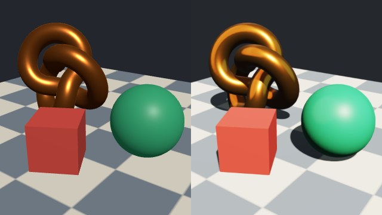

# three.js bridge



Left: the three.js scene. Right: the same scene after `fromThreeObject` turned it into 67js parts. Geometry, colours, metalness, roughness and the checker texture carry over. Light and sky are not part of the tree: you set them on the 67js side, so they differ by design.

`@codepawlhq/67js-three-bridge` (folder `packages/three-bridge`) moves meshes between a live three.js object tree and 67js parts. Use it to try 67js on a scene you already have, or to hand 67js parts to code that expects three.js objects. For a GLB you do not need three.js at all: 67js writes it.

The addon is optional and not part of the core archive. It imports neither `three` nor 67js. `three` is a peer dependency of the addon only, and you pass the namespace in when you export.

## Import a three.js tree

```js
import * as THREE from 'three';
import { Renderer67 } from '@codepawlhq/67js';
import { fromThreeObject } from '@codepawlhq/67js-three-bridge';

const group = new THREE.Group();
group.add(new THREE.Mesh(new THREE.TorusKnotGeometry(0.7, 0.24), new THREE.MeshStandardMaterial({ color: 0xe0782a, metalness: 0.9, roughness: 0.3 })));

const { parts, warnings } = fromThreeObject(group);
if (warnings.length > 0) console.warn(warnings.join('\n'));
const renderer = new Renderer67(canvas, parts);
```

Each mesh becomes one part with its world matrix, so groups, parents and their transforms are applied. `InstancedMesh` becomes one part per instance, and meshes that share a `BufferGeometry` share one geometry object, which the renderer batches. A material array with `geometry.groups` becomes one part per group.

| three.js | 67js |
| --- | --- |
| `position`, `normal`, `uv`, `index` (or no index) | `positions`, `normals`, `uvs`, `indices`. Missing normals are computed and listed in `warnings`. |
| `color` attribute, when `material.vertexColors` is on | `colors` (three channels) |
| `color`, `metalness`, `roughness` | `color`, `metallic`, `roughness` (linear RGB) |
| `emissive`, `emissiveIntensity` | `emissiveColor`, `emission` |
| `map`, `normalMap`, `aoMap`, `emissiveMap` | `map`, `normalMap`, `occlusionMap`, `emissiveMap` |
| `roughnessMap` and `metalnessMap` when they are one texture | `metallicRoughnessMap` |
| `MeshPhysicalMaterial` `transmission`, `thickness`, `ior`, `clearcoat`, `clearcoatRoughness`, `specularIntensity` | `transmission`, `thickness`, `ior`, `clearcoat`, `clearcoatRoughness`, `specular` |
| `transparent`, `opacity`, `alphaTest`, `side: DoubleSide` | `alphaMode`, `opacity`, `alphaCutoff`, `doubleSided` |

### What goes in the warning list

Nothing is dropped silently. `warnings` names the object and the property for: morph targets, `drawRange`, `instanceColor`, `envMap`, `bumpMap`, `displacementMap`, `alphaMap`, `lightMap`, `wireframe`, `flatShading`, `BackSide`, texture repeat, offset and rotation, sheen, iridescence, anisotropy, separate roughness and metalness maps, and materials that are not `MeshStandardMaterial` (only colour, map and opacity are used). Invisible objects, points, lines, sprites, lights and cameras are skipped and listed. A `SkinnedMesh` with a skeleton is imported in its current pose.

Two inputs throw an error that names the object and what to change: a `ShaderMaterial` or `RawShaderMaterial` (67js runs no custom shaders) and a `SkinnedMesh` without `skeleton.bones`. Pass `skipUnsupported: true` to leave such an object out and get a warning instead.

### Limits

`maxParts` (default 10,000, at most 100,000) and `maxVertices` (default 4,000,000 per mesh, at most 20,000,000; the whole tree may hold four times that). A tree past a limit throws an error that says which option to raise. Unknown options throw.

## Export parts as three.js objects

```js
import * as THREE from 'three';
import { toThreeObject } from '@codepawlhq/67js-three-bridge';

const { object, warnings } = toThreeObject(parts, THREE, { name: 'scene' });
threeScene.add(object);
```

`object` is a `Group` of `Mesh` objects with `MeshStandardMaterial` (`MeshPhysicalMaterial` when a part uses transmission, clearcoat or ior). Parts that share a geometry or material share one `BufferGeometry` or material. Each mesh keeps its part matrix exactly, with `matrixAutoUpdate` off, so the world matrix equals the part's. To animate a mesh with `position` and `rotation`, decompose the matrix first: `mesh.matrix.decompose(mesh.position, mesh.quaternion, mesh.scale); mesh.matrixAutoUpdate = true;`. Skin and morph targets are not exported and are listed in `warnings`.

## Export a GLB

```js
import { exportGlb } from '@codepawlhq/67js';

const glb = exportGlb(fromThreeObject(group).parts);
```

The GLB loads with `GLTFLoader`, with node transforms matching the source within 1e-6. Textures need RGBA pixel data outside a browser.

## Checks

`tests/three-bridge.test.js` builds a group with a box, a sphere, a textured plane and a vertex coloured box, imports it, builds three.js objects from the parts and compares positions, normals, indices, world matrices and material fields (matrices within 1e-6, geometry arrays byte for byte). It also loads the `exportGlb` result with `GLTFLoader`.

The picture above comes from the same scene rendered by `THREE.WebGLRenderer` and by `Renderer67` on a software GPU at 640 by 360, so edges and timing differ from a real GPU.
